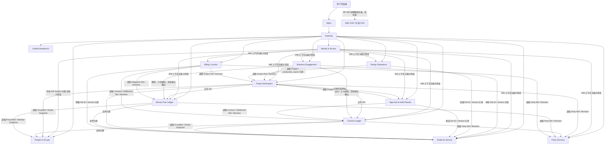
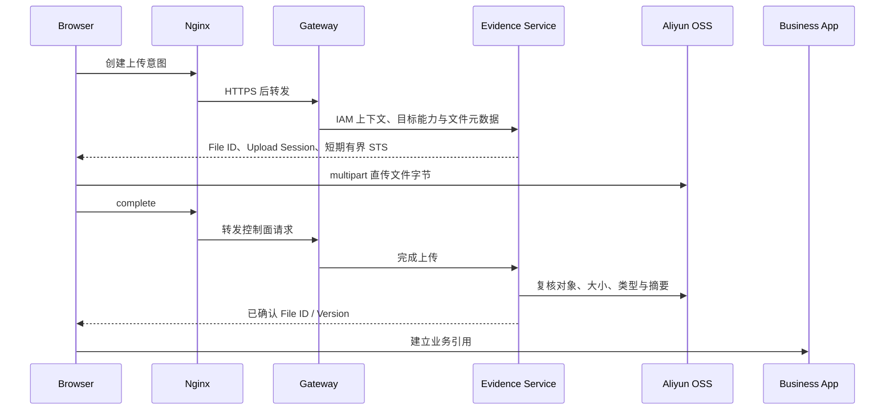

# OMSBizFoundry 当前工程架构

2026-10-26 P9 浏览器验收边界（BF-267）：C11 是外部验收驱动，不是 Workbench、IAM、Gateway、Feedback 或业务事实 Owner。它只能用现有版本化登录／Session／Grant 和 Gateway Feedback 配置入口验证浏览器行为，不得读取服务端 Secret、绕过 Gateway、修改业务事实或把 Playwright 变成运行时依赖。撤权后的故意 403 是独立记录的预期拒绝；只有其余 Console／Page error 为零才通过。`run-c0-c11` 不拥有部署和服务启停，但必须在可能发生 C9 清卷前启动／关闭目标浏览器以证明依赖可用；若 C11 已存在，则必须先复验完整链并且不执行任何阶段。C11 的四文件证据只保存摘要、稳定 Tenant／Subject、非秘密 Origin 和计数。

2026-10-26 P9 全程执行器边界（BF-266）：`run-c0-c10` 只编排已有 C0～C10 验收入口，不是部署器、服务管理器、业务应用或事实 Owner。它不能自动授权破坏性恢复，C9 仍要求显式确认；不能把外部人工依赖伪装为成功，C10 缺开发者回复仍返回 `PENDING`。最终 verifier 只证明固定证据闭集和 checksum 有向链连续，不是发布者签名，也不替代真实浏览器、回滚或尚未接受的时间稳定性要求。

2026-10-26 P9 连续执行器边界（BF-263）：`run-c0-c8` 只是验收编排，不是业务应用、部署器或事实 Owner。它只调用已有阶段入口，复验不可变证据并核对 Compose project／public Origin／checksum 有向链；不得启动、停止、恢复或修改 D1 服务，也不得保存密码、Key、Cookie 或 Capability。C5 Secret 目录与证据根强制互不包含。断点续跑只接受整个阶段证据闭集通过，不允许跳过失败阶段或就地修补制品。

2026-10-26 P9 C8 工资发放边界（BF-262）：People 继续拥有 Person 当前档案，Payroll 独占 Payment Profile、工资行快照、复核状态、发放编排和 Money 结果引用，Money 独占账簿主体、Person→收款主体映射、义务、实际支付与核销；员工工资单是 Payroll 的本人只读投影。支付档案须先以 revision 快照显式同步到工资行，核对不会自动付款，付款只能经 Payroll 的版本化 Money connector 完成。完整银行卡号只用于受保护请求和内部交付，不得进入固定证据。相同支付 Command 在 Money 已成功后由 Payroll 本地交付记录优先重放，不能按当前 revision 再次创建资金事实。当前 C8 复用 C7 的 Money `local_compatibility` Party 映射且明确 `party_directory_unified=false`，禁止跨库或直接 SQL；真实 D1 仍待执行。

2026-10-26 P9 C7 报销付款边界（BF-261）：Finance 继续独占报销申请、付款编排状态和 Money 稳定引用，Money 独占账簿主体、Person→收款主体映射、义务、实际支付与核销；员工 Open API 只读 Finance 投影，不直接查询或改写 Money。C7 通过 Money 公网命令登记本地兼容 Party，通过 Money 自有审计 ops 按 Tenant 配置 Finance owner 和精确 Person revision／digest 映射，再由 Finance 的版本化连接器写入 Money，全程禁止跨库或直接 SQL。该路径明确为 `local_compatibility`，不得被描述为 Party Directory 统一或迁移完成。固定证据串联 C0～C6 checksum，只保存稳定 ID／revision／状态而不保存密码、API Key、账号正文或响应；真实 D1 仍待执行。

2026-10-26 P9 C6 发票报销边界（BF-260）：员工 Key 只在 Gateway 换取短期 Open API／Owner Capability；Evidence 独占 PDF 字节、上传会话、校验状态与 File Version，Finance 独占报销、Person／发票／收款／Evidence 快照和审批占位，二者不共享表或数据库。签名上传 URL 只授权一个有界数据面动作，不进入业务证据；Finance 通过版本化端口复验 Evidence 后才提交。`payable`／`not_applicable` 仍不形成资金事实，C6 不调用 Money。固定证据以 C0～C5 checksum 串联稳定 ID／revision／摘要，但不保存 Key、签名 URL、账号正文或业务响应。真实 D1 仍待执行。

2026-10-26 P9 C5 开放 API 身份边界（BF-259）：API Key 由 IAM 拥有，绑定签名 Tenant／Subject 和 People 解析出的当前 Person 引用；Gateway 只把有效 Key 换成短期、有界的 Open API／Owner Capability，不拥有账号、Person 或业务事实。一次性 Secret 只允许进入证据外的受限恢复文件，固定证据只保存不可用来认证的 Key ID／prefix／status／TTL；重跑依靠恢复文件而非重复签发。`/open-api/v1/me` 和本人 usage audit 用于验证绑定与隔离，settings 的 Webhook 字段只是未来能力占位。C5 不调用 Evidence／Finance／Money，因此不能冒充发票报销或资金闭环已经发生；真实 D1 仍待执行。

2026-10-26 P9 C4 财务申请连续边界（BF-258）：C4 只编排既有 IAM、People 与 Internal Finance Requests 所有权，不新增共享事实或跨库写。Person 当前档案仍由 People 拥有；Finance 只冻结本申请所需的 Person ID／revision／digest／display snapshot，并独占付款申请、审批占位和历史。无附件只适用于付款申请且必须记录显式确认，报销的 Evidence 强制条件不因验收而放松。`payable` 与 `not_required` 不代表实际付款，C4 不调用付款端点或 Money。该入口只消费已经运行的 C0～C3 连续环境，不管理服务生命周期；离线 mock 通过不等于真实 D1 通过。

2026-10-26 P9 C3 工资表连续门禁（BF-257）：C3 只编排既有 IAM、People 与 Payroll 所有权，不新增共享事实或跨库写。方案 fixture 由 Payroll ops 写入 Payroll 自己的数据库，Person 仍由 People 拥有，Compensation Profile 与 Payroll Period 仍由 Payroll 拥有；公网命令经过 Gateway 和版本化 Payroll API。工资表冻结上游稳定 ID／revision 与方案快照，计划发薪日、`review_pending` 和 `not_required` 都不形成资金事实，C3 不调用 Money。零比例 fixture 只隔离验证快照和整数计算，不能作为国家或地区规定复用。该入口只在已经运行的 C0 组合上执行，不负责启动／停止服务；离线 mock 通过不等于真实 D1 通过。

2026-10-26 P9 C2 连续所有权边界（BF-256）：C1 的 Person 稳定引用进入 Payroll 时不复制 People 当前档案或共享表，而由 Payroll 独立保存 Person ID／source revision 快照及自身 Compensation Profile revision。工资、社保基数和公积金基数是挂载到 Person 引用的 Payroll 属性，仍不属于 People；所有金额为整数最小货币单位。C2 经 IAM→Gateway→Payroll 正式入口验证每个 Tenant 的最终隔离，且不把测试基数解释为法定比例、工资计算或实际发放。证据用前序 checksum 串联 C0→C1→C2，但摘要链不是发布者签名，真实 D1 仍待执行。

2026-10-26 P9 C1 运行边界（BF-255）：双租户验证从通过完整性校验的 C0 制品绑定到同一 D1 Compose project 和公网 Origin；只允许经 IAM 会话→Gateway Capability→People Owner 的正式入口创建和读取 Person。第二 Tenant 的平台级建立仍由 IAM `tenantctl` 承担，不把 Tenant 事实交给 Workbench 或 People；业务数据隔离最终由 People 按签名 Tenant 执行。验收驱动可发现运行中 IAM 容器，但不拥有服务生命周期，也不把管理员秘密、Session 或 Capability 写入证据。

2026-10-26 同域名多租户入口边界（BF-254）：D1 的 Suite Manifest 仍携带默认／迁移锚点 Tenant，但 Gateway 的信任边界是 IAM issuer、公钥、签名、规范 Tenant／Subject、Audience、Capability、Scope 和短 TTL，不是该单一默认 Tenant。经 IAM 会话解析出的 Tenant 随可信内部 Header 进入 Workbench；业务 Capability 可属于同一 issuer 下的其他 Tenant，Owner 再用凭证 Tenant 约束自身读写。成功登录会清除所有旧 Capability Cookie，阻止同一浏览器的新账号沿用旧账号／旧租户能力。该设计保持一个账号只属于一个 Tenant、首版无租户选择／切换，也不允许客户端自报 Tenant；多租户真实 D1 隔离与恢复仍须 P9 证明。

2026-10-26 P9 release provenance boundary（BF-253）：最终全组合门禁只运行官方 D1 release bundle：`RELEASE-METADATA` 固定声明版本、Git commit、build time 和 target，运行环境同版本且只使用 digest-pinned pull images；C0 再把配置 digest 解析到正在运行的 Image ID。P9 验收脚本本身随 release bundle 和内部 checksum 交付，目标机不依赖源码 checkout。该链不提供签名、SBOM 或 Registry 不可变策略。

2026-10-26 P9 image provenance boundary（BF-252）：C0 同时记录运行容器的不可变 Image ID 和配置镜像引用／Repo Digest，并要求引用在采集时解析到同一 Image ID。标签在容器启动后漂移时不得生成通过证据；证据交接复验会再次交叉核对，不只信任状态文件中的 `pass`。这证明采集时运行身份，不替代镜像签名、SBOM 或 Registry 保留策略。

2026-10-26 P9 C0 evidence boundary（BF-251）：全组合前置证据使用固定闭集目录，服务健康、镜像身份、readiness、Suite Manifest、脱敏 Compose 拓扑、schema／contract 日志和数值版本状态均进入 SHA-256 清单；独立验证器拒绝链接、额外／缺失文件和内容漂移。该清单只证明采集后未发生意外变化，不提供发布者签名，也不把原始 Compose／inspect 或部署秘密写入证据。

2026-10-26 P9 D1 sequence checkpoint boundary（BF-250）：数据库 checkpoint 不只包含表中当前行，也包含决定下一次自增写入的 public sequence 定义和运行状态。D1 指纹把 sequence 的数据类型、起止／步长／循环／缓存配置纳入 schema 摘要，把 `last_value`／`is_called` 的 PostgreSQL 内 SHA-256 纳入事实摘要；恢复前后任一漂移均在业务服务开放前失败关闭。该门禁只增强恢复一致性，不改变 Owner 数据所有权或以指纹替代恢复后的业务续写验证。

2026-10-26 P9 D1 pre-destructive restore gate（BF-249）：新格式数据库指纹不是被动报告。Restore 在删除目标卷前先校验格式、摘要、唯一数据库集合及与恢复 Suite 选择一致性，只有通过后才可进入空目标重建；外层 checksum 被重新计算也不能放过语义畸形。旧备份没有指纹时保持兼容，但仍受原 selection、artifact 和 checksum 门禁。该顺序降低错误备份破坏目标环境的风险，不把恢复变成自动生产切换。

2026-10-26 P9 D1 recovery fingerprint boundary（BF-248；真实恢复待执行）：D1 新联合备份在 BF-247 停写窗口内，对 IAM 与实际选装 Owner 的 public schema 和事实生成无秘密 SHA-256 指纹；原始行先在 PostgreSQL 内散列，跨容器只传表名和行摘要，最终制品只保留数据库级 schema／事实摘要及表／行计数。IAM Session 数据按既有 dump 语义排除，其他 Tenant、Subject、Person、业务 ID、revision、金额、文件元数据、Money 引用、Key 元数据和审计均由各 Owner 整库事实覆盖。空目标恢复在业务服务启动前逐字比较，差异失败关闭；这不建立共享数据库或跨库事务，也不替代 Evidence 对象字节及恢复后 API 业务复验。

2026-10-26 P9 D1 checkpoint boundary（BF-247；真实恢复待执行）：D1 联合备份以 Nginx 作为唯一公网写入口屏障。显式备份先记录入口运行态、停止 Nginx并等待有界 drain，再顺序备份各 Owner 与 Evidence；checksum 覆盖 `backup-consistency.env`、Suite selection 和全部备份对象，异常 trap 只在入口原本运行时恢复它。升级的预变更备份保持入口关闭直到新组合完成，避免回滚点之后出现新写入。Owner 事实仍各自独立保存，停入口不制造跨库事务，也不把连接器引用迁入共享表；恢复验收必须核对两侧稳定引用、revision、金额和审计。该边界依赖 C0 证明 Nginx 是唯一主机发布端口，并且当前 Owner 没有独立后台业务写任务；未来新增直连端口或后台写入前必须扩展停写协议。

2026-10-26 P9 D1 connector assembly baseline（BF-244；运行验收待执行）：`Internal Finance Requests` 与 Payroll 各自拥有独立 Ed25519 工作负载身份和私钥 volume，IAM 的版本化 workload policy 只允许 Finance 读取 Evidence 精确 File、按精确 Command 登记 Internal Finance Money Payment，只允许 Payroll 读取 People 精确引用、按精确 Command 登记 Payroll Money Payment。D1 Suite 选择强制 Finance→Money＋Evidence 与 Payroll→People＋Money；Compose 用健康依赖保证 Owner 不在下游未就绪时提供业务服务，pull／build 使用同一镜像，停用清除进程但不删除数据。静态配置和代码门禁已过，但尚无当前版本全组合启动、联合恢复和恢复后连续旅程证据，不得据此宣称 P9／D1 完成。[P9 装配源码报告](./reports/oms-v1-iteration-p9-composition-source-validation-20261026.md)

2026-10-26 P7 reimbursement runtime baseline（BF-242）：Gateway 的 `/open-api/v1/` 静态 allowlist 现在把 Evidence 上传会话／签名数据面和 Finance 本人命令映射到各自 Owner；API Key 只换取短期、Tenant＋Subject＋Person 有界凭证。Evidence 独占字节、File Version、发票校验状态和未引用清理尝试，Finance 只保存 File ID／Version／用途与指纹快照，并通过版本化 reference port 保护历史引用。Finance 提交冻结申请 revision，强重复阻断、疑似重复显式确认；财务付款使用精确资源范围的 Money capability，People Person 经受审计映射解析为 Money individual Party，Money 独占实际资金／核销。依赖不可用或结果未知只沿原幂等标识恢复，不跨库回滚。P7 本地真实 TLS／五进程／四库门禁通过；D1／公网、Feedback V2 与联合恢复留待 P8／P9。[P7 报告](./reports/oms-v1-iteration-p7-invoice-reimbursement-validation-20261026.md)

2026-10-25 P6 open API runtime baseline（BF-241）：IAM 以独立 migration 7 保存 Tenant-scoped API Key 非秘密元数据、bcrypt verifier、生命周期事件、最小调用记录和不可变清理记录；Key 认证每次重新读取 active Subject／Grant，并通过版本化 People Reference 核对稳定 Person，不把 Person 或报销事实并入 IAM。Gateway 只对 `/open-api/v1/` 明确 route／method allowlist 调用 IAM 内部交换端口，验证 `open-api.invoice-reimbursement.use` 与精确 `api_key` scope 的 5 分钟签名上下文，删除客户端 Authorization 后再进入路由；来源 IP 只作脱敏审计和短期限流，不作身份。调用完成回写失败仅记录已清洗的 request ID／Key prefix／固定原因，不把内部拓扑或 secret 写入日志，也不倒转已返回结果。Workbench 只管理 IAM Key 和读取审计，不保存 secret／业务事实。当前公开 runtime 仅含 profile、settings、OpenAPI 与说明；P7 才可向 allowlist 增加 Evidence／Finance 端点。[P6 报告](./reports/oms-v1-iteration-p6-open-api-validation-20261025.md)

2026-10-25 P5 finance payment runtime baseline（BF-240）：`Internal Finance Requests` 以独立 PostgreSQL 聚合拥有报销／付款申请、不可变 revision、收款与费用归属快照、Evidence 稳定引用、`not_required` 审批快照、付款投递和敏感访问审计；它通过自身工作负载身份调用 Money 的版本化 Internal Finance Payment 端口，不持有 Money／Evidence／Party／Project／Contract 数据库外键。Money 以 `(tenant_id, finance_request_id)` 稳定绑定一个义务，每次 Delivery 独立创建实际资金并只核销剩余义务，超额保留为未分配余额；一次性收款方只形成 Money 履约所需的本地资金主体，不回写 Party Directory。Finance 只在 Money 返回稳定引用后推进付款投影，batch partial failure 不做分布式回滚，unknown item 必须以原 command 恢复。普通读写与普通导出均只返回账号尾号，完整账号读取与敏感导出各自要求独立能力、用途和逐条审计。Workbench 在正式 Owner 装配时不再保存浏览器财务事实。该事实取代 P2 中 Internal Finance Requests“没有 Money 运行依赖”的骨架状态；当前未部署 D1／公网，Evidence 实时校验留在 P7，跨应用联合恢复和正式 IAM／Gateway 在 P9 验收。[P5 报告](./reports/oms-v1-iteration-p5-finance-payment-validation-20261025.md)

2026-10-25 P4 payroll execution runtime baseline（BF-239）：Payroll 以独立 PostgreSQL 聚合拥有 Tenant-scoped Period、Line、不可变 revision、计算快照、导入预览、review、sync、void／replacement、adjustment 和 Payment Delivery projection；它通过 People Reference 冻结 Person revision，通过自身工作负载身份调用 Money 的版本化 Payroll Payment 端口，不持有 People／Money 数据库外键。Money 以 `(tenant_id, payroll_line_id)` 稳定绑定一个工资 Obligation，每次 Delivery 独立创建 Cash Transaction，并只把 `min(actual, outstanding)` 分配到工资义务，超额保留为 unallocated；Connector binding／delivery 不可变且幂等。Payroll 只在 Money 返回稳定引用后推进成功金额，batch partial failure 不做分布式回滚，unknown item 必须用原 command reconcile。Workbench 仅编排版本化 API；正式工资事实不进入浏览器持久化。当前未部署 D1／公网，跨应用联合恢复和 connector-specific export 仍由 P9 验收。[P4 报告](./reports/oms-v1-iteration-p4-payroll-execution-validation-20261025.md)

2026-10-25 P3 member／payroll profile runtime baseline（BF-238）：People & Groups 的 Person current projection 和不可变 revision 增加 department、position、status effective date，并以 append-only Employment Event 保存 hired／offboarded／rehired；Payroll 以独立 PostgreSQL 表保存 Tenant-scoped Compensation Profile、Payment Profile、Contribution Scheme current projection、不可变 revisions、命令结果和审计。Payroll 通过自身工作负载身份与版本化 `people-groups.person.reference.read` 端口取得 Person display/status/revision 快照，不持有 People 数据库外键；inactive 是显示事实而非 Payroll eligibility。标准 Scheme 是跨租户只读目录事实，自定义 Scheme 从精确标准 ID／revision 复制后在本 Tenant 追加 revision。Workbench 并行读取两个 Owner，写入按 People→Payroll 顺序执行并把部分成功暴露为可续办状态，不跨库事务或补偿改写。普通 Payment projection 只有 masked suffix；full account route 需要独立 capability、精确 Payment Profile resource scope、purpose，并写敏感访问审计。D1 已具备 Payroll workload key／policy 和 People endpoint 配置，但本批只完成静态配置与隔离运行验证，未证明正式 D1／公网部署。[P3 报告](./reports/oms-v1-iteration-p3-member-payroll-profiles-validation-20261025.md)

2026-10-25 P2 owner runtime baseline：`Internal Finance Requests` 与 `Payroll` 已作为两个独立 Go 进程和 PostgreSQL 数据所有者进入源码及可选 D1 装配。它们分别发布 `/internal-finance/v1/` 与 `/payroll/v1/`，验证签名 issuer／audience、请求 Tenant、Capability、scope 和资源归属；当前投影、不可变 revision、命令响应与审计在单库事务中提交，并由约束阻止投影绕过 revision 或历史覆盖。两个服务只通过版本化引用端口与其他 Owner 协作，当前没有 Evidence／Money／People 运行依赖，也没有共享 ORM／业务表。独立镜像、PostgreSQL 18 集成、备份／空目标恢复和恢复后续写已本地通过；D1／公网运行尚未验证。[P2 报告](./reports/oms-v1-iteration-p2-owner-skeleton-validation-20261025.md)

2026-10-25 P1 multi-tenant runtime baseline：IAM 的 Tenant／Subject／Session／Grant 由同一进程按登录账号解析，平台运维通过独立 `tenantctl` 原子建立 Tenant、首管理员和审计；业务 Owner 验证签名、issuer、audience、Capability 与资源 Scope 后使用凭证 `tid`，不再把部署 bootstrap Tenant 当作运行时授权边界。People & Groups 以同租户唯一约束保存 IAM Subject ID、状态与 revision 快照，建立／换绑时经版本化 IAM Subject Reference 和请求 Tenant 复验；旧本地 UUID 只迁移为 `legacy_unverified`。工作负载凭证缓存键包含 Tenant，所有引用适配器按当前请求 Tenant 换票。真实双进程、双租户、撤权／停用和 IAM／People 分库空目标恢复证据见[P1 报告](./reports/oms-v1-iteration-p1-multitenant-validation-20261025.md)。该基线未部署到 D1／公网，也不改变各 Owner 的事实所有权。

2026-10-25 BF-237 Feedback diagnostic context boundary：Workbench 为 Feedback `data` 逐字段构建 allowlist projection，仅含 release／build、module、identifier-free route template、coarse browser／OS class、locale、client timestamp 和 current request correlation ID。禁止 spread／serialize global state、location query、raw path、Tenant／Subject／Person、resource fields、form／money／file data、full User-Agent、credential／header／cookie、stack 或 screenshot；未知字段默认丢弃。该 projection 只是诊断附件元数据，不成为 OMS 或 Feedback 的身份／授权／业务事实，也不允许 Feedback 回写 OMS 状态。[迭代计划](./specs/assembly/oms-v1-iteration-plan-20261025.md)

2026-10-25 BF-236 Feedback notification projection boundary：Feedback project 115 同时在 server notification allowlist 与 SDK `feedbackV2NotificationsEnabled` 中显式启用。Feedback Service 拥有 notification／read facts，Workbench 只维护当前会话的 unread count projection 并渲染 badge；count read 是 side-effect free，conversation open 只发送该 feedback ID 的 read command。badge 以 Tenant＋Subject 派生的 `customUserId` scope，不缓存为跨账号共享状态；notification API／WebSocket／poll failure 隔离在 Feedback adapter 内并降级为无角标／可重试入口，不进入 OMS route readiness 或业务写事务。[迭代计划](./specs/assembly/oms-v1-iteration-plan-20261025.md)

2026-10-25 BF-235 Feedback V2 assembly boundary：Workbench 以 `https://feedback.feitianchengzi.com/sdk-v2/index.html?embed=web` 跨域 iframe 装配 Feedback V2，首阶段 runtime config 选择 `apiKey` 并绑定 project 115；credential 从部署配置注入但在浏览器内不构成秘密，必须 project-scoped／rotatable／revocable／rate-limited，不与 OMS Open API credential 复用，目标迁移为 host backend exchange 的 15-minute feedback Session。宿主以 verified IAM Tenant＋Subject 派生 pseudonymous stable `customUserId`，用 exact `targetOrigin`、`event.origin`、`event.source` 和 message source/type 校验 bridge，并把 OMS production origin 加入 SDK allowlist。Feedback Service 独占 feedback／message／attachment／notification／status facts；OMS 只持入口、`feedback.use` authorization 和非业务装配配置，不复制其数据库。[迭代计划](./specs/assembly/oms-v1-iteration-plan-20261025.md)

2026-10-25 BF-234 Reimbursement vertical closure boundary：完整链为 IAM Account／Grant＋People mapping → API credential → Gateway → Evidence File Version → Internal Finance Requests immutable submission／approval-not-required snapshot → authorized Finance payment confirmation → Money actual transaction／allocation → reimbursement Money reference projection → self query。验收使用正式 HTTPS 与独立 PostgreSQL Owner，要求 exact-once idempotency、dependency unknown recovery、credential／Grant／Account revoke、cross-tenant／self-resource denial、duplicate／unsafe file rejection和联合恢复。连接器只传版本化建议／引用，不跨库写；此证据不外推到 bank execution、approval engine、AI／OCR、Webhook 或其他 OMS 领域。[迭代计划](./specs/assembly/oms-v1-iteration-plan-20261025.md)

2026-10-25 BF-233 Open API error／recovery boundary：统一 envelope 为 stable code／localized message／request ID／retryable／field errors。Gateway 与 Owner 共同保持 401 credential、403 authorization、409 concurrency-idempotency-state、413 payload size、422 validation、429 rate limit、503 dependency unavailable 的版本化映射。401／403／422 non-retryable，429 返回 retry metadata，timeout／503 只以原 command ID／idempotency key 重放。indeterminate write 暴露 `UNKNOWN_OUTCOME` read model 并由原键或 aggregate ID 收敛。错误序列化前移除 stack／SQL／topology／credentials／financial／file data。[迭代计划](./specs/assembly/oms-v1-iteration-plan-20261025.md)

2026-10-25 BF-232 Reimbursement draft lifecycle boundary：draft aggregate 独立于 interactive session／API credential lifecycle；`updated_at + 90d` 触发 archive command 并追加 revision，可显式 restore。delete command 只接受 never-submitted 且无 succeeded／unknown payment reference 的 draft，执行 tombstone 而非 hard delete；submitted aggregate 无 delete transition。archive／tombstone 保留 audit、idempotency 和 Evidence reference history，不向 Evidence／OSS 发送级联删除；默认查询隐藏 tombstone，归档通过显式 filter 返回。[迭代计划](./specs/assembly/oms-v1-iteration-plan-20261025.md)

2026-10-25 BF-231 Evidence retention boundary：upload grant TTL 为 15 分钟，session TTL 为 24 小时；expired incomplete／failed／unsafe temporary object 在后续 24 小时有界回收。completed File Version 若 `never_referenced` 则 7 天后 eligible for cleanup；首次被 draft 或 immutable revision 引用即进入 protected retention，当前 detach 不取消历史保护。cleanup command 幂等并在执行前重新解析 reference guard，present／unknown 均 fail closed，结果进入审计和失败重试。业务 Owner 只调用 Evidence reference／retention port，不直接持有 OSS delete 权限。[迭代计划](./specs/assembly/oms-v1-iteration-plan-20261025.md)

2026-10-25 BF-230 Invoice Evidence ingest boundary：Evidence Service 的版本化 allowlist 接受 PDF／OFD／XML／JPEG／PNG，并在 upload-session、complete、reimbursement submit 三个检查点强制 `20 MiB/file`、`20 files/request`、`100 MiB/request`。complete 只有在 magic／structure detection、content hash 和 malware scan 成功后生成 stable File Version；pending／failed／unknown fail closed。archive／Office／script／executable 拒绝，XML parser 禁止 DTD／external entity／network resolution，preview／metadata worker 不执行嵌入内容。Internal Finance Requests 仅引用 File ID／Version／purpose snapshot，不拥有 bytes、scan report 或 object credentials。[迭代计划](./specs/assembly/oms-v1-iteration-plan-20261025.md)

2026-10-25 BF-229 API credential ingress boundary：Nginx／Gateway 只在 TLS ingress 接收 API Key，HTTP 在认证 Header 解析前拒绝，不把 IP 作为 Subject identity。首版 Key record 不包含 mandatory source CIDR；authorization 组合 verified credential、current Account／Grant、Tenant／Person mapping、rate limit、Owner resource checks 和 audit。create／revoke route 仅暴露给 interactive Workbench session 并要求 confirmation，`/open-api/v1/` route allowlist 不含 credential lifecycle mutation。未来 optional CIDR policy 默认 disabled 且需另立可信代理与恢复契约。[迭代计划](./specs/assembly/oms-v1-iteration-plan-20261025.md)

2026-10-25 BF-228 API usage audit boundary：Gateway 产生清洗后的 access outcome event，API access／IAM 侧维护 180 天安全审计投影；它不是发票、报销、Evidence 或 Money 事实 Owner。self-read 以 Subject＋Key scope 授权，tenant-read 要求独立 audit capability。record allowlist 仅含 tenant／key ID-prefix／subject-person refs／action class／timestamp／outcome code／request ID／masked IP；credential、headers、payload、business fields 和 file content 在采集前删除。到期清理不级联业务记录，首版不建立计费或通用分析平台。[迭代计划](./specs/assembly/oms-v1-iteration-plan-20261025.md)

2026-10-25 BF-227 Open API versioning boundary：公网稳定契约位于 `/open-api/v1/` 并以生成／校验后的 OpenAPI 为准；Workbench 私有 route 不得充当开放契约。V1 仅允许 additive compatible change，breaking schema／state／validation／idempotency／pagination／error change 使用新 major path。版本目录、中文指南和脱敏 `curl` 示例共同发布；弃用元数据与 UI／文档公告至少早于停服 180 天，contract test 持续比较 spec 与 runtime。[迭代计划](./specs/assembly/oms-v1-iteration-plan-20261025.md)

2026-10-25 BF-226 Webhook placeholder boundary：Workbench 开放平台设置可渲染 disabled “Webhook 通知（暂未开放）”入口，但首版不提供 callback persistence、subscription aggregate、event dispatcher、delivery retry 或 enable command。占位 UI 不得调用不存在的后端或制造已启用状态；未来实现必须作为版本化独立能力增加。[迭代计划](./specs/assembly/oms-v1-iteration-plan-20261025.md)

2026-10-25 BF-225 Self query protocol boundary：submit response 返回 aggregate ID／revision／state；self list 使用 opaque cursor，limit 默认 20／最大 100，filter allowlist 为 state、submitted range、`updated_since`，order 固定 `updated_at DESC, id DESC`。list／detail projection 携带 approval／payment／duplicate state、updated timestamp 和 allowed actions，并支持 `ETag`／`If-None-Match`。首版没有 webhook dispatcher／subscription store；未来主动通知必须以版本化事件、签名、重试、去重和撤销契约作为独立能力引入。[迭代计划](./specs/assembly/oms-v1-iteration-plan-20261025.md)

2026-10-25 BF-224 Self submission query boundary：Internal Finance Requests 暴露版本化 self-collection 与 self-detail read model，查询 scope 从 verified `(tenant_id, subject_id, person_id)` 派生，忽略并拒绝客户端身份切换字段。projection 覆盖 draft／submitted／withdrawn／rejected／payable／partial／paid 全历史，输出 stable ID、revision、summary、precise amount、timestamps、approval／payment／duplicate states，并采用 stable pagination。API Key 生命周期变化不删除业务记录；Owner 对每次 list／detail 做 resource authorization，Gateway／UI 过滤不能作为隔离边界。[迭代计划](./specs/assembly/oms-v1-iteration-plan-20261025.md)

2026-10-25 BF-223 Reimbursement submission／payment boundary：Internal Finance Requests aggregate 以 immutable submitted revision 冻结 amount、lines、Evidence refs、payee 与 approval-policy snapshot；默认策略投影 `approval_not_required` 后进入 payable。仅在不存在 succeeded／unknown Money delivery 时允许 withdraw＋new revision。Money Flow Ledger 独立保存 actual payment／allocation；Finance capability holder 发起确认，申请 Owner 仅保存 Money stable reference 并投影 partial／paid。Open API self scope 不含 approval 或 payment command。未来 approval state 插入 submitted 与 payable 之间而不回写既有 policy snapshot。[迭代计划](./specs/assembly/oms-v1-iteration-plan-20261025.md)

2026-10-25 BF-222 Invoice duplicate boundary：Evidence Service 为完成文件提供稳定 content hash；Internal Finance Requests 在 Tenant scope 内保存 hash、规范化 invoice code／number、issuer／date／amount 快照和 match classification。submit command 对 hash 或 code＋number exact match fail closed，并返回经过 resource authorization 的 existing request reference；弱组合只产生 `suspected_duplicate` review signal。rejected／withdrawn resubmission 必须进入原 aggregate revision chain 或带 predecessor ID／reason 的显式链路。跨租户查询、客户端独有校验和 AI／OCR 单点裁决均禁止。[迭代计划](./specs/assembly/oms-v1-iteration-plan-20261025.md)

2026-10-25 BF-221 Open API idempotency boundary：所有 mutation route 强制 client-generated `Idempotency-Key`，dedupe scope 为 `(tenant_id, subject_id, api_action, idempotency_key)` 而不是 credential ID。相同 canonical payload 重放首次确定结果，digest 不同返回版本化 `409`。draft command record 至少保存 7 天；submit command ID 进入 Internal Finance Requests 业务记录长期保存。Gateway cache 只作加速，Evidence／Owner command handler 才是最终防重边界；unknown outcome 必须用原键恢复，不能以新键重复写入。[迭代计划](./specs/assembly/oms-v1-iteration-plan-20261025.md)

2026-10-25 BF-220 API rate-limit boundary：Gateway 对普通开放路由组合执行 `key_id: 60/min` 与 `tenant_id: 600/min` 两层额度，任一耗尽即返回版本化 `429`／retry metadata，且不得转发命令至 Owner。Evidence upload-session／complete 等重资源路由使用独立可配置 concurrency limiter，并在压测后确定部署值。认证失败只进入来源 IP 等网络维度的临时失败桶，不变更 Account／Key 领域状态；响应统一化以避免凭证和租户枚举。IAM disable、Key revoke 与 Owner authorization 仍是独立最终控制，限流不能代替授权。[迭代计划](./specs/assembly/oms-v1-iteration-plan-20261025.md)

2026-10-25 BF-219 API Key expiry／rotation boundary：create-key command 只接受 30／90／180／365 天 TTL，缺省为 180 天并冻结 `expires_at`，不支持无期限凭证。Gateway 在每次认证时校验 `expires_at`，到期后 fail closed；expired record 保留 ID／prefix／label／timestamps／state 与审计但不计入 active quota。rotation 创建独立 Key ID／secret，调用方完成切换后显式撤销旧 Key；原 Key 的期限和 secret 均不可恢复或延长，轮换并存期仍受 5 个 active Key 上限。[迭代计划](./specs/assembly/oms-v1-iteration-plan-20261025.md)

2026-10-25 BF-218 API Key secret storage boundary：IAM／开放入口以 `(tenant_id, subject_id, active)` 强制最多 5 条命名 Key；create command 返回 secret 一次，持久层只保存 stable key ID、non-secret prefix、slow verifier、label、created／last-used timestamps 和 state。list／read 永不返回 secret。revoke command 追加不可逆 revoked state，replacement 使用新 ID／secret；第 6 个 active create fail closed，不自动删除。Gateway 只在内存中验证请求 secret，通用日志、trace、metric、error 与 audit 全部使用 key ID／prefix 并执行凭证字段清洗。[迭代计划](./specs/assembly/oms-v1-iteration-plan-20261025.md)

2026-10-25 BF-217 API Key authorization lifecycle：interactive session 的 create-key command 只有在可信 Subject 持有 invoice-reimbursement-api-access capability 且 Person mapping 唯一时成功，不建立平行 approval Owner。Key record 保存 Tenant／Subject／Person binding 和状态，但不缓存不可撤销业务 Grant。Gateway 每次 Key 请求重新验证账号／Key 状态并取得当前受信 capability context；Owner 再做 self resource／state authorization。account disable、Grant revoke 或 Key revoke 后禁止签发新上下文。审计使用稳定 Key ID／prefix，不记录 secret；客户端身份与 Tenant Header 一律删除并重新派生。[迭代计划](./specs/assembly/oms-v1-iteration-plan-20261025.md)

2026-10-25 BF-216 发票报销 API access boundary：API Key 是 IAM／开放入口管理的非交互凭证，绑定唯一 Tenant、Subject 与 Person mapping；Gateway 从已验证 Key 派生可信身份上下文并删除客户端身份 Header，Internal Finance Requests／Evidence 仍校验各自原生 Capability、资源归属和状态。首版 route／scope allowlist 仅覆盖 Evidence upload session／complete 与 self reimbursement draft、line、evidence attach、submit、own-result read；不提供任意 Owner proxy。Workbench 提供 Key 申请／管理 UI。外部 CLI／Agent／Skill 不属于部署单元；仓库只提供版本化 HTTP／OpenAPI 契约、幂等／revision／错误／限流说明和最小调用示例。[迭代计划](./specs/assembly/oms-v1-iteration-plan-20261025.md)

2026-10-25 BF-215 Missing Payment Profile projection：Period generation 为没有适用 Payment Profile 的 Line 冻结 typed `missing_payment_profile`，不生成伪账户。positive net Line 的 single／batch issue command fail closed；建立 Profile 后必须经 BF-214 sync 和 review 才可付款。batch preflight 返回逐 Line executable／blocked reason，blocked Line 不进入 Delivery，其他 Lines 可独立执行。zero net 与 negative net 继续走 BF-209，无账户不改变其状态。missing projection 持续进入 filter／export，直到新 Line revision 明确消除。[迭代计划](./specs/assembly/oms-v1-iteration-plan-20261025.md)

2026-10-25 BF-214 Payment Profile snapshot sync：Payroll Line 的 account snapshot 仅由显式 sync command 更新。Owner 先校验目标 Line 没有 successful／unknown Delivery，再签发包含 old／new masked diff、Profile revision、effective month、Line／Period expected revision 和 expiry 的 preview；commit 幂等追加 Line／Period revision 并将目标 Line 退回 pending_review。其他 Lines 的 issue state 不参与阻断。目标 Line 已 partially／fully issued 或有 unknown Delivery 时 fail closed。审计引用 revisions 与脱敏 diff，不复制完整账号。[迭代计划](./specs/assembly/oms-v1-iteration-plan-20261025.md)

2026-10-25 BF-213 Payment Profile mutation boundary：Payroll capability catalog 将 profile maintain、full account read、sensitive export 与 payroll-wide read 分开。maintain command 需要 Tenant-scoped Person ID、effective month、reason、second-confirm acknowledgement、expected revision 和 idempotency key，并追加新 Profile revision；已生成 Line snapshots 不自动变化。employee self projection 永远只返回 masked suffix。审计引用前后 Profile revision 和脱敏 diff，不复制完整账号。未来 self-service 必须通过独立 request／verification／operator confirmation 流程，不能复用直接 mutation capability。[迭代计划](./specs/assembly/oms-v1-iteration-plan-20261025.md)

2026-10-25 BF-212 Payroll Payment Profile 所有权边界：Payroll 通过 Tenant-scoped Person ID 拥有版本化 Payment Profile，字段包括 account holder、bank、account、active／effective interval 和 revision；People 只提供稳定人员引用。普通 projections 仅含 masked suffix，full read 与 sensitive export 是独立 Payroll capabilities 并逐次审计。Period generation 将适用 Profile ID／revision 与账户快照冻结到 Line，Payment Delivery 只使用该快照；新 Profile revision 不反写旧 Line／Delivery／Money。完整值禁止进入搜索、URL、普通日志、错误、指标或客户端持久缓存。[迭代计划](./specs/assembly/oms-v1-iteration-plan-20261025.md)

2026-10-25 BF-211 Payroll overpayment 边界：当 proposed payment 大于 Line outstanding 时，command 必须携带逐 Line warning acknowledgement 与 reason。Money 创建完整 Cash Transaction，仅创建等于 outstanding 的 Allocation，excess 保持 unallocated；Payroll Delivery 冻结 payment／allocated／excess 三个整数值及 Money references，并投影 `issued_with_overpayment_anomaly`，outstanding 为 0。不得修改 Line net pay 或生成奖励事实。Recovery Adjustment 引用 source Line／Delivery／Cash Transaction，实际追回另建 Money 事实；异常在恢复前持续进入查询与导出。[迭代计划](./specs/assembly/oms-v1-iteration-plan-20261025.md)

2026-10-25 BF-210 Payroll Line 分次发放边界：正数 Line 拥有零到多个 Payment Delivery，每条冻结 Line ID／revision、本次整数金额、actual date、Actor、note、idempotency key 和 Money Cash Transaction／Allocation 引用。Line issued projection 只累计 successful allocation：0 为 payable，`0 < allocated < net_pay` 为 partially issued，等于 net_pay 为 issued。batch issue 是多个独立 Delivery 的编排，默认 outstanding 但不形成共享付款事实；失败／unknown 独立 reconcile。Period 状态由 Lines 汇总，zero-net confirmed 与 positive paid-in-full 计为完成，recovery-pending 单独投影。[迭代计划](./specs/assembly/oms-v1-iteration-plan-20261025.md)

2026-10-25 BF-209 Payroll zero／negative net 边界：`net_pay == 0` 的 Line 只能通过显式幂等 `confirm_no_payment_required` command 进入完成状态，冻结 Actor／time／Line revision，不调用 Money；employee self projection 显示 no-payment-required 而非 paid。`net_pay < 0` 的 Line 拒绝 issue command 并进入 recovery-pending projection，冻结 signed components、source Line revision 和 reason；Money 不接受零或负 Cash Transaction。recovery 只能由引用来源的 Adjustment Line 处理，未解决 recovery 不计为 issued／no-payment-required。[迭代计划](./specs/assembly/oms-v1-iteration-plan-20261025.md)

2026-10-25 BF-208 Payroll Period 作废／替代边界：void command 仅在 Period 的所有 Lines 都没有 successful 或 unknown Payment Delivery 时接受 expected revision，并追加 reason、Actor、time 与 terminal void state；不删除 Period／Line。replacement regular Period 必须冻结 supersedes Period ID／revision，且仍受 BF-207 同 Tenant／month 有效唯一性约束。任一成功 Money reference 后 Period 永久禁止 void／replacement；unknown Delivery 必须沿原 idempotency key reconcile 后才能判断。补发／扣回只能创建 adjustment Period，不能改变来源事实。[迭代计划](./specs/assembly/oms-v1-iteration-plan-20261025.md)

2026-10-25 BF-207 Payroll Period identity：Owner 对 `(tenant_id, payroll_month, regular_period_type, effective_state)` 执行业务唯一性并通过幂等 create command 返回已存在的 Period ID／revision；Workbench 不以客户端查重代替约束。regular Period 的成员变化与发放前修订追加 revision。Supplement／Recovery 是独立 adjustment Period，可多批存在，但每条 Line 冻结 source Line ID／revision、signed amount、reason、review／approval snapshot、issue status 与 Money reference；它不参与 regular 唯一键且不能改变来源 Line。重试沿原 idempotency key，不重复创建 Period 或 Adjustment。[迭代计划](./specs/assembly/oms-v1-iteration-plan-20261025.md)

2026-10-25 BF-206 Payroll Period 生成与核对状态：generate command 显式接收选定 Person IDs，并冻结各自 Compensation Profile／Contribution Scheme revision；Payroll 计算缴费并创建 `pending_review` Lines，performance 与 adjustments 的 0 值不产生 reviewed 语义。inline edit 与 template import 都追加 Line／Period revision；import preview 以稳定 Person ID 或 tenant member number 匹配并绑定 expected revision、diff 和 expiry，commit 幂等且禁止模糊匹配。review confirmation 冻结当前 digest，在 `not_required` 审批策略下进入 payable；任何后续编辑产生新 digest 并回到 pending_review。[迭代计划](./specs/assembly/oms-v1-iteration-plan-20261025.md)

2026-10-25 BF-205 Payroll Line 计算与工资单投影：issued Line revision 冻结 fixed pay、performance、类型化 adjustments、gross、employee contribution items／total、external tax snapshot、net pay、employer contribution items／total、actual issue date 和 Money reference。Payroll 用整数最小货币单位计算 gross 与 net，Workbench 只展示结果。employer contributions 进入 employer cost projection，不进入 employee deduction／net。Line 同时冻结 Contribution Scheme revision、bases、rates 和 rounding evidence；employee self projection 读取实际发放使用的 revision，后续 supplement／recovery 以新 Line／Adjustment 引用旧 revision。[迭代计划](./specs/assembly/oms-v1-iteration-plan-20261025.md)

2026-10-25 BF-204 Payroll 授权边界：Payroll capability catalog 至少区分 self-issued-line read、tenant-wide read、unpaid edit、single issue confirm、batch issue confirm 和 export。self scope 由可信 Actor 到 Person ID 的映射与 Line person ID 决定，且只有该 Line 已取得成功 Money payment reference 后可读；Period 的部分发放状态不能阻止已成功成员读取，也不能让未成功成员提前读取。People Group role 与 IAM tenant-admin label 不直接授予工资访问。Payroll 对 item、collection、export 和 command 分别执行 Tenant、resource、state authorization 并审计，Workbench 只呈现 allowed actions。[迭代计划](./specs/assembly/oms-v1-iteration-plan-20261025.md)

2026-10-25 BF-203 Internal Finance Requests 授权边界：Owner capability catalog 至少区分 self create／read／state command、tenant-wide read、payment confirm、batch confirm、sensitive account read 和 sensitive export。self scope 由可信 Actor 映射的 Person ID 与 Application requester 决定，不能接受客户端自报。People Group role、费用归属和 IAM tenant-admin label 都不直接生成财务访问权；只有受信 Policy Provider 签发 Owner 原生 capability 后才能访问。Owner 对 item、collection、search、export、Evidence reference 与 command 分别执行 Tenant、resource、state authorization，Workbench 仅消费 allowed actions。[迭代计划](./specs/assembly/oms-v1-iteration-plan-20261025.md)

2026-10-25 BF-202 Internal Finance Requests 费用归属引用边界：Application revision 可选冻结 People Group、Project 与 Contract 的同 Tenant stable ID／revision／display snapshot。Workbench 可用申请人当前 Group 作为默认值，但 Owner 接收显式选择或空值，不能把默认部门提升为资格条件。第一版 attribution 只进入查询 projection、筛选和导出，不跨 Owner 写预算、统计、账务、授权或审批事实。未来 required policy 必须版本化并冻结在新提交，来源 Owner 当前状态不能反写历史 Application。[迭代计划](./specs/assembly/oms-v1-iteration-plan-20261025.md)

2026-10-25 BF-201 Internal Finance Requests 核销粒度：第一版 Payment Delivery／Money Allocation 的业务目标是 Application ID／revision，不是 Expense／Purpose Line ID。application paid、allocated、outstanding 与 overpayment projection 由成功 Money allocations 汇总得出，lines 不保存支付状态，Workbench 不按顺序或比例推断 line allocation。未来逐明细核销需要新的版本化 Allocation Target 契约、兼容迁移与验收，不得修改既有 Cash Transaction／Allocation 含义。[迭代计划](./specs/assembly/oms-v1-iteration-plan-20261025.md)

2026-10-25 BF-200 Payment Request 明细聚合边界：Application revision 内含一到多条稳定 line ID 的 Purpose Line，字段为整数最小货币单位金额、用途说明和版本化 Evidence references；total 由 Internal Finance Requests Owner 求和，客户端总额不是事实。一个 Application revision 只允许一个 BF-195 payee/account snapshot，所有 lines 共用，不同 payee 必须建立不同 Application。提交后 line、total 或 payee 变化产生新 revision，首个成功 Payment Delivery 后全部冻结，后续差额使用 supplemental／adjustment Application。[迭代计划](./specs/assembly/oms-v1-iteration-plan-20261025.md)

2026-10-25 BF-199 Expense Category 所有权边界：平台基础类别与租户类别均由 Internal Finance Requests Owner 提供版本化目录；基础类别具有稳定 platform key，租户只能在自身范围选择／停用，不能反写平台定义，租户扩展具有 Tenant-scoped stable ID。rename 产生新 revision，disable 只关闭新引用；被 draft 或 submitted line 引用的 revision 不可删除。Expense Line 冻结 category ID／key、display name 和 revision。Workbench 不持有类别真值，也不为单一使用点抽取通用 Dictionary Service。[迭代计划](./specs/assembly/oms-v1-iteration-plan-20261025.md)

2026-10-25 BF-198 Reimbursement 明细聚合边界：Application revision 内含一到多条稳定 line ID 的 Expense Line，字段为业务日期、类型化类别、整数最小货币单位金额、说明和版本化 Evidence references。application total 是 Internal Finance Requests Owner 对当前有效 lines 的派生值，command 不接受客户端独立总额作为事实；提交时校验至少一条有效 line。提交后 line 变化产生新 application revision，首个成功 Payment Delivery 后 lines 与 total 均不可变，差额使用 BF-192 的 supplemental／adjustment Application。Evidence 引用可作用于 line 或 application，作用域必须显式保存。[迭代计划](./specs/assembly/oms-v1-iteration-plan-20261025.md)

2026-10-25 BF-197 Internal Finance Requests 附件边界：draft 可在没有 Evidence 引用时保存。Reimbursement submit 必须校验至少一个同 Tenant、已完成且可读取的 Evidence File ID／Version；Payment Request 无附件 submit 必须携带显式 warning acknowledgement 并冻结 `missing_evidence`。Application 只保存版本化 Evidence reference、用途和提交时 policy snapshot，不持有文件字节、对象存储位置或长期 URL。未来按申请类型配置的新策略只影响其后提交，不能重解释历史 application。[迭代计划](./specs/assembly/oms-v1-iteration-plan-20261025.md)

2026-10-25 BF-196 敏感账户读取边界：Internal Finance Requests 的普通 Application projections 只包含 masked account suffix，完整账户不得被投影到列表、搜索、普通导出或客户端持久缓存。完整读取和敏感导出是两个独立 Owner capability；请求携带可信 Tenant／Actor，Owner 执行资源与状态授权并为每次访问写入用途及结果审计。Gateway／Workbench 只转交已验证上下文和呈现结果，不能通过 CSS 遮挡、客户端脱敏或共享普通导出端点实施权限。完整值禁止进入 URL、通用日志、错误、指标标签或分析事件。[迭代计划](./specs/assembly/oms-v1-iteration-plan-20261025.md)

2026-10-25 BF-195 Payment Request 收款方快照边界：payee source 为 `party_reference` 或 `one_time_snapshot`。前者冻结同 Tenant 的 Party ID／revision 及当时显示快照，后者仅由 Internal Finance Requests 保存一次性名称与账户快照，不调用 Party command 自动创建或修改主体。Application 提交后冻结 payee source、名称、开户行和账号；Party 当前档案变化不能反向更新申请。未产生 Payment Delivery 时只能按 BF-192 撤回并追加 revision 更换账户。候选去重只作提示，不进行名称猜测、隐式 ID 绑定或跨 Owner 写入。[迭代计划](./specs/assembly/oms-v1-iteration-plan-20261025.md)

2026-10-25 BF-194 Internal Finance Requests 报销收款人边界：Reimbursement Application 分别冻结 requester Person ID／revision、recipient Person ID／revision、可信 Actor 和显示快照。recipient 默认 requester，但代收只能从当前 Tenant 的 People 投影中显式选择并记录原因；外部 Party／自由文本收款人不属于 reimbursement command，必须进入 Payment Request。People 仍独占人员当前档案和状态，Internal Finance Requests 独占提交时业务快照；后续人员 revision 不能反写既有申请或替代申请／付款状态判断。[迭代计划](./specs/assembly/oms-v1-iteration-plan-20261025.md)

2026-10-25 BF-193 Internal Finance Requests 批量付款编排边界：Batch Confirmation 只接收当前处于 payable／partially paid 的 Application 候选，预览冻结每笔 application ID／revision、outstanding、拟付款整数金额、实际日期和异常摘要。提交后由 Owner 为每笔建立独立 Payment Delivery command 与幂等键并分别调用 Money；不存在跨申请的共享 Cash Transaction 或分布式回滚。成功项立即保留稳定 Cash Transaction／Allocation 引用，失败和未知项记录可续办状态，只能按原命令重试。Workbench 汇总显示 batch result，但申请状态只由各自成功 Allocation 投影；超额项复用 BF-191 的逐笔确认约束。[迭代计划](./specs/assembly/oms-v1-iteration-plan-20261025.md)

2026-10-25 BF-192 Internal Finance Requests 金额 revision 边界：Application 的 amount 是版本化来源事实。draft save、submitted withdrawal、revision create 和 resubmit 均由本 Owner 追加历史并消费 expected revision；approval policy 为 required 时，任何受审批字段变化都会产生新的 approval subject digest，旧决定不能复用。首个成功 Payment Delivery／Money Allocation 建立后，Application amount 进入不可变状态。后续差额由新的 supplemental／adjustment Application 冻结原 application ID／revision／digest 和原因；连接器不得修改旧 Obligation、Cash Transaction 或 Allocation。Workbench 只呈现撤回、差额和历史，不以表单覆盖事实。[迭代计划](./specs/assembly/oms-v1-iteration-plan-20261025.md)

2026-10-25 BF-191 Internal Finance Requests 分次付款边界：一份申请拥有零到多条 Payment Delivery，每条冻结申请 ID／revision、本次整数金额、业务日期、Actor、Evidence 引用和幂等 command，并通过 Money 连接器取得稳定 Cash Transaction／Allocation 引用。申请状态和 outstanding 只按成功 Allocation 到本申请的金额投影；实际 payment 超过 outstanding 时，强确认命令把完整资金写入 Money，仅分配 outstanding，超出部分作为同一 Cash Transaction 的 unallocated amount。申请保存 payment／allocated／excess 三个精确值并投影 `paid_with_overpayment_anomaly`，不产生负余额或更改申请金额。失败或未知 Delivery 独立续办，不做跨 Owner 回滚；Workbench 批量操作只能编排独立命令。[迭代计划](./specs/assembly/oms-v1-iteration-plan-20261025.md)

2026-10-25 BF-190 成员离职／停用协作边界：People & Groups 独占 Person／Membership 的 active、inactive／left 状态、生效日期和 revision。Payroll 可以读取当前状态作为显示、筛选与提醒投影，但不得把它作为工资行存在、金额、补发／扣回或 Money payment 的授权条件；这些事实只由 Payroll 当前 Period／Line revision 与 Money 状态决定。第一版不引入考勤或自动按天折算；Payroll Line 以类型化 mid-month employment adjustment 保存正／负整数金额、原因、Actor 和 revision，发放前追加修订，发放后只由后续 Period 的 supplement／recovery 调整。新 Period 的 Workbench 候选默认勾选 active Person，但 inactive／left Person 仍可检索并显式选择；确认后 Payroll 冻结用户所选 Person ID 与 People revision，默认值不进入领域资格判断。重新入职复用原 Person ID，追加新 People 与 Compensation Profile revision；IAM 账号恢复必须由 IAM 授权执行。[迭代计划](./specs/assembly/oms-v1-iteration-plan-20261025.md)

2026-10-25 BF-189 Payroll 个税输入边界：第一版 Tax Withholding Amount 是 Payroll Line 拥有的外部结果快照，不是 Payroll 自动推导的税务事实。逐条录入或批量导入必须冻结来源、Evidence 引用（如有）、可信 Actor、时间和工资 expected revision；批量匹配只接受稳定 Person ID 或租户唯一成员编号，预览 token 过期失败关闭，命令幂等。最终实发由 Payroll 使用整数最小货币单位从应发中扣除个人五险一金和个税；单位缴费只进入企业成本。任一 Money payment 后禁止改写原行，只能在后续 Period 追加 Adjustment。自动累计预扣、专项扣除、申报和缴税不在第一版 Owner 边界，后续必须使用经核验的版本化 Tax Policy，不能嵌入 Workbench 公式。[迭代计划](./specs/assembly/oms-v1-iteration-plan-20261025.md)

2026-10-25 BF-188 Payroll 缴费方案边界：Contribution Scheme 是 Payroll 内的版本化策略聚合，不建立新的通用规则服务。平台标准 Scheme 以 region、effective month 和 revision 标识，保存五险／公积金个人与单位比例、社保／公积金基数上下限、逐项舍入和来源证据；它是明确的跨租户只读产品目录，不是租户业务数据。租户自定义 Scheme 必须从精确标准 revision 复制到本 Tenant，追加本地修改、原因和历史，不能反写标准目录。Payroll Line 冻结方案来源、revision、全部参数，以及个人／单位逐项整数结果。个人合计参与成员应付计算，单位合计只参与企业成本投影；最终实发再按 BF-189 扣除外部个税输入。Workbench 只负责选择和展示。未核对方案失败关闭，禁止用前端常量、浮点数或“全国默认”替代正式策略。[迭代计划](./specs/assembly/oms-v1-iteration-plan-20261025.md)

2026-10-25 BF-187 成员／薪酬组合边界：People & Groups 继续独占 Person、Group、Membership、部门／岗位呈现和在职状态；Payroll 通过稳定 Person ID 将版本化 Compensation Profile 关联／“挂载”到成员，其中包含固定工资、社保缴费基数和公积金缴费基数。这是跨 Owner 的稳定引用，不是数据库外键、共享表或 People 的通用 EAV 属性；当前也没有把三个字段拆为三个服务的稳定理由。月度绩效只进入 Payroll Period 的成员工资行。每个 Compensation Profile revision 必须带生效月份；生成 Payroll Period 时选择该月适用 revision，并冻结 Person／Profile／比例方案和精确计算快照。新 revision 只自动影响其生效月及以后尚未生成的期间。完全未发放的已生成期间允许通过预览 token、工资 expected revision 和幂等同步命令采用新 Profile；确认时若工资或 Profile 已变化则拒绝旧预览，成功后追加工资 revision 并保留原快照与月度输入。任一工资行已有 Money payment 后，整个期间禁止再次同步 Profile；后续期间的 Adjustment 以类型化 supplement／recovery、精确金额和原 Period／Line revision 建立新事实，不改变原发放确认或资金。[迭代计划](./specs/assembly/oms-v1-iteration-plan-20261025.md)

2026-10-25 BF-186 Payroll 目标边界：独立 Payroll Owner 保存工资期间、工资行、成员／比例／计算快照、审批策略 revision、审批结果、发放确认和 Money 交付引用；People & Groups 只提供人员与组织引用，Money 独占实际资金。第一版审批策略默认为 `not_required`，但工资表冻结生成／提交时的策略 revision；未来启用常规审批只能推进新工资表。计划发薪日不触发资金写入或已发放状态；外部实际发薪后的人工确认通过幂等连接器按成员工资行登记 Money payment。批量确认只编排多条独立命令；部分成功时保留成功引用并投影“部分发放”，失败／未知项沿各自原命令续办，全部完成后才投影“已发放”。[迭代计划](./specs/assembly/oms-v1-iteration-plan-20261025.md)

2026-10-25 BF-185 内部财务申请目标边界：新增 `Internal Finance Requests` 作为报销／付款申请唯一事实 Owner，保存申请 revision、来源快照、审批占位／结果和 Money 建议投递状态，不保存附件字节或实际资金。审批策略按租户内的申请类型分别版本化；第一版报销和付款申请均默认 `not_required`，提交后进入待支付。每笔申请冻结提交时的策略 revision；未来把审批设为常规路径时只能对新申请追加显式决定和状态迁移，不能重解释旧申请。实际付款由用户确认后通过幂等连接器写入 Money，Money 稳定事实返回前申请不得成为已支付。Workbench 只编排，IAM 只授权，Evidence／People／Party／Project／Contract 只提供各自版本化引用。本轮不引入通用工作流、跨库事务或银行接口。[迭代计划](./specs/assembly/oms-v1-iteration-plan-20261025.md)

2026-10-25 BF-184 多租户目标边界：OMS1 第一版在同一域名、同一服务和同一服务器中承载多个组织租户，Tenant ID 是全部账号、会话、Capability、业务事实、查询、导出、附件和审计的服务端隔离边界，而不是部署节点、数据库名称或前端选择项。登录用户第一版只属于一个有效租户，IAM 从账号和会话建立租户上下文，Gateway 只转发已验证上下文，目标 Owner 继续按 Tenant 作最终授权；客户端提交的 Tenant Header／参数不得改变上下文。一个账号多租户成员身份与租户切换延后，后续只能通过版本化账号成员关系和显式会话切换演进，不得放宽当前隔离。[迭代计划](./specs/assembly/oms-v1-iteration-plan-20261025.md)

2026-10-23 BF-180 公司内部管理候选边界：Workbench 新增的页面和 `localStorage` 模型仅用于本地交互验证，不拥有正式成员、工资、申请、审批或资金事实；非演示环境在访问持久化逻辑前失败关闭。目标态中 People & Groups 提供人员与组织事实，独立 Payroll 拥有工资期间、成员／比例快照、精确计算和确认历史，报销／付款申请来源应用拥有表单及未来审批，Money Flow 只接收确认后的义务建议或实际资金。各边界只能通过版本化端口和快照协作，不得共享表、跨库写或让 Workbench 成为 Owner。本轮不新增服务、数据库、API、Capability、Grant、路由或 Suite Manifest。

2026-10-22 BF-179 Workbench 操作列投影：列表末列是表现层导航 affordance，不拥有业务事实。Workbench 通过表头末列和 `tr[data-oms-v1-row] > td:last-child` 建立统一 76px 右对齐边界，保持动态模板无需复制列样式，并显式排除没有 `data-oms-v1-row` 的空状态行。该变化不新增服务、数据库、API、Capability、Grant、路由或跨应用读取。

2026-10-22 BF-178 Workbench 金额列投影：金额列是前端对既有精确金额字符串的排版语义，不成为新的计算或事实层。Workbench 在应收、应付、Billing 和 Money 的列表投影中给金额表头与数值单元格增加 `is-money`，统一列宽、右边界和 tabular lining figures；排序 accessors、Owner 返回值、整数最小货币单位及两位小数格式保持不变。项目状态列和非金额数字不复用该语义。该变化不新增服务、数据库、共享表、API、Capability、Grant 或跨应用读取。

2026-10-22 BF-177 建项前主体候选边界：Party Directory 继续拥有中性主体当前档案；Project Workspace 新增 `project_party_candidates` 追加式事实和 `/api/v1/project-party-candidates` 版本化端口，拥有“某稳定 Party 可在本租户后续项目中作为甲方／施工方被选择”的项目侧语义。候选只冻结登记时 Party revision 用于校验与审计，不复制名称、不替代项目的 `client_party` 快照或 `contractor-party` 关系。Workbench 组合候选与已发生关系：候选决定建项前列表和选择器，项目关系决定关联项目数；同一 Party 可有两个候选记录。写入按 Party → Project Candidate 两段幂等命令执行，后段失败可续办而不回滚或重建前段。现有 tenant-scoped `project-workspace.read/create` 覆盖读取／登记，本轮不增加 IAM Grant、共享表、跨库写或前端持久化事实。该边界已由公网 Project Workspace／Workbench v1.28、migration 000014 与正式候选命令验证。见 [ADR-0037](./adr/0037-project-workspace-owns-pre-project-party-candidates.md)和[发布证据](./reports/oms-phase1-preproject-party-candidate-publication-20261022.md)。

2026-10-22 BF-176 Workbench 主体目录投影：Party Directory 返回外部主体档案，Project Workspace 返回 `client_party` 与活动 `contractor-party` 关系。Workbench 的甲方页显示显式甲方以及尚未被识别为施工方的外部主体，施工方页只显示活动施工方关系；关系计数来自 Project，不写回 Party。该装配恢复建项前甲方候选可见性，同时避免甲方误入施工方页面；不创建共享角色表、浏览器事实、Owner 写入或跨库读取。公网 v1.27 已按真实 Owner 响应验证。[发布证据](./reports/oms-phase1-client-directory-visibility-publication-20261022.md)

2026-10-22 BF-175 活动前端装配：Gateway 是旧界面退役门禁，旧入口统一重定向当前 OMS，旧 OA／旧 OMS 静态资源不再代理给浏览器。当前 Workbench 由三个相互有界的资源层组成：服务端 OMS shell／业务脚本、只包含 CSRF 与 IAM 提交的登录脚本、首次附件动作才加载的 Evidence transfer bundle。Evidence bundle 继续调用版本化 Evidence API、Local upload 或 OSS STS multipart，不拥有文件事实；把 SDK 机制从旧 React UI 拆出不创建新服务、数据库或授权边。历史参考模板和源码可留在源码树，但不属于公网运行图。该装配已由 Gateway／Workbench `v0.1.0-test.oms-v1.26` 的公网门禁与正式 Owner 读取验证。[发布证据](./reports/oms-phase1-retired-surfaces-and-evidence-decoupling-publication-20261022.md)

2026-10-22 BF-174 Workbench 资源与角色投影：服务端渲染的 OMS 主入口只同步装配 OMS 样式、分页和业务脚本；Evidence 交互复用的旧 React 运行时由 Workbench 在首次附件动作时动态加载，Gateway CSRF 读取由 OMS 自身的最小客户端完成。带版本查询的静态资源使用长期 immutable 缓存，未带版本资源保持原缓存策略。主体页面从 Project 投影角色 ID 后再与内存中的 Party Directory 响应连接：`client_party.party_id` 形成甲方集合，活动 `contractor-party` 资源关系形成施工方集合；Party Directory 继续拥有主体档案，Project Workspace 继续拥有项目关系。该变化没有新增事实服务、数据库、共享表、API、Capability 或 Grant。

2026-10-22 BF-173 Workbench 渐进装配：Project、Party、Billing、Money、Contract 与 Evidence 的 Owner 边界和读取端点保持不变。Workbench 可以并发发起读取并把 Project／Party 组成第一阶段投影，再异步合并票据、资金、合同和逐项目经营摘要；阶段化渲染只是装配顺序，不产生新的事实副本。Gateway 签发的 HttpOnly Capability Cookie 是只读暖刷新可复用的既有安全上下文，明确凭证失效后才按 Audience 重新授权且最多重放一次；写请求仍先强制授权。同一 Audience 的并发授权和同一页面的重复刷新分别由内存中的在途任务合并，任务结束即释放，不形成跨刷新业务缓存。该变化没有新增服务、数据库、共享表、API、Capability 或 Grant。

2026-10-22 BF-172 Workbench 详情导航投影：项目详情继续由 Workbench 请求时组合 Project、Contract、Billing、Money、Party 与 Evidence，不成为新路由或事实 Owner。详情可见性、当前项目 ID 和异步读取令牌组成同一个前端生命周期；全局导航切换先原子式结束该生命周期，再激活目标页面，从而避免旧详情遮挡新页面或晚到响应污染当前视图。侧栏展开与唯一选中语义继续分别服从 BF-168／BF-169。该变化没有新增服务、数据库、共享表、API、Capability 或 Grant。

2026-10-19 BF-164 OMS 主体装配：Customer Overlay 以 `OMS_OPERATING_PARTY_ID` 把当前使用系统的公司稳定映射到 Party Directory；该身份只用于判断本方与外部往来方向，不产生“资质单位”类型。旧变量名仅在配置入口兼容，运行页只接收中性 `data-operating-party-id`。甲方／施工方集合来自 Party Directory API 的实际响应，Workbench 不拥有主体、没有静态主体种子，也不能在 Owner 失败时用假数据替代。历史合同已经冻结的旧角色字符串可被读取识别，新合同只写“本方主体”。

2026-10-19 BF-163 仓库工程形态：客户交付仓库使用 `frontend/oms-workbench`、`backend/platform/{gateway,identity-access}` 与 `backend/services/*` 明确区分前端装配、平台入口和业务事实 Owner。根目录 `contracts/`、`packages/` 是稳定契约与共享机制，不是共享业务数据库。目录移动不改变模块、运行时、数据库、API、Capability、Suite Manifest 或事实所有权；完整职责与验证入口见[仓库结构说明](./repository-layout.md)。

2026-10-19 BF-162 OMS 对手方约束：`OMS_QUALIFICATION_PARTY_ID` 仅由 Customer Overlay 向 Workbench 声明当前资质单位的稳定 Party ID。Workbench 在组装项目角色和发起上下游命令前对该 ID 执行对手方防护；Party Directory 仍只拥有主体档案，Project 拥有项目甲方快照，Contract、Billing 和 Money 仍分别按各自不变量最终授权与校验。该防护不新增共享角色表、跨库查询、Owner 之间的隐式同步或数据修复捷径；已有错误 Project 快照仍由 Project 保留。

2026-10-18 BF-161 OMS 投影范围：Unified Workbench 以 Project Owner 返回的 `project_type_keys` 判断 OMS 一期项目，只有包含 `operations` 的项目进入列表、总览和详情关联；Billing／Money 继续拥有各自事实，Workbench 只在稳定项目引用可解析到上述项目集合时显示对应记录。过滤发生在装配投影层，不改写 Owner 数据，不把项目类型复制到票据或资金库，也不让旧 OA 数据成为 OMS 事实。测试环境重置通过各 Owner 的正式恢复路径完成，Workbench 没有获得跨库删除权。

2026-10-17 BF-160 浏览器凭证续期投影：Unified Workbench 对 Owner／Evidence 的读取仍经 Nginx → Gateway → IAM → Owner；页面授权集合不拥有 Credential，也不延长其寿命。由于浏览器在 `redirect: 'manual'` 下可把 Gateway 入口重定向封装为 `opaqueredirect/status=0`，Workbench 将它与明确 3xx 统一映射为“目标 Audience 的短期凭证需续期”，删除该 Audience 的页面缓存、重新授权并只重发一次原读取。第二次失败即停止并显示错误；普通 401／403、Owner 校验／冲突和业务写入不进入此自动重放。该兼容不新增服务、数据库、共享表、Capability、Grant 或跨应用数据所有权。

2026-10-17 BF-159 入口装配投影：Gateway 的 `/`、`/oms-v1[/]` 和安全回跳默认值统一为 `/workbench/?view=oms-v1`；`/legacy[/]` 是历史工作台的独立受保护别名。Workbench 在 OMS 请求上服务端直接渲染 OMS shell，只装载 OMS、CSRF 和 Evidence 传输所需资产，不再先装配旧 OA DOM／runtime 后由客户端替换。旧工作台仍由原模板和脚本运行，二者共享正式 IAM 与 Gateway，但页面运行时互不混装。该拆分是装配和性能边界，不产生新的业务 Owner、数据库、共享表或授权捷径。

2026-10-17 BF-158 浏览器安全前置约束：Unified Workbench 使用共享 `ReferenceOAGatewayCSRF` 从当前 Cookie 与 Suite Manifest 注入的 IAM route 获取并核对 CSRF，再调用 Gateway authorize。首次 HTML 的隐藏令牌不能跨越其有效期复用；刷新失败时请求停在 Gateway／Owner 之前。该机制只建立浏览器请求的新鲜度，不签发业务身份、不扩大 Capability，也不替代目标应用按 Actor、资源和状态执行的最终授权；Project → Contract → Project Link 的 Owner 边界与分段幂等保持不变。

2026-10-14 BF-157 入口凭证投影约束：Unified Workbench 的页面内授权集合只是减少重复换票的表现层缓存，不拥有或延长 IAM／Gateway Capability Credential 生命周期。OMS 变更请求在每次发送前经 Gateway 重新换取短期凭证；读取只在 Gateway 明确返回 `credential_required` 或入口重定向时有界重授权一次。目标应用继续以原生 Capability、资源、状态和 Actor 作最终授权；普通 401／403、校验失败和业务冲突不重试。Party 管理页的“甲方／施工方”是项目关系视角，显示未关联主体不会给 Party 主档增加永久角色字段。

2026-10-13 BF-153 文件访问投影：OMS Workbench 的合同、Billing 票据和 Money 资金凭证共用既有 File Transfer Client 与 Evidence Service 版本化端口。页面先以稳定 File ID／Version 读取描述，再按现有 MIME／扩展名、大小阈值和授权策略申请短期 inline 访问；关闭预览即撤销本地 Object URL／缓存。Evidence 继续独占文件字节、版本与访问授权，Contract／Billing／Money 继续只拥有业务引用；本轮没有公开对象地址、跨库读取、文件副本、转换服务或新 Grant。

2026-10-13 BF-152 投影约束：OMS 项目详情仍是 Unified Workbench 的请求时组合视图，不是新的聚合事实 Owner。Project 提供项目身份、资源关系与 revision 历史，Contract 提供合同及正式金额变更，Billing 提供双向票据，Money 提供实际收付与余额，Party／Evidence 提供主体与附件；Workbench 只按稳定 ID 组合、精确求和和渐进展示。项目详情没有新增表、跨库读取、共享 ORM、复制事实或从页面位置推导授权，具体写入仍由目标 Owner 原生能力最终授权。

2026-10-12 BF-149 部署投影：OMS 一期公网实例已经按既定 `Nginx → Gateway → IAM → Workbench／Owner` 装配运行，`/oms-v1/` 只重定向到受保护工作面。`OMS_QUALIFICATION_PARTY_ID` 引用 Party Directory 中由正式 API 创建的稳定主体，只声明当前组合中的我方身份，不成为 Grant、主体副本或新 Owner。公网验证通过 Party、Project、Billing、Money、Contract 五条 Gateway 能力链，未增加共享表、跨库读写、匿名旁路或固定机器地址；D1 单机是本次放置结果，不改变 Deployment Profile 上限。

2026-10-12 BF-148 实现投影：OMS 一期的新建项目不是新 Owner 命令或跨库事务。Workbench 以稳定子命令编排 Project 创建、Contract 创建和 Project Resource Link；Project、Contract 各自验证 Actor、能力、revision 与幂等，已确认段不因后续失败被覆盖。Billing 仍独占票据；draft Project 不能通过 Billing 类型化 Project reference 校验时，Workbench 使用 Billing 已支持的 `manual_confirmation` 来源冻结 `OMS项目 <稳定ID> · <名称>`，并在读取时只按稳定 ID 映射回当前 Project。该兼容不放宽 Billing 生命周期，不自动生成 Contract／Money 事实。公网装配仍固定为 Nginx → Gateway → IAM → Workbench／Owner，镜像发布不是部署完成。

2026-10-12 BF-145 实现投影：Money Flow 在既有 `CashTransactionUseCases.List` 之上增加受原生 IAM 最终授权的 `GET /api/v1/cash-transactions` JSON 列表，不新增表、Owner、Audience 或跨库读取。列表只投影 Money 已确认的 Cash Transaction，按 `type`、`status`、业务日期和人工来源引用筛选，offset／limit 分页；金额仍由 `money-flow-ledger.amount.read` 独立收敛。Money obligation／transaction reference 进一步给 Party 快照附加 creditor／debtor／payer／payee 角色；Project 的既有 `commercial-summary` 只在请求时透传这些快照和 Project Link 的 `linked_at`，不落库，供 OMS 将应收／应付按稳定关系和时间排序。Project 在既有类型化 Resource Link 中增加 `party-directory/party`，施工方使用 `contractor-party` 关系键和精确 Party revision，写前由 Party Directory reference-read 复验；项目目录只返回授权范围内的当前有效 Link。Workbench 只通过 Gateway 读取这些端口并按稳定 ID 显示项目、甲方、施工方和收付，不按名称猜关系，也不保存第二份主体或资金事实；主体创建直接调用 Party 原生命令，项目关联施工方直接调用 Project 原生命令。Billing 双方向登记同样只调用 Billing 原生命令：Customer Overlay 以 `OMS_QUALIFICATION_PARTY_ID` 声明我方稳定 Party 身份，Workbench 按 Project 甲方或 `contractor-party` Link 选择另一方并提交精确 revision；该配置不授权、不复制主体，Demo 不注入，所有事实与最终授权仍归各 Owner。

2026-10-11 BF-145 装配增量：OMS 一期固定通过新公网路由 `/oms-v1/` 进入受 IAM 保护的 Unified Workbench 工作面，入口链为 `Browser → Nginx → Gateway → IAM → Workbench`。旧 `/oms/` 到只读参考 Demo 的别名暂时保留。Workbench 只读取／发起既有 Project、Party、Contract、Billing、Money、Evidence 的版本化能力，不保存项目、主体、合同、发票或资金事实；Capability Credential 仍由 Gateway／IAM 协作取得并由目标应用最终授权。任何事实 Owner 迁移、共享业务表、跨库写、双写或旧契约重解释不属于 UI 装配，必须另行决策。

2026-10-08 BF-122 装配增量：公网 `GET/HEAD /oms` 与 `/oms/` 由既有 Gateway 返回 303 到 `/workbench/?preview=oa&view=oms-reference`。参考页由 Unified Workbench 提供静态模板、样式和浏览器内状态，不新增业务服务、数据库或数据所有权，也不调用受保护业务投影；入口仍为 `Browser → Nginx → Gateway → Unified Workbench`。若后续确认独立 OMS 产品边界，必须另行决定其 Owner、契约、IAM、migration 和 Deployment Profile，不能从这个别名反推。

2026-10-07 BF-121 UI 投影：统计与权限 React 工作面随既有 Workbench 制品嵌入。统计临时按来源／含义／方向／链／费用／币种分组，加总已返回的精确金额；Project 不新增财务事实，Workbench 不持久化统计，Cost 登记不冒充付款或跨来源净额。Money／Billing 新增来源自身保护的 GET `export-view`，Billing 声明独立 export 能力、Money 原 export 兼容声明精确 cash_transaction 范围，无 migration 或自动 Grant。权限模板只保存按 Tenant／Subject 隔离的会话草稿，真实 IAM 授权与目标最终授权仍独立；本地能力目录不代表部署、选装扩展或持有 Grant。[规格](./specs/assembly/oa-statistics-permission-ui-v1.md)。

2026-10-06 BF-120 实现状态投影：架构责任和数据所有权继续以 Baseline 0.1 为约束，但实现完成度回到 `AGENTS.md` 摘要。未进入干净可追溯基线的后续代码和运行报告只作为候选，不证明对应 HTTP／IAM／页面／D1／恢复已经完成；Bonus 当前只确认领域核心与 PostgreSQL 18。下一步先完成基线清点和 C1～C8 缺口矩阵，再按[当前基线与下一步](./status/current-baseline-and-next-actions-20261006.md)推进。下方历史实现投影不删除，其状态受 BF-120 覆盖。

2026-10-06 BF-119 架构投影：边界稳定采用“变化收敛”而非“永久冻结”定义。OA 验证早期允许 Owner、契约、依赖时机和内部模型被真实操作多次证伪，但变化必须显式、版本化且可迁移／恢复；随着切片增加，涉及 Owner、公开契约、migration、强制依赖、同步调用链和旧场景回归面应总体下降，形成更长稳定窗口。长期客户差异优先收敛到 Overlay／配置／策略／连接器／只读投影，重复公共语义才兼容演进 Base。当前完整 OA 完成度低，Project、Production、Contract 整体仍为候选，不能宣称长期稳定。[演变账](./specs/assembly/small-system-boundary-evolution-ledger.md)记录逐切片趋势。

2026-10-06 BF-118 架构投影：原 OA 对外委托由 Cost 拥有 Engagement／发生时联系人／Assessment／Payable Suggestion，Party、Contract、Evidence、Money 分别拥有当前主体、法律合同、File／Version／字节和 Obligation／Cash／Allocation。Project 只在新建 Cost 事实前被单资源精确读取，普通复读零调用且不接收反写；Production 只承载页面导航位置，运行依赖为零；Contract 仅在显式选择时精确读且零写。Workbench 将一个按钮拆为可续办的 File、Engagement、Assessment、Suggestion、Money sync 子命令，不保存业务真相。私有 10／10、精确工作负载 Scope、缓存、撤权和八库空目标恢复通过；Money 实付、全角色／跨 Tenant、Main／公网与跨客户稳定未证明。[规格](./specs/assembly/oa-external-commission-native-v1.md)、[报告](./reports/oa-external-commission-native-validation-20261006.md)、[演变账](./specs/assembly/small-system-boundary-evolution-ledger.md)。

2026-10-06 BF-117 架构投影：原 OA 批复／审计页面接入既有 Approval & Audit Results 边界。批复写边界精确读取 Project、Contract 和 Evidence；审计写边界精确读取 Project、Results 自身 approval revision 和 Evidence；普通结果复读、历史及页面缓存不读取 Contract，Production 完全不参与。Workbench 只保存 scoped command／已上传 File Version 的短期待续意图，不保存结果真相。Results schema、Capability、Audience、Workload Policy 均未改变；HTTP 集合输出补上空 Evidence `[]` 稳定性。私有 11／11和六所有者恢复通过，三重点系统仍为候选。[规格](./specs/assembly/oa-approval-audit-native-v1.md)、[报告](./reports/oa-approval-audit-native-validation-20261006.md)、[演变账](./specs/assembly/small-system-boundary-evolution-ledger.md)。

2026-10-06 BF-116 架构投影：Production 新增 `reference-oa-production-progress-v1` 公开只读边界，从自己的 Work Item、冻结类型快照、Stage 和有效资料引用生成全局及咨询／设计／勘察／测绘进度；共享 Stage 只投影、不复制可写事实。Workbench 只装配原 UI 并做 30 秒页面内存缓存，不持久化或重算；普通读取只到 Production，自身不再向 Project／Evidence／Contract 扇出。Project 继续拥有当前类型且不接收进度反写，Evidence 继续拥有字节，Contract 零依赖。该变化扩大 Production 的读契约但不扩大写所有权、Capability、Audience、Workload Policy 或 migration；私有 10 场景、撤权、真实 PG18、五所有者恢复和请求数上界通过。三系统仍为候选，第二客户和完整 OA 未证明。[规格](./specs/assembly/oa-production-progress-v1.md)、[报告](./reports/oa-production-progress-native-validation-20261006.md)、[演变账](./specs/assembly/small-system-boundary-evolution-ledger.md)。

2026-10-06 BF-115 架构投影：Project 是当前项目类型及其 revision 的唯一所有者；Production v6 只在 Work Item 新建或显式版本升级边界，用现有版本化 Project reference-read 精确校验并冻结最小适用性快照。快照属于 Production 的发生时证据，不反向拥有 Project 当前档案，也不随 Project 后续变化自动同步。正常阶段读取、资料登记、撤回和即将实现的进度投影只读 Production 数据库；Workbench 只装配并缓存，不持久化阶段或进度；Evidence 继续只拥有文件字节／版本；Contract 零依赖。该选择把同步失败限制在创建／升级命令，可通过 command receipt 续办，避免每次切页形成 `Workbench→Production→Project` 逐请求链。v2→v3→v4→v5→v6 含义不可变且只能顺序过渡；类型重判必须另立显式版本化动作，不能覆盖 v6 快照。实现与九场景范围见[规格](./specs/assembly/oa-production-test-report-v1.md)及[报告](./reports/oa-test-report-native-validation-20261006.md)。

2026-10-06 BF-114：Production `reference-oa-stage-set-v1` 现以不可变 v5 增加可选 change 和必需 completion，只允许从 v4 显式升级；v2～v4 含义不变。两阶段是主文件集合，无校审／评分；替换追加新引用并结束旧引用，Evidence 仍拥有字节。验收先后抓到数据库 stage key／sequence 约束和代码阶段注册表未与定义同步，两项修复说明 code-owned definition、应用注册表、数据库约束、migration、投影和恢复必须作为一个兼容闭包。最终私有 11 场景与五所有者逻辑恢复通过；没有新服务、Audience、Capability、Workload Policy、共享表或跨库事务，Project 零变化，Contract 不参与。只增加 Production 阶段资料子边界的异类复用证据，整体与跨客户稳定仍未证明。[规格](./specs/assembly/oa-production-change-completion-v1.md)、[报告](./reports/oa-change-completion-native-validation-20261006.md)、[演变账](./specs/assembly/small-system-boundary-evolution-ledger.md)。

2026-10-06 BF-113：Production `reference-oa-stage-set-v1` 的稳定演进链为不可变 v2（方案）、v3（方案＋初设）、v4（方案＋初设＋施工图）。升级只允许同一 Work Item 顺序 2→3→4，每步均有 expected revision、command receipt、升级行和历史；旧 Stage、资料引用与 ID 不变。施工图复用同一 Production／Evidence／IAM 边界，没有新增服务、Audience、Capability、Workload Policy、共享表或跨库事务。私有 10 场景和五所有者恢复将“阶段资料集合”子边界提升为同类可重复，但 Production 整体及跨客户稳定仍未证明。下一项变更／竣工属于异类文件工作面，必须重新判断模型而非继续扩同一表单。[规格](./specs/assembly/oa-production-construction-stage-v1.md)、[报告](./reports/oa-construction-stage-native-validation-20261006.md)。

2026-10-06 BF-112：Production 的 code-owned `reference-oa-stage-set-v1` 以不可变 v2（方案）和 v3（方案＋初步设计）兼容演进。旧 v2 不批量迁移；第一次真实初设保存才在同一 Owner／Work Item 内追加一次可审计 2→3，升级和 Evidence 登记分段续办。没有新增服务、Audience、Capability、Workload Policy、共享表或跨库事务；Evidence、Project、People、IAM 与 Workbench 的既有职责不变。真实私有 9 场景和五所有者逻辑恢复只证明阶段资料子边界的第一份同类复用，不证明 Production 整体、Main／公网或跨客户稳定。[规格](./specs/assembly/oa-production-preliminary-stage-v1.md)与[边界演变账](./specs/assembly/small-system-boundary-evolution-ledger.md)是施工图设计前的架构门禁。

2026-10-05 BF-110：统一工作台的导航装配状态与领域端口状态是两层事实。前者决定原 OA 页面是否可见、可选；后者决定是否允许读取或写入某个 Owner。未接通阶段使用原 UI 结构显式显示未知，不发无关通用读取，也不把 disabled 当成权限拒绝或把方案集合映射成初设／施工图／变更竣工。该前端状态拆分不改变 Nginx→Gateway→IAM→目标应用链、不增加 Workbench 业务事实、不改变 Production／Evidence 数据所有权。[公网证据](./reports/oa-production-stage-navigation-validation-20261005.md)。

2026-10-05 BF-109 公网补证：OA 管理员权限保持四层分离——OA 站点规则 49／49、IAM 12 份 Manifest 原生 Grant 145／145、跨应用仅用显式 Workload Policy、目标应用按 `allowed_actions`／资源／状态最终授权。对外委托和奖金真实抽屉均已打开，Bonus→Project 候选读取经精确工作负载能力返回 `200` 空集；未初始化生产人员不会自动选装，也不再误报 422。批复业务前置和三个未实现生产阶段适配器不靠扩权伪装完成。17 服务健康，业务事实和 Grant 摘要不变；见[验证报告](./reports/oa-admin-full-access-validation-20261005.md)。

BF-106 当前实现补证：共享方案集合、immutable批内位置／评分／移出历史和正常原UI已接独立Production／Evidence／正式IAM，真实Nginx回环链16场景、PG18及五所有者逻辑空目标恢复有限通过，[报告](./reports/oa-production-stage-native-validation-20261004.md)。Workbench无业务库，Project／People事实摘要保持，原Base version1不变；这取代下方该修正版尚无分层证据的施工状态。Main／公网、真实阶段D1／keys恢复、旧活动任务过渡和完整类型进度仍未验，不改变入口／所有权或将集合completed当全生产完成。

BF-105 恢复状态补正：人员／专业奖金所选八应用、六库及 keys／本地 Evidence 字节已实际执行 D1 联合备份→新空目标恢复→原 UI 继续14场景，[范围](./reports/oa-professional-selected-d1-restore-20261004.md)仅为该本地 HTTP／build-mode 组合。取代下方该组合“联合恢复未通过”；完整 Suite、历史升级、Main／公网及整个架构仍未通过，此证据不包含后来新增的阶段 profile。

2026-10-04 BF-106 实现边界：Production 的显式阶段资料 profile 以 `reference-oa-stage-set-v1@2` 承接原项目共享方案集合，在自有 Work Item／Stage 存储中追加引用／结束／评分；不是新增项目类型或完整生产完成状态。共享集合与旧活动任务不能并排写同一阶段真相，旧 Base version 1／默认／JSON／hash 保持。新能力独立授权、旧资料消费者失败关闭；Workbench 仅装配原 UI，Evidence 管字节，Project 管类型／人员，IAM 管能力。该完整装配开关要求四所有者均选装，Workbench启动门禁已补齐People、与D1及页面条件一致；默认off不新增旧Suite前提。[规格](./specs/assembly/oa-production-stage-materials-v1.md)已有有限分层证据，旧任务过渡／多文件来源消费／真实阶段D1／公网仍待验，不改变部署档或宣称整体通过。

2026-10-04 BF-105：Project D01发布 schema 1／独立 resource type 的最小分工引用，Bonus 显式 v3逐项复验并冻结 Person／分工／专业，数据仍各归所有者。旧 v2和 Pool保持；只有正常 Workbench显式选择profile才启用人员工作面，不选装、不授予能力、不读取隐藏页。目录 Tenant与人员 Project scope 串行分离，Bonus先复读 Project revision。真实私有 Nginx→Gateway／正式 IAM连续20场景通过；[报告](./reports/oa-professional-bonus-continuous-validation-20261004.md)。Main、全角色／联合恢复与整个架构未通过。

2026-10-04 BF-104：六种专业生产分工及其 Tenant 专业目录由 Project 自有有界 `reference-oa-production-personnel-v1` Overlay 表达。候选 schema 12 与原生 HTTP／四动作已实现，服务 profile 默认关闭且逐项目显式选装；原 UI 独立预览接正式 IAM、真实 People HTTP 和 PG18，单应用事务／恢复分层实测。不改旧 Base Role、v1 引用或旧 Grant，不统一 People／IAM／Production／Bonus 数据；参与不适用时保存及移出保留隐藏分工。[规格](./specs/assembly/oa-production-personnel-v1.md)与[原生证据](./reports/oa-production-personnel-native-validation-20261004.md)。正常 Workbench／Main 尚未启用，Bonus 新分工消费、全角色、Suite 恢复和公网仍未通过。

2026-10-04 续轮 BF-103：Suite 可显式声明同 audience 的有限原生 namespace，奖金 v2 准入兼容旧 Pool read 和新手工 read；不扩权、不存业务事实、不改变 Nginx→Gateway→IAM／目标最终授权。Gateway、Workbench、schema／验收器与渲染器须按 BF-077 匹配交付。实际 Workbench→Gateway→真实 IAM→Bonus→PG18 的原组件登记／撤回、两侧导航、金额撤权及单库恢复已有私有候选证据；Project／People 仍各归自己的库、引用只走受保护 API。Main 未发布／未加 Grant，不是公网、D1 完整运行恢复或完整 OA 通过。[最新证据](./reports/oa-bonus-manual-ui-candidate-20261004.md)。

2026-10-04 08:32 UTC BF-102 候选：Bonus 自有显式 `reference-oa-bonus-v2`、schema 3 四表和新能力，承接原 B12 手工混合分配，不改变旧已确认来源 Pool／应付建议。Workbench 复用原组件、无业务库，People／Project 受保护引用复验并冻结。私有原生 UI／PG18／单库恢复及 schema 2→3 旧事实保持已验证，非 Main／完整 D1／OA；新能力不继承旧授权，入口链、Evidence 和部署档不变。[规格](./specs/assembly/oa-bonus-original-operation-map.md)和[证据](./reports/oa-bonus-manual-ui-candidate-20261004.md)优先于下方原奖金未接历史描述。

2026-10-04 07:36 UTC 实施投影（优先于下方早期候选状态）：Contract 22、Money 23、Billing 1 已匹配上线，Project schema 11 不变，Cost schema 3 显式选装七类／两侧扩展。Workbench `.6` 仅修原成本组件的弹层层级；其他 16 容器、schema、IAM／Gateway 策略和业务事实在发布时保持，当前运维 wrapper 为 `/opt/omsbizfoundry/acceptance/oa-cost-modal-20261004a/d1-active`。C 成本有限链和十二侧别／分类组合、合同／支付九检查点、可见历史／预览与原生边界收尾通过；Project revision 18，只增加三条已确认资源 Link／历史，来源事实仍各归 Owner。原合同金额与追加有效 revision 分开，Cash 原金额／冲销历史保留；其他项目、旧事实与文件树不变，17 服务健康。仅批准的 Cost 精确 Scope 授予 admin，Billing 另等授权，未绕过 IAM 或新增共享表。全角色与完整 OA 未通过，见[公网报告](./reports/oa-commercial-public-ui-validation-20261004.md)。

2026-10-04 BF-101 候选：Cost 自有七类／经营生产成本扩展显式选装，独立类型／端口／表，不削弱旧四类模型；新侧别 Scope 显式授权，Workbench 不存事实。入口、数据所有权和 Evidence 边界不变。[规格](./specs/assembly/oa-cost-receipt-overlay-v1.md)已实现并有普通／PG18／IAM HTTP 分层证据，公网与完整 OA 未验收。

2026-10-04 当前实现投影：Contract／Money／Billing 原组件候选已接各自版本化命令、精确金额、追加历史和有界 Project 关系；Workbench 不拥有业务库。Contract 真 IAM／Evidence／字节恢复 m 与历史夹具 18→22 原子迁移 a、Billing 最新 c 真库及真 IAM／Evidence／字节恢复 e 分层通过；Project／Party 参考夹具不当真实来源、局部恢复不当完整 Suite。候选未发布，Main Contract 仍 schema 18；匹配 owner／Workbench／IAM policy、全角色与同项目公网兼容闭包仍待验。Cost 原 OA 七类／经营生产及必填差异尚未实现，见[操作对照](./specs/assembly/oa-cost-original-operation-map.md)。Nginx→Gateway→IAM、独立数据所有权和 Evidence 边界不变；[全站清单](./specs/assembly/oa-complete-operation-delivery-ledger.md)不缩为三个经营候选，以下旧描述为历史批次。 最新构建、截图与 Main 17 服务只读收尾统一见[本轮检查点](./reports/oa-complete-ui-checkpoint-20261004.md)。

2026-10-04 BF-099：Money 在既有 Cash 用例上新增严格 JSON 工作面端口，不新增 OA 通用 FinancialRecord 或客户费用字段；Project 自有 `reference-oa-cash-v1-{client|income}-{design|survey|consultation}` 有界合法关系键保存客户分类。双方主体、账户及依据显式输入；已确认资金不可覆盖／删除，纠错走原生冲销。创建→Project Link 分段提交和原命令续办；金额权限及精确 cash_transaction Scope 由目标服务收敛，人类命令不借 workload reference.read。公网部署与未通过项以[实际页面报告](./reports/oa-commercial-public-ui-validation-20261004.md)为准，不等于完整 OA 验收。以下“候选／Main 不变”是前批历史。

2026-10-04 BF-098 候选：Contract 自有库 schema 20／21／22 分别追加有界 Reference OA 草稿、不可变协议→原生 Instrument 确认关联、业务材料引用／命令历史；客户语义不合入 Base 通用字段。Base→扩展→Project Link、Evidence 上传→Contract 登记分别提交，失败只续原段；GET 无写入，Workbench 无业务库。协议显式确认复用 Base Change 并在同 Contract 事务冻结关联；阶段／最终结算另走原生用例。Evidence 通过配置端口及单 metadata.read／精确 File Workload 复验，独立拥有字节和访问，业务移出不删文件。正式组合和发布尚待验；旧单合同 archive 无法表示扩展时拒绝导出，完整应用库恢复已分层通过。Main schema 18／Workbench `.6` 保持；[规格与兼容限制](./specs/contract-ledger/reference-oa-contract-drafts-v1.md)。以下旧“未接原表单”是历史状态。

2026-10-03 BF-097：Project 增加有界 `commercial_contributor` 和独立管理能力，Assignment 及其结束／重入历史仍只由 Project 拥有；People 提供已有 Person ID／revision，IAM 签发能力。旧全分工能力不自动拥有新职责，旧 Assignment Policy 1.2 未扩权。Project schema 前向 11、能力目录 0.7、原 OA 人员组件在 `.20261003.3` 开发测试闭包发布；旧二进制不能直接读取新库回退。后续 `.4`／`.5`／当前 `.6` 只更新 Workbench，分别补 People 配置路由、去冗余只读续签和隐藏投影抢发；入口链、限流、业务 schema 和旧策略不变。同一 C 的添加／结束／重入和丢回复原命令恢复已有真实证据；终场公网三项零写导航通过，隐藏来源零请求，可见统计仍经原生授权读取。完整经营分权／父包传播不因此关闭。当前 wrapper 为 `oa-projection-visibility-20261003a/d1-active`，详见[本批报告](./reports/oa-complete-operation-progress-20261003.md)。

合同的版本化 JSON 操作端口已是本地候选：复用原独立 Contract 用例、精确金额及幂等历史，IAM 仅允许 Tenant 或单个精确 Contract；精确资源凭证不得进入租户 HTML 列表。它未部署、未接原合同表单，两链上下文、费率／分项费用、定案纠错和 Evidence 文件仍须逐项映射，不能宣称合同栏目可用。完整范围以[全站操作交付清单](./specs/assembly/oa-complete-operation-delivery-ledger.md)为准；原站组件复用不等于复制共表后台。

2026-10-03 历史登录兼容修复：`.20261003.2` 只更新 Workbench，复用已有 Gateway CSRF helper，从 Suite Manifest 注入 IAM 更新路径。IAM 仍拥有登录／会话，Gateway 仍拒绝旧令牌，Workbench 不拥有身份或授权；无 schema、Grant、业务边界或部署档变化。真实公网登录与 Project Directory 冒烟通过；当时 wrapper 已被上方当前入口取代，见[实测报告](./reports/oa-login-csrf-repair-validation-20261003.md)。

2026-10-03 当前装配（BF-095／BF-096）：原 OA 招投标 React 组件、样式、预览和确认弹窗已局部挂入 Go Workbench，Vite 资源随既有工作台嵌入；只替换数据／权限／操作适配，未新建 UI 系统或复制原共库后台。`.20261003.1` 已部署 BE＋Workbench 两个容器，其他 15 个保持；BE 自有 schema 前向 000002，Project schema 10／镜像保持，IAM 契约／Grant 不变。

真实公网已实测 Evidence 完成文件→BE append／remove_one→Project 只读投影、原预览／下载、刷新零写及丢回复后 reload／原命令继续。文件字节／访问仍归 Evidence，材料业务引用归 BE，Project 只持有链接；未知操作暂态不拥有业务事实。Main Evidence 仍 local，静态前端仍在 ECS，不能称 OSS 分离完成。透镜已发布但 Evidence step 白名单缺口待补；完整角色、全站及恢复运行未通过。见[当前报告](./reports/oa-reused-bidding-ui-validation-20261003.md)。下方旧候选／`.11` 未部署描述保留其历史范围，不是当前部署状态。

2026-10-02 BF-093～BF-095：架构允许小系统在完整 OA 建设中兼容演进；边界稳定不等于功能冻结。B03 工作面组织原生 BE 命令与 Project Link，各自事务、历史和权限独立。`.11` 方式链无业务 schema 变更、已公网复读；下一多附件切片在 BE 自有库追加 migration／append-remove_one，不改旧 put-remove，材料集合仍归 BE，字节和访问仍归 Evidence。GET 不创建／连接，来源成功后的 Link 故障不回滚已确认来源。无新服务、共享业务表、跨库事务或授权旁路；多附件尚未部署，完整文件链及整体 OA 继续待办。

2026-10-02 BF-092：同项目 OA 详情页签由无业务数据库的 Workbench 组织。商业分段来自 Project 只读 composition，承接／生产来自 active 精确 Link 指向的来源用户 API，成本／奖金来自来源精确 Project 列表；所有受保护读取仍经过 Gateway／IAM／目标应用，不共享表或复制事实。导航启用不是权限授予，未实现表单及语义映射不伪装可用。

2026-10-02 当前恢复实现（BF-090／BF-091）：完整前端仍须逐步对应原 OA，不能迫使用户进入别的产品结束分工后才能立项。Project 新增版本化 `initiation-info-changes`，仅 draft／pending_completion，复用 update 和各 owner 的既有能力，在本库同事务追加资料、结束旧分工、新分工、revision、历史和回执；旧 active-only 编辑、schema 10、IAM 能力／授权不变。Auth58 `.2` 公网真实点击已验证缺经营分工＋已有生产分工的同类夹具恢复、同项目详情和刷新，用户原数据未改。无新增应用、共享表或跨库写，入口、Evidence、Suite、部署档不变；完整字段／授权矩阵和 OA 仍未通过。见[兼容规格](../arckit/spec/project-workspace/initiation-info-change.md)、[修复报告](./reports/oa-initiation-recovery-repair-validation-20261002.md)及[分步清单](./specs/assembly/oa-original-usage-workflow-baseline.md)，下方候选“Main 未更新”保留其历史范围。

BF-089 只读补全候选：历史甲方名称只来自 Project 自有历史和创建时最小身份快照，受既有资料读取能力及可信 Tenant／Project Scope 约束；不查 Party 主档、不授新权、不制造业务事实。原界面无下拉、Tab 明确接受，见[规格](../arckit/spec/project-workspace/counterparty-name-suggestions.md)和[分层证据](./reports/oa-client-name-clone-repair-validation-20261002.md)。真库、独立启动与合成浏览器通过，不是 Main 或 B01 全项验收。

2026-10-02 BF-088 候选：Project Counterparty Context v1 是项目专属对方联系资料，不是 Party 当前档案；通过自有不可变历史快照投影当前值，Project revision／回执同事务提交，正式 client_party 身份快照不变。新增独立 read／manage，历史内容同样脱敏；新 Overlay／Policy 须显式选择，旧 Grant 不扩权。参考 OA 在同项目经营页行内保存，无跨应用主数据双写。见[规格](../arckit/spec/project-workspace/counterparty-context.md)和[分层报告](./reports/oa-client-info-clone-repair-validation-20261002.md)；真库、独立启动、单库恢复及合成浏览器已验证，非正式部署或完整 B01 通过结论。

2026-10-02 BF-087 候选：同一参考 OA 基本信息抽屉调用 Project Basic Info Change v1，将自有资料和两类分工放在一个幂等事务中，资料与每类负责人逐字段按既有能力授权。People 仅提供受保护的版本化 Person 校验，Project 保留原分工快照并追加有效期／新分工；不改名册、身份、外部链接或 Client 快照。旧接口及 schema 10 不变，没有新服务、共享表、客户岗位内核或新 IAM 能力。见[规格](../arckit/spec/project-workspace/basic-info-change.md)及[报告](./reports/oa-basic-info-clone-repair-validation-20261002.md)。候选人员筛选、其余 P02 字段、完整 OA 和 Main 未闭合。

2026-10-02 BF-086 候选实现：Project 发布独立只读 Directory v1，以可信 Tenant／Resource Scope 返回有界可见根、子项及自有当前 Assignment，旧列表契约不变；详情父子摘要同步收窄。参考界面按原编号分年份、分页并恢复导航，不增加数据库字段、服务、授权者或外部事实副本。单页快照不等于跨页冻结；进度筛选仍需来源投影，Main 与完整 OA 未通过。见[规格](../arckit/spec/project-workspace/directory.md)和[验证报告](./reports/oa-directory-clone-repair-validation-20261002.md)。

2026-10-02 BF-085 候选实现：已立项 Project 的基本资料通过独立 Profile Correction v1 原生动作更正，旧 update 仍只处理立项期；新能力显式授权，资料更正不改分工、外部事实或稳定身份，且保留原因／revision／历史。核心字段已通过组件、独立真库、独立启动及合成浏览器检查；可选新 Overlay／Policy 尚未部署，P02 全项与公网不因此通过。见[规格](../arckit/spec/project-workspace/profile-correction.md)及[修复报告](./reports/oa-profile-clone-repair-validation-20261002.md)。

日期：2026-09-29
状态：Architecture Baseline 0.1 已确认；M0～M4、M7、M8、M9-J1、M9-J3、M10-001／M10-002／M10-003 已完成相应工程验证，M6 工程内可验证范围已收口、外部待验；Project、Business Engagement、Billing、Production、Results、Cost & Outsourcing 与 Bonus Distribution 已进入 D1；C5 已完成真实独立进程旅程，C6 已完成正式 D1、Party 切换和 C6→Money 应付建议真实双进程旅程；C7 已完成领域／真库、受保护入口、真实来源、人类工作区、正式 D1、未选缺席、联合空目标恢复、恢复后继续写入和 C7→Money 直接跨进程建议；C8 责任边界已确认，Evidence 分权与 Project direct Evidence 组合已通过真实运行，Money 指标与 Production 个人工作已通过公司 D1 正式入口、撤权刷新、停机恢复和零源写入，资料页面与 Business Engagement 间接资料源已有单元／契约证据；真人浏览器、间接资料运行链、第二投影来源、完整连续旅程和公司空目标恢复待验；C7 正式 D1 connector、建议引用恢复、单类型最小组合和 D2～D4 尚未实现

本文件是 OMSBizFoundry 的 **Architecture Baseline 0.1**。应用职责、数据所有权、固定入口链、权限协作、文件边界和部署档是已接受约束；具体产品选型、接口 Schema、资源规格和自动化脚本可以在不违反这些约束的前提下继续细化。架构变更必须先更新 `docs/decisions.md`，不能由实现自行改变边界。

## 工程形态

BF-084 范围升级不改变后端所有权：前端完整对应原 OA，应用仍独立。立项第一切片用服务端封闭目录中的版本化门槛表达两种已有责任时机，默认旧双负责人规则保持兼容，参考界面显式选择经营负责人先齐备的规则。Project 自有 `InitiationDispatch v1` 把初始草稿与经营 Assignment 原子保存，先验证 People 引用并组合原生创建／分工能力，普通项目正式编号与类型在完成前补齐、生产负责人可后补；000010 不改旧事实，激活仍受数据库约束。没有新增服务／共享数据库／客户角色条件或任意流程引擎；首条候选统一界面链已有隔离证据，完整前端和公网仍需独立闭合，见 [立项修复报告](./reports/oa-initiation-clone-repair-validation-20261002.md)。

2026-10-02 用户操作补充（BF-083）：应用的独立数据所有权、部署和 API，不要求用户在完成一个 OA 动作后离开统一项目界面。参考 OA 前端应在同一项目基本／经营／生产上下文组织命令、展示各所有者结果并保持返回路径；原操作与输入时机见[使用流程基线](./specs/assembly/oa-original-usage-workflow-baseline.md)。这不是把 Workbench 变成事实所有者或合库；Nginx／Gateway／IAM、目标最终授权、Evidence 边界和 Suite／Deployment Profiles 不变。此次仅源码梳理，无新的业务实现或部署证据。

当前交付仓库包含十五个彼此独立的 Go module：十二个业务服务、两个平台应用和一个前端装配应用。

```text
frontend/oms-workbench
backend/platform/gateway
backend/platform/identity-access
backend/services/approval-audit-results
backend/services/billing-invoice
backend/services/bonus-distribution
backend/services/business-engagement
backend/services/contract-ledger
backend/services/cost-outsourcing
backend/services/design-operations
backend/services/evidence-service
backend/services/money-flow-ledger
backend/services/party-directory
backend/services/people-groups
backend/services/project-workspace
```

其中当前十个运行数据所有者（Identity & Access、People & Groups、Project Workspace、Business Engagement、Design Operations、Contract Ledger、Money Flow Ledger、Evidence Service、Party Directory、Billing / Invoice）各自拥有独立的：

- Go module；
- 启动入口；
- 环境配置；
- PostgreSQL 数据库；
- SQL migrations；
- HTTP 服务；
- 单元和集成测试；
- 本地运行说明。

Gateway 与 Unified Workbench 独立构建、配置和测试，但不拥有业务数据库或 migration。

Party Directory 与 Billing / Invoice 都是独立运行应用和数据所有者。`backend/services/party-directory` 已实现稳定 Party ID、当前投影、不可变 revision、登记／搜索／更正／状态／历史／精确引用、IAM 双 Provider、幂等与并发控制，并通过单元、HTTP、真库 race、独立进程、可执行 release、契约随包、非 root 镜像、完整备份、空目标恢复、非空目标保护和恢复后继续写入验证。它现有可操作管理页并进入 Workbench。首个 Project 消费边界也已进入 D1 正式链：浏览器以独立 Party 用户凭证发现 active 候选，Project 创建仍以 IAM 交换的单 action、精确 Party Scope 工作负载凭证复验客户 Party revision，并只冻结 ID、revision、kind、legal name；Party 目标最终授权、重放、stale、跨租户、停用、依赖停机／恢复、无 Party Base 命令和联合空目标还原均有证据。Contract 与 Money 继续拥有迁移前的本地 Party 表和历史快照，但现已具有来源自有、追加不可变的运行时转换账：显式切换要求全部已引用来源 Party 存在精确映射，回滚只恢复本地兼容读而不恢复本地写权。两侧真库机制和 Contract-linked C6 D1 的切换／回滚／重切／恢复已经通过；完整双租户矩阵与 Money 的完整 D1 消费链仍待补证。`backend/services/billing-invoice` 已实现独立领域／PostgreSQL 事实层、原生 Capability、目标授权、上游精确引用端口、消费侧最小权限 resolver 和完整生命周期 HTTP；Linux AMD64 非 root 镜像、pull-only release、Suite Manifest、Nginx→Gateway→IAM 正式入口、逐引用精确工作负载凭证、故障恢复及联合空目标还原已经验证，人类工作区也已进入 Workbench 并通过撤权、恢复、409 和依赖故障验收。C3 只读组合现由 Project 根据 active Resource Link 并行读取 Contract、Money 和 Billing 类型化投影；组合不落库、不跨来源合计，使用独立人类金额 Capability 与逐资源工作负载凭证，并已通过三角色、撤权／停用及四类故障恢复。Business Engagement 是 C2 的独立数据所有者：后端纵向闭环、独立 PostgreSQL migration、原生 Capability、目标应用最终授权、D1 镜像／release 装配、Workbench 客户工作区、C2 角色／资源／状态／撤权矩阵、本地空目标恢复／继续写入、409／503 自动化和真实浏览器恢复，以及账号停用、IAM／Policy 故障与恢复审计已通过；下游连接器和完整双租户 D1 矩阵尚未完成。

根目录 `go.work` 只提供开发便利，不形成运行时依赖。任一应用都必须能够脱离 workspace 单独构建。

Party Directory 的第一版产品／技术契约已经定义生命周期、不可变 revision、版本化 API、原生 IAM Capability、精确工作负载引用、故障语义和迁移边界；核心运行时、独立交付／恢复、可操作管理页和首个 Project 消费边界已经证明这些边界可落地，D1 正式入口、用户候选发现、精确工作负载授权、依赖故障恢复与联合空目标还原也已通过；Contract／Money 确定性只读迁移预检、来源应用自有不可变映射和追加转换账已经覆盖独立最小权限身份、重放／冲突／stale、Party 停机恢复、数据库防篡改、含引用数据切换和只读回滚。Contract-linked C6 的 62 条正式入口断言与联合空目标恢复进一步证明切换序列和历史可恢复；完整双租户矩阵与 Money 的完整 D1 消费链仍待验证。

## 初始技术基线

- Go：模块兼容 Go 1.25，开发工具链使用 Go 1.26 的最新补丁版本；
- HTTP：Go 标准库 `net/http`；
- 页面：Go 标准库 `html/template`，先提供服务端渲染页面；
- 数据库：PostgreSQL 18；
- 驱动与连接池：`pgx/v5`；
- migration：应用内嵌、按文件排序、事务化执行的 SQL migrations；
- 日志：标准库 `log/slog`；
- 测试：标准库 `testing` 与 `httptest`；
- 本地数据库：每个应用各自维护 Docker Compose 配置。

详细依据见 [ADR-0001](./adr/0001-initial-technology-stack.md) 和 [ADR-0002](./adr/0002-application-boundaries.md)。

## 已确认应用组合（目标态）

当前十二个运行数据所有者均已有至少一条可启动实现。Approval & Audit Results 已进入正式 D1，并通过独立数据库／工作负载身份、Suite Manifest、Workbench、Gateway 路由、未选缺席、联合空目标恢复和 74 个正式入口旅程。第十二个数据所有者 Cost & Outsourcing 也已有领域核心、migration、PostgreSQL 18 Store、可执行进程、人类工作区、IAM／模板 Provider、精确引用 adapter 和正式 D1 运行组合；57 个入口断言、依赖故障零写入、IAM workload audit、未选缺席和恢复后继续写入已通过。Project Workspace 与 Design Operations 已完成 J1、J3 独立业务切片；Project、Party、Business Engagement、Billing、Production、Results 和 C6 已接入相应 D1／完整 API 入口；Contract／Money Party 运行时切换机制及 Contract-linked C6 D1 已通过，完整双 Tenant 与 Money 完整 D1 消费链仍待推进：

下表的技术职责用于说明边界，不是永久的“核心／辅助”商业等级。应用在某个客户组合中可以承载主要业务结果、作为显式依赖或不选装；无论组合角色如何变化，数据所有权、版本化契约、历史解释和独立生命周期保持不变。最小组合以完成目标业务结果为准，并包含该结果所需的直接依赖。

| 应用 | 技术职责 | 数据所有权与依赖边界 |
| --- | --- | --- |
| Identity & Access | 平台应用 | 拥有租户、账号、登录、邀请／激活、会话、角色、能力授权与凭证决策；所有受保护访问依赖 IAM 契约 |
| People & Groups | 业务基础应用 | 拥有最小 Person、Group、Membership、组内角色、能力画像和名册快照；不拥有密码、业务授权、具体项目任务或财务事实 |
| Party Directory | 主体领域应用（核心、人类页面、独立交付恢复与首个 D1 消费者边界已实现） | 独立拥有主体当前档案、稳定 Party ID 与不可变 revision；登记／查询／更正／状态／历史／精确引用、原生 IAM、Workbench 页面、release、非 root 镜像、D1 入口、依赖故障恢复和联合空目标还原已通过；可以作为所选主要产品，也可以成为其他领域应用的显式依赖；不拥有合同／资金／项目客户关系和业务历史快照；Contract／Money 预检、来源映射和含引用数据切换／回滚机制已通过，完整双租户矩阵待验 |
| Project Workspace | 可选业务小应用 | 已实现 J1 Project、Assignment、类型化 Resource Link、两级 Project Package、既有项目转换／安全撤销、可选客户 Party 关系、选择页及选择时最小快照；浏览器候选发现与服务端精确工作负载复验分离；不拥有 Party 当前档案、人员名册、合同、台账、项目包金额分配或文件事实；已进入 D1 开关、入口、IAM Resource Scope、镜像和联合恢复边界；改绑／解绑语义待真实证据 |
| Business Engagement | 经营承接应用（后端闭环、客户工作区、D1 权限矩阵与本地恢复已实现） | 独立拥有阶段适用性、承接方式、材料业务引用、缺口／完成条件、revision 与历史；默认引用 Project 和 Evidence，向 Contract／Money 提出可确认建议；只有以后出现与项目客户不同且证据充分的主体角色时才直接引用 Party；第一版 `ready` 不等于中标或签约；已经由 Nginx／Gateway／IAM／Workbench 装配并验证撤权刷新、联合备份、空目标恢复、继续写入，以及 409／503 自动化和真实浏览器恢复，下游建议待完成 |
| Design Operations／目标 Production Operations | 类型化生产业务小应用 | 当前实现独占 Work Item／Stage／成果引用和历史；`design-v1` 与首个 `consultation-v1` 已由同一代码拥有的版本化注册表创建，旧 Design API 只代理设计类型；完整 fixture additive migration、同 Project 双类型生命周期／隔离、canonical Production 权限、最小组合、Level A／B 回归、D1 正式入口、未选缺席与联合恢复已有直接证据。只引用 Project／Assignment 与 Evidence Version，不拥有项目、人员、文件字节或财务事实；Grant 撤销／恢复、账号停用／启用、Assignment 结束与真实浏览器权限恢复已验证，双 Tenant 与真实 Ubuntu 待验证 |
| Approval & Audit Results | 批复审计结果业务小应用（领域核心／真库、受保护 HTTP／IAM、精确引用、人类工作区、正式 D1 装配／恢复、真实跨进程旅程与私有原 OA 浏览器双列已验证） | 独占批复／审计外部结果、整数金额、精确来源快照、Evidence 业务引用、覆盖原因、纠正／撤回和不可变历史；批复默认读 Project 活动链接的 Contract／Settlement，审计读精确批复 revision。Project 的 `reference-oa-c5-v1` GET 只读最小引用并区分 pending／unavailable，显式确认只追加 Project 自有检查点与 revision，Project 保持 active；Results 不写 Project、Production、Contract、Billing 或 Money；浏览器 11／11 未覆盖 Project Completion Checkpoint，Main／公网、正式 D1／keys、双 Tenant、全角色、账号停用和第二客户仍待验 |
| Cost & Outsourcing | C6 可选业务小应用（核心／真库／受保护后端／人类工作区／正式 D1 已实现） | 一个独立数据库内用 Cost Entry 与 Outsourcing Engagement 两个严格聚合拥有发生原因、精确金额、Provider 快照、评分、Evidence 引用和 revision／历史；正式 D1 已验证入口、裁剪、故障和恢复；Contract Party 已显式切换到 Directory；C6→Money 建议已验证接受／拒绝／停机恢复和幂等，Money 继续独占 Obligation；禁止宽财务表、物理删除、名称关联、共享 ORM 和跨域直写 |
| Contract Ledger | 业务小应用 | 独占合同、文书、revision、结算和合同关系 |
| Money Flow Ledger | 业务小应用 | 独占义务、资金、核销、余额事实和台账投影 |
| Billing / Invoice | 业务小应用（领域、数据库、目标授权、消费 resolver、人类工作区、D1 正式入口与联合恢复已实现） | 独占已开票登记、精确金额、Party／来源发生时快照、Evidence 引用与不可变纠错历史；页面只投影服务端 `allowed_actions` 与金额可见性，目标应用拒绝无读取能力的金额盲写；只通过版本化精确端口读取来源，不拥有来源当前事实；独立镜像、数据库、migration、工作负载身份和备份边界已验证 |
| Evidence Service | 基础能力应用 | 独立拥有文件字节、版本、摘要、上传会话、存储状态和访问凭据；业务含义属于引用应用 |

Nginx、Gateway、Unified Workbench 和部署运维包是正式装配组件，不是业务小应用。完整组合固定使用 Nginx 和独立 Gateway：Nginx 是唯一公网 HTTPS 边缘入口，第一版 Gateway 是只使用版本化静态路由的独立、小型 Go 服务和内部应用入口。单应用开发可以直接访问应用 API；正式完整组合不能用 Nginx 替代 Gateway，也不能让 Gateway 直接暴露公网。两者都不拥有业务事实，也不替 IAM 或目标应用作最终授权决定；动态服务发现、Redis 和消息队列不是 Gateway 的最低运行前提。

Unified Workbench 的页面读取投影与 Gateway 路由、IAM Credential 及业务事实缓存是不同边界。按 BF-108，浏览器可对同一会话／Project／页面键保留最长 30 秒的只读投影：首次用 Skeleton，fresh 返回零网络，stale 保持旧内容并后台刷新，显式刷新绕过投影；并发相同读取合并。该投影不保存 Token、不写业务库、不改变来源 revision，也不能跨 Project 或会话复用。来源应用仍拥有事实并逐请求执行最终授权，因此合理的即时切页体验不要求合并小应用或建立共享业务数据库。

Production Operations 是已接受且已开始兼容实现的目标，不是第十一个并行数据所有者。现有 Design 数据库、ID、revision、成果和历史必须原位保留；首个 migration 已按 additive／compatibility-first 方式放宽受控类型约束，任何时刻仍只有一份可写 Work Item／Stage／Deliverable／History 真相。Project 只持规范化 `project_type_keys`，完成立项要求至少一项但不硬编码 `design`，也不复制 Stage Definition 或 Production 注册表；Production 创建 Work Item 时校验类型定义、Project 选型和 revision。旧 `design-work-item.*` 只能代理 `design-v1`，新的 `production-work-item.*` 由独立 `production-operations` audience 保护，目标应用按精确 Project／Work Item Scope 最终授权。类型注册表随代码和契约发布，禁止管理员在线拼装任意阶段、条件或跨应用动作。

Approval & Audit Results 是 C5 新增的数据所有者，当前已有独立 Go module、领域核心、migration、PostgreSQL Store、可启动 HTTP、原生 Capability、IAM／模板 Provider 和人类工作区，并已作为正式 D1 可选应用进入独立数据库、工作负载身份、Suite Manifest、Workbench、Gateway 路由、摘要镜像、联合备份和空目标恢复。它与 Production Operations 分离，因为结果金额跨生产类型且有独立外部报告、来源、覆盖和纠错生命周期；与 Project、Contract、Billing、Money 分离，因为结果登记不等于项目身份、法律依据、票据、义务或资金。Project 的 `reference-oa-c5-v1` 完成评估按版本化规则只读 Results 最小引用，GET 不写状态；显式确认只追加 Project 自有确认、命令、历史和 revision，冻结精确来源，Project 仍为 active，来源变化显示 drift。正式 D1 已证明可装配／可裁剪／可恢复，74 个真实入口断言又完成独立 Contract／Evidence／Results／Project 的批复→审计→Project 检查点确认、故障恢复和纠正 Grant 生命周期。多 Contract／Settlement 聚合、真实 `not_applicable` 规则、完整双 Tenant、两级在线审批、多轮复审、外部签章与自动下游建议在取得真实证据前保持未知。

Cost & Outsourcing 是 C6 已接受并进入正式 D1 的目标数据所有者。它以一个部署单元降低第一版交付复杂度，内部保持 Cost Entry 与 Outsourcing Engagement 两套 ID、状态机、current、revision 和类型化命令；共享数据库与技术 receipt／audit 不等于共享宽表或共享聚合。PostgreSQL 18 已验证精确整数金额、Project／Party／Contract／Evidence 快照、追加纠错、评分、幂等并发和失败零写入。受保护版本化 HTTP、正式 IAM、人类工作区和 D1 已进一步验证 Project／精确资源 Scope、金额／Evidence 分权、动态 `allowed_actions`、四类请求绑定工作负载 adapter、选装缺席和联合恢复。Contract 引用必须同时命中当前 Project 与 provider Party；来源自有转换账已通过 `cutover → rollback → recutover`，Contract-linked Engagement 在 Directory 模式下成功且恢复后保持。

C6→Money 的写协作现使用显式两阶段业务状态而不是跨库事务：C6 先追加 `target_unavailable` 建议 revision，Money 幂等受理后 C6 同步为 `proposed`；Money Actor 独立接受时创建且仅创建一个 Money 自有 payable Obligation，拒绝时不创建义务；C6 随后只同步 accepted／rejected、目标 revision 和可选 Obligation 引用。两个独立 PostgreSQL 数据库和 HTTP 进程已经通过接受、拒绝、目标停机／恢复、命令重放、历史防篡改和部分失败恢复。该证据不等于连接器已完成完整 Nginx→Gateway→IAM D1、双 Tenant、跨进程撤回或真实 Ubuntu。票据仍由 Billing 拥有。详细边界见 [BF-059～BF-065](./decisions.md)、[C6 技术决策](../arckit/tech/cost-outsourcing/decision.md)、[C6→Money 实验](./reports/oa-c6-payable-suggestion-experiment-20260928.md)与[Party 运行时切换实验](./reports/oa-party-ledger-runtime-cutover-experiment-20260928.md)。

Bonus Distribution 是 C7 已接受并完成六轮收缩的第十三个目标数据所有者。它独占经营／生产 Pool、版本化 Policy／Input Snapshot、Allocation、发布／取代／撤回、Payable Suggestion 和不可变历史；两类奖金共用生命周期但使用不同来源端口与 Capability。经营基础来自 Contract 的已确认 Settlement，生产基础来自 Money 的不可变 Receipt Set；人员资格来自 People Person 与 Project Assignment 的精确 revision。金额只使用整数最小货币单位和显式舍入，参考 OA 公式只作为 `reference-oa-bonus-v1` Customer Overlay。前五轮完成独立 Go module、PostgreSQL 18、版本化 HTTP、正式 IAM、真实来源、人类工作区和正式 D1；第六轮又以两个独立进程／数据库证明 C7→Money 停机恢复、接受／拒绝、幂等和源撤回无级联。People Person 通过人工审核、不可变的 exact revision／digest 映射解析到 Money 自有 individual Party；C7 不直接创建工资、付款、核销或 Project 完成事实。正式 D1 connector／建议引用恢复、单类型最小组合、双 Tenant 与真实 Ubuntu 仍待验证。详细边界见 [BF-066～BF-072](./decisions.md)、[C7 产品规格](../arckit/spec/bonus-distribution/bonus-lifecycle.md)、[C7 技术决策](../arckit/tech/bonus-distribution/decision.md)、[C7→Money 实验](./reports/oa-c7-money-payable-suggestion-experiment-20260929.md)与[C7 D1 实验](./reports/oa-c7-d1-assembly-recovery-experiment-20260928.md)。

C8 不新增数据所有者或持久化报表层，而是资料、统计与个人工作三个只读装配旅程。项目资料由 Project Workspace 依据 Project／Resource Link 请求 Evidence 元数据；Evidence 最终决定文件版本、访问授权和下载地址，metadata／download／export 必须使用不同能力。统计指标由 Contract、Money、Billing、Production、Results、Cost、Bonus 等事实所有者分别发布类型化投影，未经版本化 `report_definition` 不跨来源合计。工作项由事实所有者发布 `WorkItemProjection v1`，Unified Workbench 仅按当前 Subject 有界并发聚合，不推断业务状态、不写统一待办。个人工作和指标读取都不能用 Workbench workload 冒充人类：第一版由浏览器经 Gateway 使用当前 Suite Session 取得来源路径限定的 HttpOnly 短期 Credential；Workbench 不读取 Token、不接收 Subject 输入、不代理写命令。所有组合必须保留来源 revision／digest、口径、单位和观测时间，并逐来源区分 empty、unavailable、forbidden、not_selected 与 revision_changed；无权金额为 redacted／null，不得伪装为 0。首个 direct Project → Evidence 切片已经用真实 IAM 工作负载换票、精确 File／Project Scope、三个独立进程、一个 PostgreSQL 容器及停机恢复验证；Project 没有 download 权限且不暴露 Object Key。首个间接切片由 Business Engagement 发布版本化 Evidence 引用投影，Project 以独立业务来源凭证读取后，再以自身 Evidence metadata 凭证逐文件组合；两层 revision／digest 和局部失败单元／契约验证已通过，不共享表或领域模型。首个个人工作切片由 Production 发布当前 direct-person `production_owner` 的可执行工作；Project Assignment 保存 People Person 与 source revision，不能直接与 IAM Subject 比较，Production 必须经 People Policy Fact 解释当前关联。公司 D1 47/47 已正式证明 Manifest 发现、相邻 Subject、action/read 撤权刷新、Production 停机局部降级和零业务写入。首个指标来源由 Money 发布 current Operating Summary 的六个 `MetricProjection v1` 项，`statistics.read` 与 `amount.read` 分权，无金额权时值与摘要同时隐藏；该链也已在公司 D1 通过。当前缺口转为真实浏览器、Business Engagement 间接运行链、第二指标／工作来源、完整连续旅程和空目标恢复。详见 [BF-073～BF-076](./decisions.md)、[C8 产品规格](../arckit/spec/assembly/c8-material-statistics-personal-work.md)、[C8 技术决策](../arckit/tech/assembly/c8-read-projection-boundary.md)、[C8 边界审计](./reports/oa-c8-material-statistics-personal-work-boundary-audit-20260929.md)、[C8 运行实验](./reports/oa-c8-project-evidence-runtime-experiment-20260929.md)、[C8 间接资料投影单元验证](./reports/oa-c8-business-engagement-material-projection-unit-validation-20260929.md)、[C8 个人工作正式 D1](./reports/oa-c8-production-personal-work-d1-validation-20260929.md)、[C8 Money 指标来源单元验证](./reports/oa-c8-money-metric-projection-unit-validation-20260929.md)与[C8 Money 指标 Workbench 消费者单元验证](./reports/oa-c8-money-metric-workbench-consumer-unit-validation-20260929.md)。

Application audience 与 Capability action namespace 是独立契约维度。Suite／Capability Manifest 可用互斥字段显式声明一个 `capability_namespace` 或多个 `capability_namespaces`；未声明时为既有应用回退 application ID。Gateway 只按声明 namespace 校验入口动作，IAM Grant／Policy／Workload 必须命中目标 Capability Catalog 的精确成员，数据库不再用 audience 字符串前缀冒充能力所有权；目标应用仍最终复验 audience、action、Scope、资源与状态。C6 已用 `cost-entry` 与 `outsourcing-engagement` 两个原生命名空间提供兼容性证据。

## 已确认逻辑架构（目标态）



Project 页面可以让用户直接创建或修改合同、登记台账动作，但只向目标应用发送带 IAM 凭证的正式命令。目标应用执行授权、业务校验、写入和审计；Project 只保存 Project ID 与外部 Resource ID 的类型化关联。People & Groups 只提供 GroupRef、PersonRef 和版本化 Roster Snapshot，不成为业务应用的共享数据库。Group 的用途说明和 Capability 表达“适合做什么”，某项目或合同中的具体 Assignment 仍由 Project／Contract 拥有。任一应用都不能直接读取或修改另一个应用的内部表。

Business Engagement 在目标态独立拥有合同形成前的经营承接事实。它读取 Project／Evidence 的版本化引用并保存自身业务快照；项目客户关系由 Project 拥有，只有以后出现与项目客户不同且证据充分的独立主体角色时，Business Engagement 才直接引用 Party。它不能把参考 OA 的共库 `bidding_info`、跨表经营进度或宽 FinancialRecord 复制进新内核。它可以向 Contract／Money 发送带来源 revision 和幂等键的建议，但目标应用独立确认；`ready` 只表示当前材料规则满足。Project／Workbench 可以聚合显示承接、合同和支付进度，但不保存可写总状态或跨库联表。

报销等未来来源应用拥有申请、计算、审批和撤销语义，只能向 Money Flow 提交版本化来源快照与义务建议。奖金已按上述 C7 边界由 Bonus Distribution 拥有计算、分配、发布和建议历史；领域／PostgreSQL、受保护入口、真实来源独立进程、正式 D1 和联合恢复均已实现，向 Money 的直接建议协作也已验证停机恢复、接受／拒绝、幂等与源撤回无级联。Money 通过不可变人工映射把 exact People Person revision／digest 解析到自身 individual Party，再独立确认并拥有应收／应付、实际资金、核销和余额；人工或外部来源可以直接建立合同外义务，因此 Money Flow 不依赖 Contract，也不等同于会计总账。正式 D1 connector 与建议引用联合恢复仍待独立验收。

IAM／策略服务可以把组织、角色、项目成员和数据范围组合为目标应用认识的短期能力凭证。目标应用不解释外部授权原因，但仍校验 audience、action、资源范围、租户、有效期和自己的状态、revision、金额等业务不变量。Party Directory 不参与签发权限结论；它只提供版本化主体引用和当前档案，消费应用在确认业务事实时冻结本地快照。

登录与注册的网络入口依次经过 Nginx 和 Gateway，事实所有者位于 IAM：Gateway 把 `/auth/*` 请求转发给 IAM，IAM 校验账号、密码／验证码、邀请和账号状态后签发或更新会话。后续业务请求由 Nginx 处理 HTTPS 与外层连接约束，再由 Gateway 限流、删除外来身份 Header 并执行基础验签，最后把签名凭证转发给目标应用；目标应用必须再次验证与自身相关的声明和领域规则，不能只信任普通 Header 或 Gateway 的通过结果。

D1 的限流客户端键属于明确的边缘信任契约：唯一公网 Nginx 覆盖外来 `X-Forwarded-For`，只转发其直接连接的单个客户端 IP；Gateway 默认不信任代理 Header，D1 因 Gateway 无法绕过而显式启用可信代理模式，并且只接受单个有效 IP，链式或非法值退回直接对端。增加负载均衡器、额外代理或 Gateway 直连能力时必须重新定义并验证该信任边界，不能沿用 D1 的假设。

NebulaAuth 参考工程的 Auth Server、User Service、OAuth Server 与 API Gateway 逻辑分层可作参考，但其五服务、Redis 和 Service Registry 部署规模、`public/user/apikey/admin` 粗粒度授权、URL 中携带认证等级以及默认开放自动注册均不直接采用。第一版 User 与 Auth 保持 IAM 内部模块，OAuth、Redis 与服务注册中心不是启动前提；任何局部代码复用前另做许可证、依赖、威胁模型和安全复验。

参考 OA 的客户工作面必须把“看起来能操作”和“真实业务动作”分开。正式页面只能在事实所有者返回成功后显示成功并刷新真实投影；Workbench 不保存 Project、Party、Contract、Money 或其他业务事实，也不能用静态样本、前端内存或二次跳转按钮冒充写入。第一条产品化链固定为 `Browser → Nginx → Workbench → Gateway → IAM → Project Workspace → Project DB`：Nginx 负责边缘入口，并在启用 HTTPS 的公网部署中处理 TLS；Workbench 组织输入，Gateway 建立内部受保护入口，IAM 签发有界能力，Project 最终授权并写入 revision。Auth58 当前通过回环 HTTP／SSH 隧道验证该内部链，不等于公网 HTTPS 已验收。管理员“架构透镜”只是 Workbench 内的只读解释层，以当前操作展示这些职责和失败点；第一版仅在浏览器会话保存展示状态，不建共享日志库、不读取其他应用内部表，也不参与授权或业务结果判定。

### 权限解耦契约

权限链采用“多份事实在可信策略边界汇合”，不采用 `IAM → 业务层 → 小应用` 的逐请求同步转发：

| 契约 | 所有者 | 用途 |
| --- | --- | --- |
| Capability Manifest | 目标应用 | 发布稳定业务动作和兼容版本，不包含客户岗位或页面按钮 |
| Business Fact Snapshot | Project、People & Groups 等事实应用 | 陈述项目成员、组织范围和资源关联，包含来源、revision／有效时点和稳定引用 |
| Capability Credential | 受信 IAM 授权模块或 Policy Provider | 把身份授权与业务事实转换成目标应用认识的 audience、action 和有界资源 scope，并短期签名 |
| Allowed Actions | 目标应用 | 在验证凭证后结合本地资源状态、revision 和领域不变量返回当前可执行动作 |

业务请求采用 `Browser → Nginx → Gateway → Target App`。Gateway 可以代表浏览器取得或传递能力凭证，但不能签发权限结论；业务事实应用只提供事实，不能因为自己的岗位判断直接调用目标应用写接口。目标应用不实时查询 IAM、Project、People & Groups 的内部表，也不解释客户角色名称。Capability Manifest 在安装／升级时校验和导入，不让应用启动依赖实时注册。

参考 OA 的 `reference-oa-administrator-v1` 是显式 Customer Overlay 权限画像：指定 Subject 对当前已安装 Suite 的每个 Capability Manifest Action 持有 tenant Grant。它不由 IAM `administrator=true` 自动推导，也不是通配符或业务绕过；IAM 仍逐 Audience／Action 签发，目标应用仍按资源、状态、revision 和领域不变量收敛 `allowed_actions`。安装新应用或发布新 Action 后必须在同一发布闭包重新执行 Catalog 对齐，并验证管理员 Credential 的动作集合与实际装载 Manifest 完全一致。

BF-082 固定入口门禁的兼容扩展：旧 `entry_action` 与新有限 `entry_actions` 互斥，后者只需命中任意原生能力即转交原签名 Token，不补授权。Evidence metadata 与 download 因此不再被更宽的 view 作为必需入口；目标动作／文件 Scope 最终校验不变。Gateway／Workbench 与 Manifest 交付必须同时兼容。源码、隔离真实 IAM／Gateway／Evidence 三账号矩阵和 Workbench 离线清单启动已取得[直接证据](./reports/auth58-evidence-native-entry-validation-20261001.md)，主站未部署，公网／连续 C8 仍待验，详见[规格](./specs/assembly/gateway-entry-capabilities-v1.md)。

BF-073 的 C4 资料装配增补：Production 只从自己的同一只读快照发布当前成果 File ID／Version／来源 revision／确定性 digest；Project 用 canonical Work Item Link 和精确 reference.read 再接 Evidence metadata，000008 只扩充 Project 自有关联约束。没有生产表复制、对象位置、下载能力或新服务；端点可选注入，旧 Design Link 不猜测迁移。来源真 PG18／真 IAM，以及消费者 typed HTTP 测试端口、7→8 旧事实保持和单库空目标恢复分别通过；主站仍旧版、完整跨进程／正式联合恢复待验。详见[来源](./reports/auth58-production-material-source-validation-20261001.md)、[消费者](./reports/auth58-project-production-material-consumer-validation-20261001.md)与[规格](./specs/assembly/production-material-reference-v1.md)。

BF-073 的 C5 来源增补：Results 单个当前 Result 自有 snapshot 发布有界报告文件引用，不带金额或金额摘要，不改变按 Project 的 Completion Reference；read 能力由目标原生 Result／Project／Tenant Scope 最终执行。更正／撤回保留可解释版本，没有新所有者／服务／migration。来源真 PG18／真实 IAM8 与零 GET 写入通过，但 Main 和 Project 消费尚未交付，见[规格](./specs/assembly/results-material-reference-v1.md)与[实测](./reports/auth58-results-material-source-validation-20261001.md)。

C6 同样由 Cost／Engagement 各自 snapshot 发布只读资料，沿用两个不同的原生 read 与精确 Scope，不携带金额／Party／付款事实；真 PG18／真实 IAM8 和十表零读写增量通过。下一 Project 消费切片使用显式 Link／000009 和按资源类型限定的单能力，不增加数据所有者；来源撤回保留解释而不展示可用材料，见[来源实测](./reports/auth58-cost-material-source-validation-20261001.md)与[消费者规格](./specs/assembly/project-results-cost-material-consumer-v1.md)。主站及正式链仍待验。

Project C5／C6 候选消费者随后通过源码／精确 Workload Policy 契约、真 PG18 8→9、旧事实保持与单库空目标恢复。使用显式测试端口的三来源异常／撤回／drift 和 GET 零写入证据见[消费者实测](./reports/auth58-project-results-cost-material-consumer-validation-20261001.md)；不是主站部署或真实 Workload／全 Suite 恢复。

随后隔离环境取得 Project 自有 Workload Key→真实 IAM8→Results／Cost／Production 正式目标验签→Evidence7 元数据的只读进程链证据：四类 Link、五种原生单动作／精确资源范围、局部故障／恢复与各来源 owned GET 不变。来源创建前相邻引用和 Evidence 元数据仍明确为夹具；不是正式来源写旅程、Main 升级、公网／浏览器或全 Suite 恢复，见[报告](./reports/auth58-material-workload-validation-20261001.md)。没有新增事实所有者、服务或跨库读取。

这四个应用随后以 `test.50` 固定镜像摘要交付到 ACR，并通过 12 个执行文件核对和实际空库启动，见[候选报告](./reports/auth58-material-candidate50-validation-20261001.md)。改变仍限于来源自有只读端口、Project Link／连接器／只读组合及配置；没有增加“小系统”或复制来源事实。候选 D1 配置同时选择 IAM8、新契约与 Gateway／Workbench49；Main 尚未升级，Evidence 仍是 Local7。schema 7→9 与 BF-082 的 strict Manifest reader 都须在 BF-077 兼容闭包内验证，制品启动不等于整套部署／恢复通过。

候选包随后完成 17 镜像全选配置、新端点和 native entry Manifest 渲染，以及 network-none IAM8 对全部公共权限／策略文档的无数据库解析。这个结果只关闭配置／parser 预检，不证明完整 D1 运行、运行时 key 装配或联合恢复，不改变数据与入口边界。

策略层是可替换的逻辑端口而非强制新服务：单节点简单装配由 IAM 内部模块实现，复杂客户可以使用独立 Policy Provider，两者必须通过相同 Credential 契约测试。Project 未安装时，IAM 仍可发出租户级或明确资源级授权；Project 或 Policy 临时不可用时，只有未过期凭证可以继续生效，需要新事实的授权明确失败。M7-001 已固定 v1 Schema、Ed25519 单 Audience JWT、5 分钟最大 TTL、最长 30 秒时钟偏差、离线复验、撤销残余窗口和故障行为。IAM 现支持 Tenant／Resource Grant 以及多目标 Project Assignment Business Fact Policy：Project 发布带 revision 和有效时点的 Assignment 事实，People 发布 Person 到 IAM Subject 的版本化映射，IAM 使用一分钟、精确资源范围的服务凭证读取两类事实并把稳定 Project 角色键按 audience 映射为目标应用的最小 actions；Gateway 只转交不透明事实引用，目标应用仍作最终授权。客户站点角色由版本化 Overlay 分别映射到 Project 与 Business Engagement Capability；两个目标应用都不解释客户岗位名。应用间访问不再依赖静态 Bearer Token：Project 和 Business Engagement 使用各自独立的 Ed25519 工作负载身份生成最长 60 秒、一次性且绑定具体交换请求的 Assertion，IAM 校验公钥、Tenant、请求摘要、重放记录和 Workload Policy 后，只签发最长 60 秒的单 action、精确资源 Scope 凭证。私钥只在调用应用，IAM 只持公钥；active／retiring 重叠轮换不要求重启业务进程。该实现不读取跨应用表、不让 Gateway 解释角色。C1 已实现项目责任范围的矩阵已通过；C2 又以 Business Engagement 的独立 Overlay、Assignment Policy、精确 Project／File 工作负载凭证、撤权残余窗口和正式 D1 入口完成角色／资源／状态正反例，并由目标应用在列表／详情返回状态收敛 `allowed_actions`。实际浏览器从 Workbench 换证进入，IAM 撤权后刷新立即移除页面动作，恢复 Grant 后动作重新出现；隐藏按钮仍不替代服务端最终授权。Business Engagement 出站只可申请 `project-workspace.read + project:{id}` 和 `evidence-service.view + file:{id}`，Evidence 上传保持 tenant scope，明确拒绝参考 OA 单一 `manage_business_info` 和资源级上传扩权。后续专项又完成账号停用、IAM／Policy 故障恢复和目标错租户凭证拒绝；它仍不表示完整双租户 D1 或 C3～C8 权限矩阵已经通过。完整实现契约见 [IAM 与 Capability 契约 v1](./specs/identity/access-contract-v1.md)，架构决策见 [ADR-0033](./adr/0033-access-credentials-use-ed25519-audience-tokens.md)和 [ADR-0034](./adr/0034-workload-identities-exchange-request-bound-capabilities.md)，C2 实验证据见 [OA C2 Business Engagement 权限实验](./reports/oa-c2-business-engagement-authorization-experiment-20260927.md)与[C2 IAM 边界实验](./reports/oa-c2-iam-boundary-experiment-20260927.md)。

后续 C2 专项已从同一正式入口自动验证旧 revision 的 `409` 不写入、Evidence 不可用时 `503` 不产生部分写入、恢复后以新 `command_id` 只成功一次，并对页面脚本执行语法和恢复契约检查；真实浏览器又复核相同故障恢复、Project 上下文返回和撤权退出。第二组专项进一步验证账号停用、IAM 502、Policy 事实源 503、失败不签发、恢复后单次签发及目标错租户拒绝。该结果不替代完整双租户 D1 或 C3～C8 权限矩阵。

类型化跨应用来源读取进一步固定为目标应用原生的最小权限端口：Project reference 使用既有 `project-workspace.read + project:{id}`；Contract 与 Money reference 使用工作负载专用 `contract-ledger.reference.read`／`money-flow-ledger.reference.read`，并且每份凭证只能包含一个精确 Contract、Settlement、Obligation 或 Transaction。普通 Tenant Scope 的 `view` 继续服务人类页面，但不能访问正式 reference endpoint。Project、Contract、Settlement、Obligation 和 Transaction 的最小投影包含事实所有者给出的稳定显示摘要、状态和 revision；不可变 Settlement 记录自身固定为 revision 1。目标端拒绝相邻资源、错误类型、错误动作和跨 Tenant，不把 Billing 或组合层变成跨库查询者。

Billing 消费侧现已使用与共享 `workload-identity` Token Source 兼容的 HTTP resolver，并在 Workload Policy 中获得严格上限：Party、Project、Contract／Settlement、Obligation、Evidence 每个调用分别交换单 audience、单 action、单精确资源凭证，401 只允许失效缓存并重新交换一次。Billing 复验 Tenant、资源类型、ID、revision、稳定摘要和第一版可用状态矩阵后才冻结快照；404／422 与依赖／IAM 故障使用不同错误语义。服务先查本地 Command 重放，再访问外部依赖；依赖失败不写本地成功事实，恢复后同 Command 可安全重试，成功后再次重放不访问依赖。

Billing 的本地生命周期 HTTP 已把原生 IAM／模板 Provider、PostgreSQL Store、领域服务与上述 resolver 装入可配置进程，开放创建、列表、详情、纠正、登记无效、Evidence 管理、历史与工作负载只读引用。目标应用在操作前复验 Capability、Tenant 与 Project／精确登记 Scope；Project Scope 创建要求每个 Project 来源均获授权，列表要求显式匹配 `project_id`，来源纠正不得越界换挂相邻 Project。金额是否可见由服务端投影条目、历史和汇总；无金额读取能力的纠错不得写入金额或币种；只读引用只接受 IAM 单 action、单精确登记 Scope。真实 PostgreSQL 18 已完成 revision 1→4、Evidence 精确引用、登记无效后有效金额归零和相邻资源拒绝；同一实现随后通过 Linux AMD64 非 root 发布、Nginx→Gateway→IAM 正式入口、逐引用工作负载授权、Party 停机零写入／恢复单次提交和联合空目标还原。Billing 人类工作区现已从 Suite Manifest 进入 Workbench，并验证撤权脱敏、恢复、409 与依赖故障交互。C3 分段只读组合又把 Contract、Obligation、Transaction 和 Invoice Registration 作为四个独立 segment 接入 Project，D1 100 个断言、总经理／财务允许、生产经理拒绝、撤权／停用与 Contract／Money／Billing／IAM 故障恢复已通过；双 Tenant、真实浏览器最终点击、Billing-only 与真实 Ubuntu 仍是独立后续门槛。

## 稳定 Base 与客户覆盖层

跨客户产品线以稳定 Base 加 Customer Overlay 作为验证方向。Base 由版本化业务应用镜像、公开契约、migration、装配组件和兼容规则组成；它是可选择的发布能力集合，不表示每个客户安装全部应用。Customer Overlay 声明当前客户的 Suite Manifest、配置、版本化策略、类型化扩展、连接器、只读投影和隔离专项。Deployment Instance 再把 Base、Overlay、Deployment Profile 与环境秘密装配到具体环境。

Overlay 是加法边界，不是覆写机制：不得修改 Base 镜像、替换公开契约含义、执行其他应用 migration、共享业务表、复制可写事实或绕过 IAM／Evidence 契约。Overlay 声明自身版本、兼容的 Base 版本范围和所需 Capability；只迁移自己拥有的状态。客户域名、证书、OSS、数据库数据、秘密和备份属于 Deployment Instance，不进入 Overlay 制品。

### 标准 Web 与客户定制前端（目标态，未实现）

Base 的远期交付物还包括一套版本化、可独立发布的成熟标准 Web 前端。它应按 Suite Manifest 只呈现已选装应用，并让低定制客户在完成基本配置后直接使用已支持的业务流程，而不要求先实施客户专用页面。标准前端不拥有业务事实；它只消费版本化公开 API、来源投影及目标应用返回的 `allowed_actions`，不能以菜单显隐或前端校验替代服务端授权。轻定制通过版本化 Overlay 增加品牌、术语、导航和明确声明的界面扩展；一旦涉及状态、金额、审批、计算或纠错语义，仍须回到对应业务所有者的契约、策略或类型化扩展。

确需完全定制的客户可交付独立前端制品，替换标准用户界面，但不复制业务数据库、改写 Base API 含义、保存长期业务凭证或绕过 Gateway、IAM 与目标应用最终授权。标准与定制前端都必须声明所兼容的 Suite／API 版本，分别验证最小组合、未选应用缺席、权限撤销、失败恢复、独立发布与回滚；不能因界面不同维护两套业务真相。

标准前端直接发布到独立的 OSS 网页 Bucket（可选 CDN）是目标部署方式；Evidence 文件继续使用另一私有 Bucket 与自身授权链，两者不能混放。公开的静态 HTML／CSS／JS 可走静态分发入口，所有受保护的登录、会话、能力交换和业务请求仍须经过 Nginx → Gateway → IAM／目标应用。BF-019 的“唯一公网 Nginx”目前仍是 D1 已实施的入口基线；引入 OSS 直达静态入口前，必须以单独规格和安全验收明确该例外与现有决策的兼容或取代关系，并验证域名／证书、Cookie／CSRF、CSP／CORS、缓存、版本兼容和回滚。不得把用户私有数据或带身份的服务端渲染页面作为公开静态对象发布；仅创建 Bucket 或迁出 CSS／JS 不等于完整前后端分离。当前 Unified Workbench 仍按 Suite Manifest 和 IAM 会话在 Go 服务中生成页面，尚不具备上述标准前端的独立部署能力。

“尽量只做加法”不冻结 Base。重复稳定语义、公共安全或完整性缺陷，以及所有消费者都需要的兼容能力，必须通过向后兼容契约和显式 migration 演进 Base。若客户适配必须长期合并 Git 分支、读取内部表或复制领域模型，则 Overlay 拒绝承载，并把该现象作为边界反证。当前方向和未决技术问题见[稳定 Base 与客户覆盖层调研](../arckit/tech/assembly/customer-overlay-research.md)。

当前以参考 OA 完整业务范围作为该架构的首轮可行性验证，不把静态架构审计当作运行成功。每个 OA 增量必须继续保留应用独立性和版本化边界，并同时登记 Base 与 Overlay 的变化；OA 权限另以多 Subject、多角色、多 Project、资源 Scope、撤权和故障矩阵验证 Nginx／Gateway／IAM／Policy／目标应用分工，不能用统一登录或全能力管理员代替；同一不可变发布物还必须在公司私有 Ubuntu 或 ICP 生效后的个人阿里云试验田至少一处通过完整入口、升级、备份和恢复。验证计划与最终报告契约见[OA 完整体架构可行性验证计划](./oa-full-scope-validation-plan.md)，权限专项方法见[OA 完整体权限架构验证方案](../arckit/tech/assembly/oa-authorization-validation.md)。

## Complete Suite 部署档

Suite Manifest 与 Deployment Profile 是两个独立维度：前者决定安装／启用哪些应用，后者决定这些应用放在哪些节点、运行几个副本并连接什么数据设施。部署档变化不改变业务代码、API、migration、IAM／Evidence 契约或数据所有权。

| 部署档 | 节点放置 | 解决的问题 | 可用性声明 |
| --- | --- | --- | --- |
| D1 Compact | 一台 ECS 承载 Nginx、Gateway、Workbench、应用和 PostgreSQL | 最低成本也能使用完整产品 | 单点，不是 HA |
| D2 Data Split | ECS-1 承载入口和应用，ECS-2 私网承载 PostgreSQL | 隔离应用与数据资源及网络边界 | 两个单点，不是 HA |
| D3 Role Split | ECS-1 边缘入口，ECS-2 内部应用，ECS-3 PostgreSQL | 分开公网、应用和数据职责 | 三个单点，不是 HA |
| D4 HA | 冗余流量入口、至少两个可摘除应用节点、高可用数据库与 OSS | 单节点故障后继续服务 | 必须通过自动切换验收 |

### D1 Compact：一台 ECS 最低拓扑

完整组合最低必须可以在一台阿里云 ECS 上运行：

```text
Nginx：唯一公网入口、HTTPS、域名／静态资源和基础反向代理
Gateway：仅内网监听、应用路由、Token 基础验签、身份 Header 清理、基础限流和访问日志
Unified Workbench：统一前端
IAM / People & Groups / Party Directory / Project / Business Engagement / Contract / Money Flow / Evidence：独立运行单元；Party 核心、管理页面、release／恢复、Project 消费边界和 D1 正式链已实现；Contract／Money 预检、来源自有映射、含引用数据切换／回滚机制与 Contract-linked C6 已通过，尚未完成完整双 Tenant 与 Money 完整 D1 消费链
PostgreSQL：一个实例、每个应用独立数据库和账号
Evidence：独立数据库；本地独占持久目录或阿里云 OSS Provider
```

- 只有 Nginx 对外暴露端口，Gateway 与内部应用监听本机或受限内部地址；D1 的 Gateway 因此显式信任由 Nginx 覆盖生成的单值客户端 IP，用于按真实入口客户端限流。HTML、登录／授权和业务 API 共享每客户端每分钟 120 次动态请求预算，不可变 `/workbench/assets/*` GET／HEAD 不占用该预算。Workbench 对同页面、同 Audience、同 Scope 的来源读取只在 30 秒页面内存租约内复用既有 HttpOnly 能力 Cookie；Scope 改变必须重新换票，目标应用仍逐请求最终授权；
- 一个 PostgreSQL 实例可以承载多个独立数据库，但禁止跨库外键和正式业务查询；
- 每个应用独立 migration、数据库账号、备份范围和恢复验收；
- 本地文件是最低可用提供者，生产数据至少具备云盘快照、对象存储或其他离机备份；
- Kubernetes、Redis、消息队列、服务注册中心和托管数据库不构成启动前提；
- 当前 IAM＋Workbench＋People & Groups＋Party Directory＋Project Workspace＋Business Engagement＋Billing＋Contract＋Money＋Evidence 组合已使用 Docker Compose 完成正式入口验证。C2 权限矩阵继续作为角色／资源／状态回归；Party→Project 又证明精确 Party Scope 工作负载凭证、Party 目标最终授权、依赖停机后新命令失败关闭、既有快照可读和恢复后新命令只写一次。Billing 进一步证明逐引用最小权限、Party 故障零写入／恢复单次提交及联合空目标还原。各数据应用仍保持独立数据库账号／migration；真实 Ubuntu、离机副本和公网恢复仍待补齐；
- 单节点不宣称高可用，宿主机故障可以影响整体访问，但不能破坏应用的数据所有权和迁移边界。

Complete Suite 0.1 使用一个版本化 Suite Manifest 声明应用是否安装和启用。开关共同控制 Gateway 路由、Workbench 菜单、应用进程和相关连接器，但不删除已有数据库或文件；重新启用前校验版本、migration、健康状态和权限目录。IAM 逻辑契约不可关闭，完整组合使用正式 IAM，独立模式使用同形本地模板提供者。

当前 D1 实现位于 `deployments/d1/`：只有 Nginx 发布宿主机端口，IAM、People、Party、Project、Business Engagement、Billing、Production、Approval & Audit Results、Contract、Money 与 Evidence 使用同一个 PostgreSQL 实例中的十一个独立数据库和账号；联合运维命令负责 Suite Manifest／可选 Nginx 数据面渲染、migration、首管授权、升级前备份和空目标恢复。Project 的显式 Resource Grant 已在该入口链中通过 Project A 允许／Project B 拒绝并在联合恢复后重验；Project Assignment Business Fact Policy 又证明单项直接 Grant 可撤销、Assignment 结束后新凭证拒发且旧凭证残余窗口不超过五分钟。Project 校验 Person／Group、Party 与 C3 经营来源时会自动用工作负载身份向 IAM 获取和续期精确凭证，不再由脚本注入静态 Token；Billing、Production 与 Approval & Audit Results 也以独立工作负载身份交换单 action、单资源 Scope 凭证。D1 私钥卷与 IAM 公钥卷分离。停止 IAM、People 或 Party 会使依赖新外部事实的命令失败 `503`，既有 Project 仍可读；Party 依赖停机时不携 Party 的 Base Project 仍可创建，恢复后新命令只写一次。Billing 与 Production 对其依赖故障也保持零部分写入并在恢复后以原 Command ID 单次提交。C1 专项现以九类 Subject、两个 Project、多个 Package 和 152 个入口断言证明身份管理员无隐式业务权、经营／生产经理职责分离、项目负责人／参与者精确 Scope、状态最终授权、Assignment 撤权、tenant-scoped Package 创建／转换／安全撤销，以及页面 `allowed_actions` 刷新和撤权后旧 Cookie 清理；第三层、旧双 revision 和不安全撤销失败关闭。C3 专项又以 100 个入口断言证明四类经营来源并行分段、独立人类金额能力、撤权／停用和 Contract／Money／Billing／IAM 局部降级恢复，本地 p50/p95 为 13/220 ms。C4 Production 最小组合再以 49 个入口断言、未选应用缺席、IAM／Evidence 故障恢复和联合空目标恢复证明正式装配边界。C5 Results 最小组合已证明 Suite Manifest／Workbench／正式入口、未选缺席、独立数据库／工作负载密钥和联合空目标恢复；新增 74 个入口断言完成真实 Contract／Evidence→approval→audit→Project 确认、依赖故障恢复、纠正 Grant 生命周期和来源 drift。完整双 Tenant、账号停用、真实浏览器、真实 Ubuntu、公网环境、D2～D4 仍未完成。详细证据见 [M7-006 D1 组合交付验收](./specs/delivery/d1-combined-delivery-m7-006.md)、[M10-003 Evidence D1 装配](./specs/evidence/m10-003-d1-integration.md)、[Party→Project D1 正式链实验](./reports/oa-party-project-d1-chain-experiment-20260927.md)、[OA C3 Billing D1 交付与恢复实验](./reports/oa-c3-billing-d1-delivery-recovery-experiment-20260927.md)、[OA C3 项目经营链路 D1 实验](./reports/oa-c3-commercial-summary-d1-experiment-20260927.md)、[OA C4 正式最小组合实验](./reports/oa-c4-formal-minimum-composition-experiment-20260928.md)、[OA C5 D1 正式装配与恢复实验](./reports/oa-c5-d1-assembly-recovery-experiment-20260928.md)、[OA C5 真实独立进程旅程实验](./reports/oa-c5-real-process-journey-experiment-20260928.md)、[OA 第一阶段权限实验](./reports/oa-stage-1-authorization-experiment-20260926.md)和[OA C1 项目包、转换与权限恢复实验](./reports/oa-c1-project-package-experiment-20260926.md)。

Production 权限生命周期现在也已纳入 D1 基线：目标应用在列表和详情中返回与凭证 Scope／本地状态同源的 `allowed_actions`，浏览器经 Gateway 显式刷新后收敛写入口。86 条正式入口断言与真实浏览器已通过 Grant 撤销／恢复、账号停用／启用、Assignment 结束、最长 300 秒旧凭证残余窗口和新 Session 恢复；联合备份销毁卷后的状态摘要、revision、Evidence 引用与历史也再次通过。该证据不代替完整双 Tenant 或真实 Ubuntu／公网环境。

D1 宿主机基线由 `deployments/d1/ops/bootstrap-host` 和 `bootstrap-remote-host` 提供 `plan/apply/check`：在已经创建、可经密钥 SSH 登录的 Ubuntu 22.04 ECS 内幂等配置 Docker／Compose、有限容器日志、Swap、部署目录和 SSH 加固。ECS 购买／换镜像、密钥绑定、安全组、DNS、证书与 ACR 仓库属于云控制面前置条件，不由宿主机脚本越权创建；IP、私钥、AccessKey、证书私钥和应用秘密均不进入仓库。

D1 镜像供应支持两个显式模式：`build` 供本地开发从源码构建，`pull` 供云端交付从私有 Registry 拉取。`pull` 模式把 `compose.pull.yaml` 叠加到同一 D1 Compose，所有核心组件和已启用应用必须使用 `name@sha256:<digest>`；运行主机只拉取并以 `--no-build --pull never` 启动，不访问 Docker Hub、不现场编译。`publish-images` 在发布侧固定 `linux/amd64`，先镜像四个基础制品，再构建十三个应用制品并生成十五个 D1 运行摘要引用；Registry 登录凭据不进入该脚本或仓库。ACR 个人版不提供控制面 API，因此实例、密码和命名空间是一次性控制台前置，十七个私有仓库由首次推送自动创建。详细步骤见 [ACR 私有镜像供应](./operations/acr-image-supply.md)。

D1 升级的镜像集合按契约与 migration 的兼容闭包确定，而不是按“哪些应用文件发生修改”确定。Capability／Suite Manifest、策略和公开 Schema 的新版本必须连同全部运行时解析者进入同一候选；应用一旦执行前向 migration，旧二进制若不认识未来 schema 就必须继续失败关闭，不能以直接拉起旧镜像冒充回滚。共享环境采用 `preflight → 联合备份 → 单兼容单元 migration／替换 → health/check → 真实入口读链` 的串行过程。事故恢复时允许短暂、可审计的混合版本，但它不是发布完成状态；数据级回退只能把升级前备份恢复到新的空目标。详细规则见 [ADR-0035](./adr/0035-d1-release-upgrades-use-compatibility-closure.md)。

当前个人阿里云账号、个人 ECS 与个人 ACR 是可重建的开发验证环境，不是公司生产基础设施。部署资产必须保持账号中立：仓库不保存个人账号 ID、实例 ID、公网 IP、Registry 密码、云资源 ARN 或证书私钥，所有端点和凭据由环境配置注入。迁移到公司环境时，应把已经验证的不可变镜像制品提升到公司控制的 Registry，并在公司账号重新建立 ECS、域名／证书、OSS、RAM、数据库秘密和备份责任；公司 ECS 只拉取版本清单中的制品，不通过现场重新编译引入新的构建变量。环境迁移仍须独立执行安装、健康、备份恢复和外部集成验收，个人环境通过不等于公司环境自动通过。

### D2～D4 放置约束

- D2 的数据库节点不提供业务公网入口，PostgreSQL 只接受应用节点安全组；
- D3 的边缘、应用和数据节点全部通过 VPC 私网通信，安全组只开放相邻职责需要的端口；
- D4 的公网流量先到冗余负载均衡，应用副本不得把唯一 Session、上传文件或任务进度保存在本机，高可用数据层必须另行验收；
- 所有服务地址由配置注入，D1 可以解析到本机或 Docker 服务名，D2 以上解析到 VPC 私网地址，禁止把 `localhost`、固定 IP 或机器名写入业务代码；
- 从低档迁移到高档时，ID、revision、文件摘要、审计、业务引用和数据库所有权保持不变；迁移通过备份、恢复、健康检查、切流和回退完成，不复制运行中的数据库目录。

两台或三台服务器只提供职责与资源隔离，不自动产生高可用。完整节点矩阵、网络规则和多副本前提见 [Deployment Profiles](./specs/assembly/deployment-profiles.md)。

## 目标 Evidence 与 OSS 数据面

Evidence Service 是独立进程和数据所有者，不作为 Contract、Project 或 Money Flow 的内部包。它拥有上传会话、File ID、不可变 version、服务端确认的大小／媒体类型／摘要、Object Key、存储状态、技术访问审计和清理过程；业务应用只保存 Evidence Reference 及“为什么引用它”的业务含义。

File ID 是稳定逻辑身份，Version 是服务端分配、单调且不复用的不可变内容事实。新 File 从 Version 1 开始；后续修订继续使用同一 File ID，并通过独立版本上传会话形成 Version 2 及以后版本。稳定 File 引用解析到最新已完成版本，用于发现来源 drift；显式 File Version 引用永久解析到原版本，用于历史重现。业务应用冻结建立连接时的 version／digest 并在读取时比较当前投影，不复制 Bucket、Object Key 或可变“最新版”表。upload 保持 Tenant Scope，metadata／download 可使用精确 File Scope，规则见 [ADR-0036](./adr/0036-evidence-files-use-stable-identity-and-immutable-monotonic-versions.md)。

阿里云 OSS 第一目标流程把控制面和文件数据面分开：



下载／预览先经 Nginx、Gateway 和 Evidence Service 完成授权，再由浏览器凭短期签名 URL 从 OSS 读取字节。长期 OSS AccessKey 不进入浏览器；STS 必须限制到约定 Bucket、单一 Object Key 和必要 multipart 动作。上传完成必须幂等，不能只凭客户端声明或对象存在就确认；过期会话、未确认对象和失败清理必须可扫描、可重试、可审计。

OSS Provider 必须区分浏览器地址与服务端地址：浏览器上传授权和签名下载使用公网 `OSS_BROWSER_ENDPOINT`；同地域 ECS 上 Evidence 的对象复核、读取和清理使用 VPC 可达的 `OSS_SERVICE_ENDPOINT` 内网地址。本机验收两者都走公网。内网 Endpoint 不得进入浏览器响应，签名 URL 也不得基于内网地址生成；两个 Endpoint 指向同一个私有 Bucket，不形成第二份文件真相源。旧 `OSS_ENDPOINT` 仅作为迁移兼容回退。

Evidence Service 自己实现 Storage Provider：同机最低部署使用独占本地目录，阿里云生产使用 OSS。两种 Provider 必须通过同一文件身份、版本、摘要、访问与恢复契约测试。需要文件能力的单应用 release 可以捆绑 Evidence Service 的本地模式，但业务进程不得复制 OSS SDK 或本地字节存储逻辑。OA 参考实现的可复用范围与缺口见 [OA OSS 文件传输参考审计](./specs/evidence/oa-oss-transfer-reference-audit.md)。

`M10-001` 已实现 `packages/file-transfer-core` 和 `contracts/evidence/v1`；`M10-002` 已实现独立 `backend/services/evidence-service`、PostgreSQL migration、正式 IAM／本地模板 Provider、本地文件／阿里云 OSS Storage Provider、服务端摘要复核、幂等与清理、独立 Docker／release 和一致性备份恢复；`M10-003` 已把 Evidence 接入 D1 的 Suite Manifest、IAM、Gateway、Nginx 本地数据面、应用开关及联合备份恢复。工程内验证覆盖本地真实 HTTP 数据面和 OSS 精确 Policy／临时凭据契约；2026-09-22 的外部验收又覆盖真实私有阿里云 Bucket、精确 CORS、150 MiB 浏览器 multipart、取消清理、同一 STS 越 Object Key 拒绝、签名读取和匿名拒绝。Contract Ledger 的既有内嵌 Evidence 尚未迁移，网络中断／过期等云端负例及公网入口尚未验收，不能据此宣称 M10 或 Complete Suite 全部完成。

BF-081 允许 Evidence 内部显式 `hybrid` 兼容模式：Primary 只决定新会话的 Provider，历史 Version 与已有 Session 按不可变 Provider／Bucket 路由；未知位置拒绝，不猜测其他存储。混合冷备份 v2 包含数据库、本地字节与外部对象引用，外部字节仍需独立保护。配置／回退与验收边界见 [Local／OSS 切换规格](./specs/evidence/local-oss-transition.md)。自定义浏览器域名需显式 `OSS_BROWSER_CNAME=true`，服务端继续走独立 Endpoint；存储细节不扩散到业务应用。

## 依赖方向

### OA 验证期的边界演变门禁

Project Workspace、Production Operations 与 Contract Ledger 的当前边界和依赖变化由[小系统边界演变账](./specs/assembly/small-system-boundary-evolution-ledger.md)持续记录。代码／数据库静态隔离只证明最低守卫；架构结论还必须检查事实唯一所有者、直接版本化端口、部分成功续办、来源停机时既有事实可读、旧版本兼容和恢复。

边界演变按 BF-119 使用收敛曲线，而不是要求验证期零变化：探索期允许真实操作扩大或纠正模型，但每次必须版本化并保留旧事实；收敛期要求后续切片更多复用既有 Owner／端口，变化面和回归面总体下降；稳定窗口仍允许向后兼容演进，但客户差异主要进入 Overlay／配置／策略／连接器／只读投影。每个切片必须在演变账中记录改变的 Owner 数、公开契约／migration、强制依赖及同步调用链、受影响旧场景和 Base／Overlay 归属。

持续出现无关 Owner 同改、共享表／双写、工作台拥有事实、逐请求同步链扩大、核心长期 fork 或原位改写旧版本，即为边界未收敛的反证。当前 OA 完成度低，三重点系统整体仍为候选；局部可重复证据不得外推成整套成熟。

跨系统依赖只允许是 IAM 身份／授权、写入时精确引用校验或 Workbench 只读组合。reference endpoint 不得递归扇出；远端调用不得包在本地数据库事务中；来源成功而 Project Link 失败必须分段续办；Workbench 不保存来源事实或替目标系统授权。当前 Project 与 Approval／Billing／Business Engagement／Cost／Production 的五组双向引用是运行时耦合风险清单，不是分布式事务许可。

```text
HTTP / HTML
    ↓
应用用例
    ↓
领域模型
    ↓
端口 ← PostgreSQL / 文件 / 身份等适配器
```

M0 已建立启动、配置、迁移、健康检查和测试骨架。M1 已跑通从本地登录、轻量主体目录、合同草稿、签约主体、草稿编辑取消到激活并形成 revision 1 的业务事实链。M2 已跑通生效补充协议形成 revision 2+、生效终止文书形成下一 revision 和终态、合同检索与稳定分页、引用两端 revision 快照的合同关系图、独立的阶段／最终结算事实、不改写 revision 与金额的操作性关闭、引用本地合同事实的版本化文件证据、追加新 revision 的核心条款受控更正、单合同可验证账簿导出、空业务库单合同原子恢复、PostgreSQL／Evidence 可校验全量备份和空环境恢复，以及带显式 schema 门禁的独立安装升级交付；Contract Ledger v1 的 M2 退出门槛已经满足。后续系统继续通过各自领域端口推进，不改变应用边界。

合同草稿使用稳定 UUID 作为身份，以 Command ID 保证创建幂等，以“当前账簿 + 编号命名空间 + 合同编号”作为不区分大小写的业务唯一范围。金额使用十进制文本进入领域层并保存为 PostgreSQL `numeric(24,6)`，不经过二进制浮点数。

草稿签约主体保存 Contract 与 Party 的本地引用和自由文本合同角色，不保存尚未发生的签约快照。添加与移除命令使用同一命令日志保证幂等，并在事务内锁定合同、校验 Expected Draft Version、递增 `draft_version`；移除只写入 `removed_at`，不物理删除关联。激活功能必须另行把当时的 Party revision、名称、登记标识与角色冻结为不可变快照。

草稿基本字段编辑采用完整替换命令，复用创建时的字段规范和精确金额规则；标准化后没有变化的提交不产生版本。编辑与取消共享一类不可变命令记录，均在合同行锁下校验 Expected Draft Version。取消保存原因和发生时间，将状态变为 `cancelled`，但不删除合同、签约主体或旧命令，且不产生正式 revision。

合同激活在一个 PostgreSQL 事务中冻结 revision 1 条款、Party revision/名称、登记标识和角色快照，并写入 `contract_activated` 审计事实。激活消费 Expected Draft Version，之后使用 `current_revision` 表示正式事实版本；`draft_version` 不再增加。激活命令、revision、主体快照和审计事实都有数据库不可更新、不可删除保护。

已生效原合同和补充协议统一进入不可变 Contract Instrument 时间线。原合同顺序固定为 1 并产生 revision 1；每份补充协议必须连续消费当前 Expected Revision，以显式 `effective_order` 产生同序号的新 revision。同日多份文书也不能依赖写入时间或 UUID 猜测顺序。现有 active 合同通过 migration 无损回填原合同 Instrument，既有 revision 内容和 Actor 不被改写。

补充协议目前只支持三种类型化金额语义：在上一 revision 金额上执行精确差额调整、把当前金额重述为指定值，或保持金额不变。每个新 revision 完整保存新的有效金额并复制上一 revision 的非金额条款和全部 Party Snapshot；旧 Instrument、revision、快照、命令和审计均禁止更新或删除。active 合同当前金额只从最新 revision 读取，Contract 根表中的草稿金额不作为第二真相源。详细决策见 [ADR-0004](./adr/0004-contract-instrument-revision-sequence.md)。

生效终止文书使用独立 `termination_instrument` 和类型化命令，连续消费当前 revision，在同一事务中复制条款与 Party Snapshot、形成下一 revision，并把 Contract 从 `active` 推进为 `terminated`。终止后不能继续登记补充协议或再次终止。`terminated` 表示文书驱动的法律终态；草稿 `cancelled`、结算事实与操作性 `closed` 保持独立。终止 revision 只保持上一 revision 的有效金额，不生成或覆盖结算金额。详细决策见 [ADR-0005](./adr/0005-contract-termination-is-a-terminal-instrument.md)。

合同列表查询属于 Contract Ledger 内部的只读应用用例。领域层统一标准化关键词、状态、币种和版本化游标；PostgreSQL 适配器使用参数化字面量 `LIKE`、固定 `(created_at DESC, id DESC)` 顺序和 keyset 条件，每页最多返回 50 条。游标绑定标准化筛选条件，但不是授权凭据；每次请求仍经过本地身份边界。正式合同金额继续从当前 revision 读取，查询不复制业务事实、不写审计，也不访问 Money Flow。当前规模没有证据支持引入全文检索扩展或独立搜索服务。

合同关系是 Contract Ledger 内部的独立不可变有向边。第一版固定六种有方向的关系类型；除普通引用外，其余类型各自通过事务级类型锁和递归路径检查维持无环，但不限制为单父树。关系命令按固定顺序锁定两份正式合同并消费两端 Expected Revision，成功后保存两端 revision 复合外键、可信 Actor 和可选日期／说明，不推进任一合同 revision。Relation、幂等命令和审计原子提交且禁止更新或删除；详情查询从登记时 revision 读取编号和标题快照。详细决策见 [ADR-0006](./adr/0006-contract-relations-are-versioned-graph-edges.md)。

合同结算是独立于 Contract Instrument 与 revision 的不可变事实序列。`progress` 与 `final` 都保存截至该次确认的累计结算金额，阶段金额之间不求和；`final` 至多一条并终止后续结算写入。命令同时消费 Expected Contract Revision 与 Expected Settlement Sequence，在 Contract 行锁下与补充协议、终止文书形成确定顺序。每条结算继承 source revision 币种，冻结用户明确选择的确认主体快照，但不修改原始金额、当前有效金额、合同状态或 revision，也不创建任何 Money Flow 义务。详细决策见 [ADR-0007](./adr/0007-contract-settlements-are-cumulative-facts.md)。

操作性关闭是 Contract Ledger 内的独立终态事实，不是终止文书、履约证明或财务清偿。只有 `active` 或 `terminated` 可以关闭；命令必须显式选择引用当前 final Settlement，或确认无需独立 final Settlement，并同时消费 Expected Contract Revision 与 Expected Settlement Sequence。Closure、command、`closed` 状态与审计原子提交，在与补充、终止、结算共用的 Contract 行锁下形成确定顺序；关闭不创建 Instrument 或 revision，不修改合同金额和任何结算事实。详细决策见 [ADR-0008](./adr/0008-contract-closure-is-an-operational-terminal-fact.md)。

合同文件证据在 Contract Ledger 内以 Evidence Document 和不可变 Evidence Version 表达。Document 只允许引用本地 Contract、Instrument、Settlement 或 Closure，所属关系由 repository 与 PostgreSQL 触发器双重校验；正常上传的 Version 保存服务端探测的媒体类型、实际大小、SHA-256 和内部 storage key，原始文件名不进入存储路径。默认文件适配器把内容原子写入应用拥有的持久目录，数据库只提交已落盘的引用；数据库失败时补偿删除候选文件。下载前重新校验实际字节，并在交付前写入可信 Actor 审计；所有下载强制使用 attachment、octet-stream、nosniff 与 no-store。单合同归档恢复的旧 Version 因不含文件字节而显式使用 `missing` 状态和空 storage key，不提供下载；正常追加的新 Version 仍为 `available`。证据追加和内容缺失状态都不改变 Contract 状态、draft version、revision、金额或 settlement sequence。详细决策见 [ADR-0009](./adr/0009-contract-evidence-uses-versioned-references.md) 和 [ADR-0012](./adr/0012-restore-is-atomic-empty-business-database-import.md)。

正式合同核心字段的技术性纠错使用独立 `correction_instrument`，只针对 current revision 连续追加 revision N+1，不原地修改旧事实。第一版完整重述标题、通用分类、当前有效金额、合同签署日期和生效日期；编号、币种与 Party Snapshot 从上一 revision 原样复制。active、terminated、closed 都可由 administrator 更正，状态保持不变；命令同时消费 Expected Status 与 Expected Revision，并与 Instrument、revision、快照和审计在同一事务提交。列表、检索和详情的正式合同字段统一从 current revision 读取，既有 Settlement、Relation、Closure 与 Evidence 仍保留形成时的历史引用。详细决策见 [ADR-0010](./adr/0010-contract-correction-appends-a-new-revision.md)。

单合同账簿导出使用 `omsbizfoundry.contract-ledger/contract-export-v1` 版本化 ZIP，固定包含 `manifest.json` 与 `ledger.json`。PostgreSQL 适配器在一个 `REPEATABLE READ, READ ONLY` 事务中读取当前投影、草稿取消事实、全部 Revision 与 Party Snapshot、Instrument、双向 Relation、Settlement、Closure、Evidence 校验元数据和通用审计；manifest 保存 ledger 精确字节的长度与 SHA-256。Evidence 二进制、`storage_key`、身份凭证和内部幂等 payload hash 不进入归档。服务先在内存中完成归档，再写 `contract_ledger_exported` 审计，审计成功后才发送下载；当前导出审计不进入自身快照。该归档是恢复的版本化输入，但不等同于 PostgreSQL 全库备份。详细决策见 [ADR-0011](./adr/0011-contract-export-is-verifiable-snapshot-archive.md)。

空业务库单合同恢复只接受上述 v1 双文件归档，并在写库前严格校验 ZIP 路径和大小、未知字段、格式版本、ledger 精确摘要、生命周期转换、金额结果、主体快照、Settlement／Closure／Evidence 引用和必要来源审计。目标库可以已有 migration、本地用户和身份审计，但 Contract 与 Party 必须同时为空；含任意 Relation 的单合同包整体拒绝。恢复 repository 以全局事务锁和单个 `SERIALIZABLE` 事务写入全部业务事实、确定性命令链、源审计、恢复记录与本地恢复审计。源 Evidence Version 只恢复校验元数据并标为 `missing`，没有虚假 storage key 或下载入口；后续本地追加新 Version 不会补齐旧内容。恢复按 Restore Command ID 和 ledger SHA-256 幂等，既不覆盖也不合并已有业务数据。详细决策见 [ADR-0012](./adr/0012-restore-is-atomic-empty-business-database-import.md)。

全量灾难恢复使用 `omsbizfoundry.contract-ledger/full-backup-v1` 版本化 ZIP。备份工具在 `REPEATABLE READ, READ ONLY` 事务导出 PostgreSQL snapshot，让 custom-format `pg_dump`、schema／事实计数和 available Evidence 引用共享同一 MVCC 时点；随后只收集这些引用对应的不可变普通文件，并逐项核对大小与 SHA-256。dump 不包含 `local_sessions` 数据，归档保留用户密码摘要和业务文件，因此属于敏感运维资产。恢复只接受真正空的数据库和不存在的 Evidence 根目录：Evidence 先严格校验、暂存和原子发布，`pg_restore` 再以单事务恢复，失败时只回收带本次随机标记的目录；成功后复核 migration、计数、空会话和全部 Evidence。PostgreSQL 与文件系统没有共同事务，数据库已提交后的最终核验异常必须隔离目标并重建，不能伪称成功或擅自清库。详细决策见 [ADR-0013](./adr/0013-backup-is-a-versioned-database-and-evidence-set.md)，操作步骤见 [全量备份与恢复运行手册](./operations/contract-ledger-backup-restore.md)。

Contract Ledger 以版本化 release bundle 作为最小独立交付单元，固定包含 server、ops、backup 三个带同一 version／commit／build time 的二进制、示例配置和安装升级／备份恢复手册，并为归档生成 SHA-256。数据库状态只接受嵌入 migration 清单的 `empty`、严格前缀 `pending` 或完全一致 `current`；未知版本、缺口和非托管已有 relation 均为 `incompatible`。一次显式 migration 在同一 PostgreSQL 事务和 advisory transaction lock 中提交全部 pending 文件。正式服务使用 `MIGRATION_MODE=verify`，只在 PostgreSQL 18、schema current 和 Evidence 可写时监听；本地开发可保留 `auto`。migration 只前向，升级失败需要回退时从升级前全量备份恢复到新目标，不让旧二进制连接未知 schema。详细决策见 [ADR-0014](./adr/0014-release-bundle-uses-explicit-schema-gates.md)，操作步骤见 [独立安装与升级运行手册](./operations/contract-ledger-install-upgrade.md)。

M3 在任何经营收支事实之前先建立 Money Flow 自己的可信身份入口。空用户库通过一次性 bootstrap 配置原子建立首位 administrator；密码只保存 BCrypt 摘要，32 字节随机 session token 只在客户端出现，数据库保存 SHA-256、过期时间和 session generation。首页与后续业务页面先解析本系统 Cookie 得到 Principal，状态变更使用 CSRF；bootstrap 用户与不可变审计同事务提交。第一功能不复制 Contract 用户、不共享 Cookie、不建设 IAM 平台，也不提前实现完整多用户生命周期。详细决策见 [ADR-0015](./adr/0015-money-flow-establishes-identity-before-financial-facts.md)。

Money Flow 当前实现的轻量 Party 目录是本系统拥有的当前资料，不是 Local User，也不引用 Contract Party。第一版只保存 organization／individual、标准化名称、可选登记标识和 revision 1；登记标识不声明全局唯一。创建以标准化业务负载和可信 Actor 计算 SHA-256，按 UUID Command ID 取得 PostgreSQL 事务级 advisory lock；同命令等价重放返回原 Party，改变负载或 Actor 明确冲突。Party、不可变创建命令和 `party_created` 审计在同一事务提交，页面只允许本地 administrator 访问。后续义务冻结当时 Party 快照，不能把当前目录资料反向改写历史。目标 Party Directory 完成后，Money Flow 改为通过版本化 Party Port 取得当前档案并继续保存同形本地快照；迁移不得改写既有 Party ID、revision、义务、资金或审计。当前预检已从 Money 自有数据库输出来源 Party 摘要和义务／资金／转账引用计数，人工确认可以写入 Money 自有不可变映射并精确验证目标 revision；D1 已完成 1 条真实审核及最小权限、stale、停机恢复和防篡改验证，运行时切换尚未执行。

人工 Obligation 草稿要求每次明确选择 Money Flow 本地 Party 作为账簿所有者和不同的往来方。`receivable` 把所有者映射为 creditor，`payable` 把所有者映射为 debtor；数据库约束同时保护这一方向语义。草稿内联冻结 creditor／debtor 的 Party ID、revision、类型、名称和登记标识，Party 当前资料变化不会改写快照。金额以标准化十进制文本进入领域层并保存为 `numeric(24,6)`，严格大于零；币种、LocalDate 到期日和 `manual` 来源依据与 draft version 1 一起保存。Command ID 锁、标准化负载 SHA-256、创建命令和可信 Actor 审计提供并发幂等与原子提交。`draft` 不进入余额、账龄、资金或核销。

义务确认以独立 Command ID 明确消费 Expected Draft Version。事务先解决命令幂等，再锁定 Obligation；只有 `draft` 能把已经冻结的全部草稿事实直接复制为不可变 revision 1，并原子写入确认命令、`obligation_confirmed` 审计、`open` 状态与 `current_revision = 1`。确认不会重新读取 Party 当前资料，正式义务的当前投影统一从 current revision 读取；相同命令可重放，不同命令并发确认只有一个成功。`open` 只表示正式应收／应付已经形成，不代表存在收付款、余额、账龄或核销事实。

人工 Cash Transaction 是独立于 Obligation 的不可变实际资金事实。每笔记录都相对于明确的 Money Flow 本方账簿主体解释：`receipt` 把往来方映射为 payer、本方映射为 payee，`payment` 则相反；登记时冻结双方 Party 快照，并以精确 `numeric(24,6)` 保存正金额、币种、LocalDate 发生日、账户标签、`manual` 来源依据和可选外部流水号。Command ID 保证相同意图可重放；非空外部流水号在“本方主体 + 不区分大小写的账户标签 + 来源类型”范围内不区分大小写唯一，并由 advisory lock 与部分唯一索引共同保护。Cash Transaction、创建命令和 `cash_transaction_recorded` 审计原子提交且禁止更新或删除。当前资金事实不选择义务、不形成 Allocation、不计算账户余额，也不声明经过银行核验。

Allocation 是 Cash Transaction 与 Obligation current revision 之间的独立不可变核销关系。第一版每个命令只连接一笔资金和一条 `open` 义务，显式消费 Expected Obligation Revision，并要求 `receipt/receivable` 或 `payment/payable` 方向一致、本方主体一致、payer／payee Party ID 与 debtor／creditor 一致且币种相同；第三方代收付和跨币种不会被静默接受。分配金额必须同时不超过资金未分配额和义务剩余额。命令先按 Command ID 解决重放，再固定按资金、义务顺序取得行锁；数据库插入触发器以相同顺序二次保护兼容性与聚合不超额。Cash allocated／unallocated 和 Obligation allocated／outstanding 全部由不可变 Allocation 求和，不在根表保存可写汇总字段；余额归零暂不自动关闭义务。Allocation、创建命令和 `allocation_applied` 审计原子提交且禁止更新或删除。

多对多核销不增加新的批量事实或汇总表，而是由多条上述单笔 Allocation 组合形成。同一资金和同一义务都可以出现在多条 Allocation 中；资金详情按 cash transaction ID、义务详情按 obligation ID 读取各自完整历史，并固定按 `(applied_at DESC, allocation_id DESC)` 返回。两端详情继续使用父事实的聚合余额投影并逐条链接到 Allocation 与另一端事实；读取失败不能伪装为空历史。该能力复用 `000007` 的表与父 ID／时间索引，不改变 schema version，也不把余额归零解释成义务自动关闭。

内部账户转账是独立于 Cash Transaction 的单一不可变非经营事实。它冻结一个本方 Party 快照，保存不同的来源／目标人工账户标签、同币种精确金额、LocalDate、人工依据和可选外部参考；不虚构往来 Party，也不拆成 payment 与 receipt。经营收付、未分配资金和 Allocation 继续只读取 Cash Transaction，数据库不存在 Allocation 引用 Internal Transfer 的路径。非空外部参考在“本方 Party + 来源账户标签 + 目标账户标签 + 来源类型”范围内不区分大小写唯一，方向反转属于不同范围。当前没有 Account 主数据或账户余额，未来如需账户投影，只能从同一事实派生来源 `-amount` 与目标 `+amount`，不能改写历史。详细决策见 [ADR-0016](./adr/0016-internal-transfer-is-a-separate-non-operating-fact.md)。

Allocation 纠错使用引用原 Allocation 的独立、不可变完整 Reversal。原 Allocation 不更新、不删除；一条 Allocation 最多反向一次，Reversal 的资金、义务、义务 revision、金额与币种全部从原事实复制，管理员只提交原因。Allocation 的 `active`／`reversed` 状态由 Reversal 是否存在派生；Cash allocated 与 Obligation allocated 统一按 Allocation 正金额减 Reversal 金额的净额重建，释放后的容量可以形成新的正确 Allocation。Apply 与 Reverse 都固定按资金、义务顺序加锁，Reversal 再锁原 Allocation；应用层校验与数据库触发器使用同一净额规则。该事实不是负数 Allocation、Cash Transaction 冲销、退款、义务调整或会计凭证。详细决策见 [ADR-0017](./adr/0017-allocation-reversal-is-an-immutable-full-offset.md)。

Cash Transaction 录入纠错使用引用原 Cash Transaction 的独立、不可变完整 Reversal。原资金事实、外部流水唯一占用、主体快照和历史 Allocation 永久保留；方向、金额与币种从原事实复制，管理员只提交原因。只有 Allocation 净额为 0 的 `recorded` 资金可以冲销，存在 active Allocation 时必须先逐条追加 Allocation Reversal。冲销后状态派生为 `reversed`，current effective amount 与 unallocated amount 均为 0；应用仓储和 PostgreSQL Allocation 触发器共同禁止重新分配。Cash Reverse、Allocation Apply 和 Allocation Reverse 都先取得 Cash Transaction 行锁；Apply 在等待后使用独立语句读取 Reversal 状态，避免复用等待前的语句快照。该事实只表示原登记不应继续生效；真实退款、拒付扣回或反向付款必须另记新的 Cash Transaction。详细决策见 [ADR-0018](./adr/0018-cash-transaction-reversal-invalidates-only-unallocated-facts.md)。

真实退款／退回款应保留原 Cash Transaction 与后续反向资金两个不可变事实，但当前不进入实现。参考材料没有定义已核销资金发生部分或多次退款后，原 Allocation 是否仍有效、Obligation outstanding 如何恢复、closed 义务是否重开，以及主动退款、拒付和付款失败退回是否同类。现有 Cash Reversal 只纠正错误资金，Allocation Reversal 只纠正错误核销，二者都不得改名复用；在结清影响明确前也不先实现只有反向现金的半闭环。详细决策见 [ADR-0026](./adr/0026-refunds-are-deferred-until-settlement-effects-are-defined.md)。

Billing Document 与 Billing Link 仍是 Money Flow 的候选独立子域，不能合并进 Obligation、Cash Transaction、Allocation 或 Evidence。当前参考材料不足以确定票号唯一范围、作废／红冲／更正链、匹配金额及错误 Link 撤销，`MF-M4-007` 因此只完成边界审计并延期，运行时和 schema 不包含票据事实。详细决策见 [ADR-0023](./adr/0023-billing-documents-are-deferred-until-lifecycle-and-link-semantics-are-defined.md)。

Obligation 金额调整使用独立、不可变的 `increase`／`decrease` Adjustment，并从当前 revision N 连续追加完整 revision N+1；正调整金额由服务端精确计算结果，新 revision 只改变 effective amount，其余义务事实从 source revision 原样复制。根记录的 original amount 与旧 revision 不变，当前 effective amount 只来自 current revision；既有 Allocation 保留形成时的 revision，新 Allocation 必须引用最新 revision。减少结果必须大于 0 且不得低于 Allocation／Reversal 净额，等于净额时 outstanding 为 0 但状态仍为 `open`。Adjustment、Allocation Apply 与 Allocation Reverse 共用 Obligation 行锁形成顺序，数据库触发器保护直接写入时的连续性、算术、复制字段和净额下限；该事实不冒充减免、坏账、退款或关闭。详细决策见 [ADR-0019](./adr/0019-obligation-amount-adjustment-appends-revision.md)。

Obligation 减免使用独立、不可变的 Remission 处置事实，不生成或改写 Obligation revision。每笔 Remission 冻结记录时 current revision、effective amount、币种、正减免金额、原因、人工来源依据、可信 Actor 与时间；同一 revision 可以连续追加多笔。当前 outstanding 统一按 `current effective amount - Allocation/Reversal 净额 - Remission 累计额` 投影，全部减免或组合归零后状态仍为 `open`。Remission、Allocation Apply／Reverse 与 Amount Adjustment 共用 Obligation 行锁；新增 Allocation 扣除累计减免，金额减少 Adjustment 不得低于净分配额与累计减免额之和，应用仓储和数据库触发器共同保护直接写入。该事实不冒充普通依据调整、坏账、审批、会计凭证或受控关闭。详细决策见 [ADR-0020](./adr/0020-obligation-remission-is-a-separate-disposition-fact.md)。

Obligation 受控关闭使用独立、不可变的 Closure，把“余额恰好为零”与“本系统停止接受常规余额写入”分成两个事实。只有 `open` 且 `effective amount = Allocation／Reversal 净额 + Remission 累计额` 时才能关闭；命令同时消费 Expected Current Revision 和由 Allocation、Allocation Reversal、Remission 数量构成的单调 Expected Balance Sequence，避免余额事实被替换后仍接受旧页面意图。Closure 冻结 revision、sequence、effective、net allocated、remitted、币种、派生结清构成、原因、可信 Actor 与服务端时间，并与 `closed` 根状态、命令和审计原子提交。`closed` 禁止 Adjustment、Remission、Allocation Apply／Reverse 与再次关闭，第一版不重开；它只表示 Money Flow 的操作终态，不证明法律终止、履约完成、会计结账或 Contract Ledger 状态。详细决策见 [ADR-0022](./adr/0022-obligation-closure-is-an-explicit-zero-balance-terminal-fact.md)。

当前账龄是无持久化的 Obligation 只读投影。它从单次 current 列表读取中筛选 `open` 且 outstanding 大于 0 的义务，以 LocalDate 分类日比较 current revision 的 `due_on`，按未到期、1–30、31–60、61–90、91+ 天分段；汇总在应用层使用六位小数定标大整数精确累加，并按 direction 与 currency 隔离。分类日缺省为服务当前 UTC 日期，只允许今天或未来；未来只改变到期分类，不预测余额变化。过去日期继续拒绝，因为 MF-M4-009 只完成单条 Obligation recorded-time 快照，没有定义跨义务历史账龄的共同截点和业务日期语义。详细决策见 [ADR-0024](./adr/0024-aging-is-a-current-balance-classification-projection.md)。

单条 Obligation 历史余额使用系统 recorded-time 重放，不读取 current 根状态再倒推。带时区的 RFC3339 `as_of` 统一为 UTC 并包含同刻事实；截至时点的最大 revision 给出 effective amount，Allocation 减已出现的 Reversal 得到 net allocated，累计 Remission 得到 remitted，Closure 是否已出现决定 open／closed。查询在只读 `REPEATABLE READ` 事务中执行；确认前与义务不存在分别返回 `422`／`404`，未来时刻拒绝。`000014_obligation_recorded_time_guards.sql` 在升级时验证既有因果顺序和每个历史前缀，并以 Obligation 行锁与六个插入门禁保证后续事实时间非递减；同刻事实作为不可拆分批次。该能力不等同于业务生效日、会计期间或跨义务历史账龄。详细决策见 [ADR-0025](./adr/0025-historical-balance-uses-monotonic-recorded-time.md)。

当前经营汇总是无持久化的 Money Flow 只读投影。它在单次只读 `REPEATABLE READ` 快照中按本方账簿主体 Party ID 与币种隔离六项指标：receivable／payable outstanding、receipt／payment current effective 和 receipt／payment unallocated；同名 Party 不合并，不同币种不相加。Obligation 指标复用 `effective - net allocated - remitted`，Cash 指标复用 Cash Reversal 后的 current effective 与 `effective - net allocated`，每项只统计正贡献并下钻到同一公式下的原事实。金额仍以六位定标整数校验、累加，不保存汇总表；Internal Transfer、退款、坏账、票据、Contract、银行余额和会计口径均不进入。详细决策见 [ADR-0027](./adr/0027-operating-summary-is-a-current-owner-currency-projection.md)。

当前预计现金排期以独立、不可变且按 Obligation 连续递增的 `set`／`clear` Expectation 表达经营判断，不修改 `due_on`、Obligation revision、状态或余额事实。写入必须消费 current revision，`set` 还要求 open 正余额；Expectation、幂等 command 与可信 Actor 审计原子提交，并与余额写入共用 Obligation 行锁。当前投影在单次只读 `REPEATABLE READ` 快照中把 open 正余额作为预计金额，按 expected date、本方主体、方向与币种隔离汇总；没有当前 `set` 的余额单列为未排期。它不是银行余额、完整流动性预测、付款承诺或会计现金流量表。详细决策见 [ADR-0031](./adr/0031-expected-cash-date-is-an-independent-operating-fact.md)。

BF-143 接受的 OMS 一期兼容方向不改变上述事实所有权和既有语义：日期不确定的多批工程回款继续由同一 receivable Obligation、多个 receipt Cash Transaction 和多条 Allocation 组合表达。未来如增加期限依据、无固定期限、客户承诺或催收跟进，只能通过版本化兼容字段、独立追加事实或只读投影演进；既有 `due_on`、Expectation、历史 revision、审计、导出和 API 不得被静默重解释或替换。该方向目前只约束后续设计，并不表示相关 schema、命令、页面或迁移已经实现。

Money Flow 可校验台账导出以单一 `ledger owner Party ID` 为最小闭合单元。repository 在同一个只读 `REPEATABLE READ` 快照中读取本方主体、实际引用的往来 Party、Obligation 全历史、Expectation 全历史、Cash、Allocation、各类 Reversal、Remission、Closure、Internal Transfer 与范围内审计，并拒绝跨本方主体 Allocation。服务把固定十三张 UTF-8 RFC 4180 CSV 与 `manifest.json` 组成 `owner-ledger-export-v2` ZIP；manifest 保存 schema version 和每张 CSV 的行数、字节数与 SHA-256。v1 不包含 Expectation，新增事实通过 v2 显式表达，不静默改变旧格式。归档不保存 current 汇总、身份凭证、会话、幂等 payload hash、其他账簿或 Contract 数据。真正生成使用 administrator + CSRF POST；完整归档构造后追加访问审计，审计成功才返回。详细决策见 [ADR-0028](./adr/0028-money-flow-export-is-an-owner-scoped-verifiable-csv-archive.md)。

Money Flow 全量灾难恢复使用 `omsbizfoundry.money-flow-ledger/full-backup-v1` 版本化 ZIP，固定包含严格 `manifest.json` 与 PostgreSQL custom-format `database.dump`。备份工具在只读 `REPEATABLE READ` 事务中持有 migration shared advisory lock 并导出 snapshot，使 `pg_dump`、schema version 和所有 public base table 的逐表计数共享同一 MVCC 时点；dump 排除 `local_sessions` 数据，但保留用户密码摘要、锁定状态、全部账簿、幂等命令、payload hash、审计、约束与触发器。恢复只接受同 PostgreSQL major 的真正空数据库，先校验归档、大小和 SHA-256，再以 `pg_restore --single-transaction --exit-on-error` 恢复，随后复核 schema、完整表集合、逐表计数和 session 为 0。Money Flow 当前没有外部业务文件存储；若将来增加，必须升级格式并重新证明跨资源一致性。该能力不读取 Contract，也不把 owner CSV 当作恢复输入。详细决策见 [ADR-0029](./adr/0029-money-flow-backup-is-a-versioned-database-snapshot.md)，操作步骤见 [Money Flow 全量备份与恢复运行手册](./operations/money-flow-ledger-backup-restore.md)。

Money Flow 独立交付使用固定 release bundle：server、ops、backup 三个脱离根 workspace 的二进制共享 version／commit／build time，配套示例配置、安装升级／备份恢复手册和外部 SHA-256。ops 与 server 从同一嵌入 migration 清单识别 empty、严格前缀 pending、current 和 incompatible；一次升级的全部 pending migration 在同一事务与独占 advisory transaction lock 中提交，并与全量备份的 shared lock 使用同一 key。正式 server 使用 `MIGRATION_MODE=verify`，在监听前只验证 PostgreSQL 18 和 current schema；开发默认 `auto` 也只能迁移合法空库或严格前缀。升级不提供 down migration，回退通过升级前备份恢复到新空数据库。详细决策见 [ADR-0030](./adr/0030-money-flow-release-bundle-uses-explicit-schema-gates.md)，操作步骤见 [Money Flow 独立安装与升级运行手册](./operations/money-flow-ledger-install-upgrade.md)。

Money Flow clean-room release 验收只消费实际归档与外部摘要，在随机全新 PostgreSQL 数据库调用归档内 ops／server，完成 strict bundle、空库迁移、`verify` 启动、HTTP 核心业务、v2 导出和无 bootstrap 重启。子进程使用显式白名单环境，不接收 Contract 配置。macOS 构建显式设置 `COPYFILE_DISABLE=1`，防止扩展属性被 `tar` 转成违反固定文件契约的 AppleDouble `._*` entry。测试数据库 helper 从解析后的 base URL 显式替换随机数据库名，不能让子进程误连开发库。该能力是 M6 的交付物验收层，不成为业务运行依赖。详细规格见 [MF-M6-001](./specs/money-flow-ledger/clean-room-release-acceptance.md)。

Money Flow clean-room 备份恢复验收继续只消费实际 release。它在随机源库经实际 HTTP 建立代表性事实，由归档内 backup 调用真实 PostgreSQL 18 客户端在线生成 full-backup-v1，离线验证双文件归档与 dump 摘要，再以 whole-ZIP 外部摘要把副本交接到另一个随机空库。恢复后的实际 server 必须拒绝源 Cookie、允许原账号重登、保持 60.25 CNY 余额与预计日期并继续写入；非空目标在调用 `pg_restore` 前拒绝，摘要不一致的 dump 不产生用户 relation。源、目标和失败目标彼此独立，Contract 停止时全链路仍通过。详细规格见 [MF-M6-002](./specs/money-flow-ledger/clean-room-backup-restore-acceptance.md)。

Contract clean-room release 验收只消费实际归档和外部摘要，在随机空数据库及新 Evidence 根调用归档内 ops／server，完成登录、两个 Party、1000 CNY 合同草稿和真实文件上传下载。归档内 backup 在线生成同时覆盖 custom dump 与 manifest 声明 Evidence 的 full-backup-v1，经 whole-ZIP 摘要移交到另一组空目标后，由无 bootstrap 的实际 server 验证源 Cookie 失效、原账号重登、合同保持、文件字节一致和继续写入。非空数据库、已存在 Evidence 根或摘要不一致的 Evidence 都在越界修改前失败。macOS 构建也显式设置 `COPYFILE_DISABLE=1`，保持固定六文件 release 契约。Money Flow 停止时全链路通过。详细规格见 [CL-M6-003](./specs/contract-ledger/clean-room-release-backup-restore-acceptance.md)。

根目录 `acceptance/combined-delivery` 是独立测试模块，只消费两个 actual bundle、外部摘要和两个 PostgreSQL 测试入口，不被任一业务应用导入。它把两个 release 解包到不同临时根、迁移不同随机数据库、分配不同随机端口，并用同一 Cookie Jar 同时登录；`contract_ledger_*` 与 `money_flow_ledger_*` session／CSRF Cookie 名称在同一 hostname 下共存。验收交替停止和无 bootstrap 重启单侧服务，另一侧持续 ready、保留会话并写入；最后直接确认两个数据库没有对方表、Money Flow 未创建 Evidence 路径。该模块证明部署共存和故障隔离，不建立业务调用或共享真相。详细规格见 [M6-004](./specs/combined-delivery/same-host-install-fault-isolation.md)。

三类参考装配场景不形成新的运行时架构层。M6-005 只把已经验证的台账能力、可成立但未获客户确认的假设、明确未实现能力和未知责任边界分开；设计单位的 Project／生产／奖金、施工综合体的人员／管理费／付款过程，以及小型服务公司的批量导入／完整票据都不能反向污染两个核心。Customer Assembly 仍只是未来承载页面、术语、策略和外部适配的责任位置，不是当前必须部署的平台，也没有对应空代码骨架。详细审计见 [M6-005](./specs/assembly/three-reference-scenarios-boundary-audit.md)。

M6-006 对照可交付性计划确认：两个应用的 actual release 安装、升级、备份恢复和同机故障隔离已经有直接证据；Money Flow 多用户与组织范围、通用导入、容量性能线和真实客户装配仍缺外部事实，不能为了关闭里程碑改变运行时架构。当前唯一可以基于既有证据继续补齐的工程缺口是操作者视角的双 release 同主机运行手册与复演。详细审计见 [M6-006](./specs/delivery/m6-exit-gap-audit.md)。

M6-007 用操作手册编排两个产品已有的 release 工具，不新增统一部署运行时。两个进程、配置、数据库、端口、Evidence、Cookie、migration、备份和恢复继续分别拥有；组合入口验证同时运行和单侧故障，两套单应用 clean-room 入口分别验证可恢复性。手册明确两份归档不构成跨系统一致性备份，同机也不代表存在业务连接器。详细规格见 [M6-007](./specs/delivery/combined-same-host-operation-rehearsal.md)，操作步骤见[双 Release 同主机运行手册](./operations/combined-same-host-operation.md)。

根级 `ops/resolve-release-provenance` 是两个产品共用的纯交付门禁，不进入任何业务应用运行时。development 模式允许本地测试 identity；official 模式在编译前要求仓库根、真实 HEAD、tracked／staged／untracked 全部干净、可选显式 commit 与 HEAD 完全一致，以及显式 UTC build time。首个本地 Git 基线 `cdc7bc8…` 已生成两个绑定完整 HEAD 的 official-mode 候选包并通过三组 actual bundle 验收。该门禁不等于远端发布、签名或供应链证明。详细决策见 [ADR-0032](./adr/0032-official-release-provenance-requires-clean-git-head.md)。

当前不实现 Obligation 坏账。坏账只可能面向 receivable 的可收回性处置，未必消灭原权利；若直接扣减现有 outstanding，会在运行时等同 Remission 并阻止未来资金核销。系统尚未定义 settlement outstanding 与 expected collectible 的双重投影，也没有坏账转回、追回款、调额后重算或关闭引用规则，因此 schema、领域和页面均不增加 bad-debt 状态或金额。详细决策见 [ADR-0021](./adr/0021-bad-debt-is-deferred-until-recoverability-is-defined.md)。

## 本地身份、权限与审计边界

### 已确认的目标 IAM 边界

所有受保护访问必须经过版本化 IAM 契约，并形成不可为空的可信 Principal／Actor 上下文。标准生产装配使用正式 IAM 提供者；客户明确不接外部 IAM 时使用显式配置的本地模板提供者；自动化测试使用受测试边界限制的测试提供者。三种提供者产生同形上下文，不存在关闭鉴权的运行模式。

IAM 负责身份、租户、角色以及角色到稳定业务能力的授权关系。Contract Ledger 与 Money Flow Ledger 各自拥有能力目录，并结合资源归属、当前业务状态、expected revision 和必要业务证明作最终授权。应用不得判断客户岗位名称，也不得使用页面或按钮位置作为权限键。前端可以消费业务应用计算的 `allowed_actions` 控制入口，但每个命令仍由服务端重新授权。

OA 的权限治理是独立的高风险架构轴，不是入口接通后的附属功能。IAM 在完整组合中是必须安装的正式应用，负责账号生命周期、Session、Grant、Customer Overlay／Policy 组合、短期能力凭证签发与审计；但它既不成为业务请求的同步转发器，也不接管目标应用的状态、revision 和领域不变量。每个 C1～C8 增量都必须同时验证预期执行者、相邻角色、无关角色、跨资源、撤权、账号／Assignment 状态和依赖故障，不能以统一登录、全能力管理员或前端按钮显隐代替。

业务应用只依赖 IAM Port 和版本化上下文，不读取 IAM 数据库或导入具体 IAM 产品的内部模型。缺少可信上下文的受保护请求不能构造业务 Actor；客户端提交的用户、角色或权限 Header 不能成为可信来源。M7-001 已确定 opaque Suite Session、Ed25519 单 Audience 短期 Capability Credential、离线双重验签、租户／资源 Scope 结构、Manifest 兼容和 IAM 故障降级契约；实现必须遵守[访问契约 v1](./specs/identity/access-contract-v1.md)及其[威胁模型](./specs/identity/access-threat-model-v1.md)。

Capability Credential 的离线复验不等于撤权无限延迟。账号停用后 Suite Session、新登录和新签发立即失败；已经签发的应用凭证只在自身最长 300 秒有效期内残余。Gateway 显式刷新在 IAM 网络故障时返回 502，在 IAM 已可达但 Policy 事实依赖不可用时返回 503，并在两种情况下清除当前应用凭证 Cookie。Policy 失败不能写成功签发审计；依赖恢复后必须重新签发。目标应用继续校验 issuer、签名、audience、tenant、action、scope、时效和本地业务状态，签名有效但 Tenant 不匹配仍按未认证拒绝。该行为已由[C2 IAM 边界实验](./reports/oa-c2-iam-boundary-experiment-20260927.md)直接验证；完整双租户 D1 交叉矩阵仍是后续证据门槛。

### 当前本地实现

Contract Ledger 内置自身可独立使用的最小本地身份适配器，不依赖共享 IAM、客户 OA 或 Money Flow Ledger：

- 空数据库通过显式 bootstrap 配置原子建立唯一首位管理员；
- 密码只保存 BCrypt 摘要，服务端会话只保存原始令牌的 SHA-256 摘要；
- 固定 `administrator`、`editor`、`viewer` 三种角色，服务端执行授权；
- 普通业务写入允许 administrator/editor；正式合同受控更正的 `business.correct`、完整账簿导出的 `business.export` 和空业务库恢复的 `business.restore` 仅 administrator 拥有；
- 用户停用、修改密码或重置密码通过会话代次立即使旧会话失效；
- 所有业务写入的 Actor 都由有效会话构造为 `local_user:<user-id>`，请求不能覆盖；
- 业务写入和身份管理写入都在同一 PostgreSQL 事务内追加通用不可变审计；
- 迁移前没有 Actor 的历史事实明确标记为 `legacy_unknown`，不猜测操作者；既有激活 Actor 原样保留。

该本地能力只属于 Contract Ledger。当前 Contract 已同时实现正式 IAM Adapter 和本地模板 Provider：两者映射到同一稳定 Capability，正式模式不再暴露本地账号路由，业务审计使用 `iam_subject`；历史 `local_user` Actor 保留并通过显式不可变映射解释，迁移不改写既有审计。详细决策见 [ADR-0003](./adr/0003-contract-ledger-local-identity.md)和 [M7-004 规格](./specs/contract-ledger/iam-adapter-m7-004.md)。

Money Flow Ledger 也保留自己的本地模板身份适配器用于独立交付，并已实现正式 IAM Adapter、Capability 到具体服务端动作的映射、`iam_subject` 审计和显式历史身份映射。中心模式下账号、密码和 Suite Session 只归 IAM；Money Flow 只复验自己的单 Audience 短期凭证并执行本地业务不变量。详见 [M7-005 规格](./specs/money-flow-ledger/iam-adapter-m7-005.md)。

## 数据边界

- 当前 `contract-ledger` 只写入 Contract 数据库和自身配置的 Evidence 存储目录；迁移到目标架构后只保存 Evidence Reference，文件字节与技术元数据改由独立 Evidence Service 拥有；
- `money-flow-ledger` 只写入 Money Flow 数据库；
- 目标 `party-directory` 独占主体当前档案、稳定 ID 与 revision；Contract、Money、Project 只保存版本化引用、各自业务角色和本地不可变快照；
- 禁止数据库级跨库外键；
- 禁止将另一个系统的当前表结构当作本系统业务规则输入；
- 跨系统读取只经过版本化公开 reference-read；跨系统业务写入通过显式命令、来源快照或可选连接器完成，均不得跨库读写。

Project Workspace 当前通过 tenant-scoped Bearer reference-read 校验 Contract、Money Obligation／Transaction、Evidence File 和 Design Work Item，只保存稳定 ID、来源 revision、类型和关联语义。Contract 与 Money 的本地独立模式使用显式静态引用凭证，正式 IAM 模式禁止该静态凭证并验证各自 audience 的 `view` Capability Credential。任一引用服务不可用时新 Link 失败关闭，既有 Project 仍可读并标记该项不可用；Project 不获得合同、金额、账户、人员名册或文件对象信息。

Business Engagement 只写入自己的 PostgreSQL，并通过版本化 reference-read 在线确认 Project 和 Evidence。正式 IAM 模式禁止静态 Project／Evidence Token，按每个 Project ID 或 File ID 动态交换精确工作负载凭证；Evidence 对 File scope 只开放读取和受控访问，上传仍要求 tenant scope。Business Engagement 只保存 Project revision、Evidence File／Version／revision 与本地材料业务含义，不获得文件对象位置、Project 内部表或相邻领域可写权。

## 运行边界

Contract Ledger 当前依赖自己的 PostgreSQL 数据库、IAM 契约提供者和嵌入式 Evidence Port；目标迁移后，有文件功能的部署必须连接独立 Evidence Service，独立 release 可以把该服务的本地文件模式一并交付。Money Flow Ledger 当前只依赖自己的 PostgreSQL 数据库和 IAM 契约提供者，没有文件功能时不强制启动 Evidence。两个台账目前仍以本地 Party 目录运行；各自 ops 已能生成确定性只读迁移预检，并把人工决定写入本应用不可变映射、用精确 Party Scope 工作负载凭证验证目标 revision，但这些证据不会授权运行时切换。目标迁移后可以把独立 Party Directory 作为显式依赖随各自产品包安装。没有中心 IAM 时使用同形本地模板提供者，不允许关闭鉴权。其他未声明应用、审批和 Project 都不是两个台账的隐式业务依赖；IAM、Party、Evidence 等已声明依赖必须进入 Suite Manifest、版本兼容、健康、备份恢复和故障验收。Complete Suite 的公网访问固定经过 Nginx 与 Gateway。
