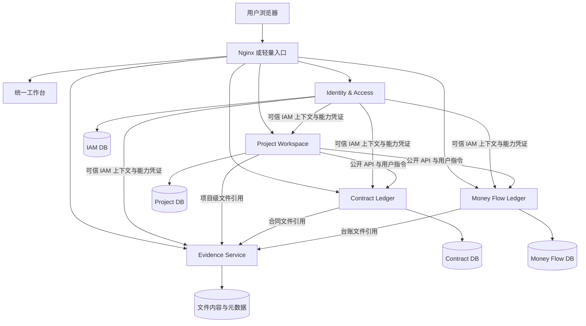

# 第 9 轮：应用组合与单节点架构

日期：2026-09-20  
状态：已进入当前讨论基线；除 Contract Ledger 与 Money Flow Ledger 外均为目标设计，尚未实现

## 本轮要解决的问题

随着 Project、IAM、文件基础能力和网关参考工程进入讨论，需要明确哪些是真正需要建设的小应用，哪些只是部署或体验组件，并保证完整产品能够在预算有限的小公司只使用一台阿里云 ECS 时稳定运行。

## 评估结论

当前设计合理，但必须区分应用、装配组件和技术基础设施：

- 当前应用组合包含五项：Identity & Access、Project Workspace、Contract Ledger、Money Flow Ledger、Evidence Service；
- 网关不是业务小应用，最低部署使用 Nginx 或等价反向代理即可；
- 统一工作台是前端装配，不拥有合同、台账或项目业务事实；
- 连接器按真实跨系统业务流创建，不是常驻公共平台；
- 部署运维包负责安装、升级、备份和恢复，不成为业务运行时；
- 完整组合必须支持单台 ECS，不强制 Kubernetes、服务注册中心、Redis、消息队列或多台服务器。

## 五个应用

| 应用 | 类别 | 最小根因 A→B | 是否强制安装 |
| --- | --- | --- | --- |
| Identity & Access | 平台应用 | 多个应用各自解释身份会产生不一致与审计缺口 → 每次受保护访问获得统一可信的身份与能力凭证 | IAM 契约强制；标准组合安装正式 IAM，例外部署可使用同形本地模板提供者 |
| Project Workspace | 业务小应用 | 同一项目的合同、收支和资料散落在不同应用 → 从一个项目入口组织、查看并操作这些记录 | 可选 |
| Contract Ledger | 业务小应用 | 合同不断补充和修改 → 随时知道当前按哪份约定办事以及为什么 | 按客户组合选择 |
| Money Flow Ledger | 业务小应用 | 应收应付与实际收付款容易混在一起 → 随时知道该收付、已收付和剩余金额 | 按客户组合选择 |
| Evidence Service | 基础能力应用 | 多个应用分别处理文件会产生重复、安全和追溯差异 → 提供统一、版本化、可校验的文件保存与受控读取 | 完整组合采用；单应用可以使用同一 Evidence Port 的本地提供者 |

“基础”当前只确认 Evidence／File 能力，不创建可以不断塞入字典、编号、审批、业务规则和客户字段的万能 Foundation Service。通知等能力只有出现两个稳定使用点和清晰 A→B 后才评估。

## 不作为业务小应用的组件

| 组件 | 定位 | 当前结论 |
| --- | --- | --- |
| Nginx／轻量网关 | 外部统一入口 | 公网生产部署需要统一 HTTPS 与反向代理入口；不要求自研 API Gateway |
| Unified Workbench | 统一前端壳 | 提供 OA 式连续体验；技术形态仍可选择，不拥有业务数据 |
| Connector | 定向集成组件 | 只为一条真实重复录入业务流存在；可关闭、可重试、不替目标应用作决定 |
| Deployment & Operations | 交付组件 | 负责配置、启动、升级、备份、恢复和健康检查，不承载业务规则 |

NebulaAuth 网关参考工程同时包含 Auth、OAuth、User、Gateway、Registry、PostgreSQL 和 Redis，适合提供 IAM、令牌、API Key 和路由方面的参考，不自动成为 OMSBizFoundry 的整套必选运行时。

## 目标逻辑架构



图中的箭头表示公开契约调用，不表示共享数据库。Project 可以在一个页面中创建或修改合同、登记台账动作，但实际命令由对应应用授权、校验和写入；Project 只保存自己的项目事实和外部资源关联。

## 数据所有权

| 数据 | 唯一所有者 |
| --- | --- |
| 用户、租户、角色、能力授权和凭证决策 | Identity & Access |
| 项目身份、项目资料和外部资源关联 | Project Workspace |
| 合同、文书、revision、结算和合同关系 | Contract Ledger |
| 义务、资金、核销、余额事实和台账投影 | Money Flow Ledger |
| 文件字节、版本、摘要和存储状态 | Evidence Service 或单应用本地 Evidence 提供者 |
| “该文件是合同扫描件／付款凭证”的业务含义 | 引用该文件的业务应用 |

任何应用都不能直接读取或修改另一个应用的内部表。单台 ECS 只表示共享宿主机，不表示共享数据所有权。

## IAM 与权限流

1. 用户通过正式 IAM、本地模板或测试提供者形成同形 IAM 上下文；
2. IAM／策略服务把组织、角色、项目范围等外部条件收敛为目标应用认识的短期能力凭证；
3. 网关只负责传递或提前校验，不形成业务授权结论；
4. 目标应用校验凭证的签发者、租户、audience、action、资源范围和有效期；
5. 目标应用继续校验自己的资源归属、状态、revision、金额和其他业务不变量；
6. 应用返回 `allowed_actions` 辅助前端显示，实际命令仍在服务端再次授权。

Project 的“可以查看某项目”可以参与上层权限组合，最终给 Money Flow 的是 `obligation.read` 对明确资源或范围的能力凭证。Money Flow 不需要增加 Project 业务规则，也不需要理解客户岗位。

## 单台 ECS 最低部署

```text
Alibaba Cloud ECS
├── Nginx：唯一公网入口、HTTPS、静态文件和反向代理
├── Unified Workbench：统一前端
├── IAM 服务
├── Project Workspace
├── Contract Ledger
├── Money Flow Ledger
├── Evidence Service
├── PostgreSQL：一个实例、每个应用独立数据库和账号
└── Evidence 持久目录或可选对象存储
```

最低部署约束：

- 除 Nginx 外的应用端口只监听本机或受限内部网络；
- 可以使用同一个 PostgreSQL 实例，但每个应用使用独立数据库、账号、migration 和备份边界；
- 不建立跨数据库外键，不允许跨库查询成为正式业务规则；
- 本地文件存储可以满足最低部署，生产数据必须存在云盘快照、对象存储或其他离机备份；
- Redis、消息队列、服务注册中心和 Kubernetes 都不是启动前提；
- 进程监管与容器编排方式尚未确定，可以基于实际交付验证选择 systemd、Docker Compose 或等价方案；
- 单节点不宣称高可用，宿主机故障会影响整体访问，但应用和数据边界仍保持可迁移。

## 部署组合

| 组合 | 内容 |
| --- | --- |
| 合同独立交付 | Contract Ledger + IAM 契约提供者 + Contract DB + 本地 Evidence 提供者 |
| 台账独立交付 | Money Flow Ledger + IAM 契约提供者 + Money Flow DB |
| 项目组合 | Project Workspace + IAM + 选择安装的 Contract／Money Flow／Evidence |
| 完整 OMS | Nginx + Unified Workbench + IAM + Project + Contract + Money Flow + Evidence + 独立数据边界 |

项目应用未安装时，Contract 和 Money Flow 仍可使用；Evidence Service 未安装时，允许支持该模式的单应用使用本地 Evidence 提供者；另一个业务应用停机时，本应用已经确认的事实仍可读取和继续处理。IAM 契约始终存在，但 IAM 故障时既有凭证有效期、撤销与降级行为仍待正式契约确定。

## 当前实现状态

- Contract Ledger 与 Money Flow Ledger 已经实现并完成独立交付、备份恢复和同机隔离验证；
- 两个应用当前仍使用各自本地身份实现，尚未迁移到目标 IAM 契约；
- Contract Ledger 已有本地 Evidence 实现，尚未抽取独立 Evidence Service；
- Project Workspace、正式 IAM、Unified Workbench 组合入口和单节点完整装配尚未实现；
- Nginx／自定义网关、IAM 令牌格式、资源范围和应用注册方式仍需技术方案与验收证据。

## 后续顺序

1. 先完成 IAM 契约、能力目录和正式／模板／测试提供者，迁移两个现有应用；
2. 再完成 Project Workspace 最小纵向闭环，证明项目只保存关联且能从项目页面调用业务应用；
3. 再验证 Evidence Service 是否能在不破坏本地交付和备份边界的前提下独立；
4. 最后形成 Nginx、统一工作台和单台 ECS 的完整组合交付；
5. Contract → Money Flow 连接器仍等待真实业务流，不因应用组合扩大而提前实现。
