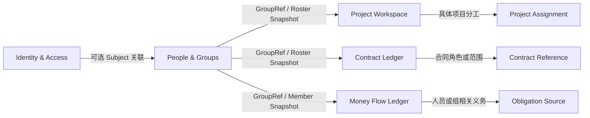

# 第 11 轮：人员编组与可配置能力

日期：2026-09-20  
状态：已进入当前讨论基线；将上一轮 Organization & People 校正为以“组”为核心的 People & Groups，目标设计尚未实现

## 本轮要解决的问题

OMS 参考原型存在“施工队”和人员名册，但“施工队”是客户场景名称。需要判断它能否抽取为独立小应用，同时避免把施工范围、合同、预算、应付款和工资等客户业务一起带入内核。

用户提出的稳定信号不是“管理施工队”，而是：系统需要管理一组由若干人员组成、成员和分工会变化、并且可以说明这组人具备什么能力的人员集合。

## 参考原型提供的证据

OMS 原型中的一条 `TeamRecord` 同时包含：

- 施工队名称和工头；
- 施工范围和关联合同；
- 人员数量；
- 年度预算、预算使用和应发未发；
- 正常、预算关注、名册待补等混合状态。

这些字段不能整体复制为一个通用 Team 表。它们实际来自不同事实所有者：

| OMS 字段或展示 | 稳定归属 |
| --- | --- |
| 组名称、组类型、成员、组内角色 | People & Groups |
| 工头／负责人 | 从当前有效 Membership 的组内角色派生，不固化为施工字段 |
| 施工范围、关联合同 | Project／Contract 的具体 Assignment 或关联快照 |
| 年度预算、预算使用 | 未来 Budget／Planning 能力或客户装配，不属于组身份 |
| 应发未发、实际付款 | Money Flow 或薪酬／付款来源应用 |
| 名册待补 | People & Groups 可派生的名册完整性 |
| 预算关注 | 财务投影，不是 Group 状态 |

因此 OMS 证明“人员集合”确实有独立价值，也同时证明当前施工队页面是跨系统汇总视图，不是可以直接复制的数据模型。

## 应用定位

候选应用名称确定为 **People & Groups（人员与编组）**。客户界面可以按场景把 Group 显示为“施工队”“项目组”“服务小组”“班组”或“协作队”，内核不认识这些客户词。

最小根因：

> 一群人被反复组织在一起，但成员、分工和能力信息容易散落 → 随时知道有哪些组、组里是谁、各自在组内承担什么，以及这个组具备什么能力。

这个应用关注“谁和谁组成一组”，不是通用 HR，也不管理这组人当前具体为哪份合同、哪个项目做什么。

## 三种不同的“做什么”

用户提出“他们做什么不是最关键，但需要能配置”，需要拆成三种含义：

1. **组的用途说明**：面向人的自由文本，例如“负责现场安装与回填协作”；保存在 Group Profile 中，只用于理解，不参与业务计算；
2. **组具备什么能力**：租户可配置的 Capability 标签，例如“管线安装”“设计审核”“客户实施”；可用于搜索、筛选和候选组选择；
3. **组当前具体做什么**：某项目、合同或任务中的实际工作范围；由 Project、Contract 或未来 Assignment 应用拥有，只引用 Group ID 和当时能力快照。

只使用一个描述字段会导致无法稳定检索和配置；把“施工范围”固化为字段又会绑定建筑业务。因此第一版同时保留自由文本 Purpose 和可配置 Capability，不在 People & Groups 中保存具体项目任务。

## 最小数据边界

| 对象 | 最小职责 |
| --- | --- |
| Person | 提供可被编组的稳定人员身份、显示信息、状态和可选 IAM Subject 关联 |
| Group | 稳定 Group ID、类型、名称、用途说明、状态和有效期 |
| Membership | Person 在某 Group 中的组内角色、生效／结束时间、状态和变更历史 |
| Capability Definition | 租户配置的能力键、显示名称、说明和停用状态 |
| Group Capability | 某 Group 当前声明具备的能力及可选说明、生效／结束时间 |
| Group Type | 租户配置的组类别和显示名称，不向内核增加施工专用字段 |
| Membership Role | 租户配置的组内角色，例如负责人、成员、安全员；它不是 IAM 权限角色 |
| Roster Snapshot | 对外提供指定 revision／时点的组资料、成员、角色和能力快照 |

Person 可以属于零个、一个或多个 Group；Membership 的开始、结束和角色变更必须保留历史，不能直接覆盖。Group 可停用或归档，但不能因为解散就删除历史名册。第一版不预设只能有一个负责人，也不预设组必须是树形层级。

## 配置边界

允许配置：

- Group Type 的稳定 key、显示名和说明；
- Membership Role 的稳定 key、显示名和说明；
- Capability Definition 的稳定 key、显示名、说明和是否可用；
- 客户界面的术语，例如把 Group 显示为“施工队”；
- Group 的 Purpose 自由文本和 Capability 选择。

暂不提供：

- 任意动态字段设计器；
- 通用表单或工作流设计器；
- 由标签自动执行合同、预算、薪酬或授权规则；
- 把客户角色名直接当成 IAM 权限；
- 通过配置改变 Membership 历史与快照语义。

如果以后真实案例证明某种能力需要等级、证书、到期日或数量，还应先建立独立 A→B，再扩展 Capability Assignment，不能提前把任意 JSON 塞进核心。

## 与其他应用的关系



- IAM 管登录身份和权限；People & Groups 的“负责人”“成员”是组内分工，不自动授予系统权限；
- Project 可以把一个 Group 关联到项目并说明当前分工，但不能修改 Group 名册；
- Contract 可以引用 Group 或其关联 Party 快照，但 Group 不自动成为法律签约主体；
- Money Flow 可以引用 Group／Person Snapshot 作为义务来源或收付对象依据，但工资、奖金和付款批次不归 People & Groups；
- 所有引用使用公开 API 和版本化快照，禁止其他应用直接读取 People & Groups 数据库。

## 独立运行与默认实现

People & Groups 必须能够独立完成：

```text
建立人员
  → 建立组并选择 Group Type
  → 添加成员并配置组内角色与有效期
  → 设置用途说明和 Capability
  → 调整／移出成员且保留历史
  → 查看当前名册和历史名册
  → 导出可校验的 Roster Snapshot
  → 归档组
```

它不要求 Project、Contract、Money Flow 或客户 OA 存在。人员可以在本应用内建立或通过公开适配器导入；与 IAM Subject 的关联可选，但所有受保护访问仍必须经过 IAM 契约。

## 第一版明确不做

- 项目任务、排班、工时、考勤和现场管理；
- 工资、奖金、社保、报销、应付和实际付款；
- 合同施工范围、年度预算和成本控制；
- 招聘、绩效、完整员工档案和劳动关系合规；
- 专业资质、证书和复杂技能矩阵；
- 组织树、组嵌套和自动继承，除非后续真实案例证明需要。

这些能力可以在 Workbench 中与组一起展示，但数据仍来自各自应用。

## Complete Suite 0.1 中的位置

上一轮的 Organization & People 由 People & Groups 替代，不再额外增加第七个数据应用。Complete Suite 默认启用 People & Groups，并用它完成“建立人员 → 编组 → 在项目中引用组”的演示；独立 Contract 或 Money Flow 交付不以它为启动前提。

M8 的目标相应校正为 People & Groups 最小闭环。具体 Assignment、预算和人员付款仍留在后续真实业务来源，不通过扩大 M8 冒充完成。

## 仍然开放

- Person v1 允许保存哪些最小联系信息和敏感字段；
- Group Type、Membership Role 与 Capability 的 key 命名、停用和历史引用规则；
- Roster Snapshot 是按显式 revision 还是有效时点生成，及其完整性摘要；
- Group 与外部 Party 的关联由哪个应用拥有；
- 是否存在必须支持组嵌套、多人负责人或能力等级的首个真实案例；
- OMS 施工队人员名册如何脱敏迁移，以及原有预算、合同、付款字段分别迁往哪个应用。
