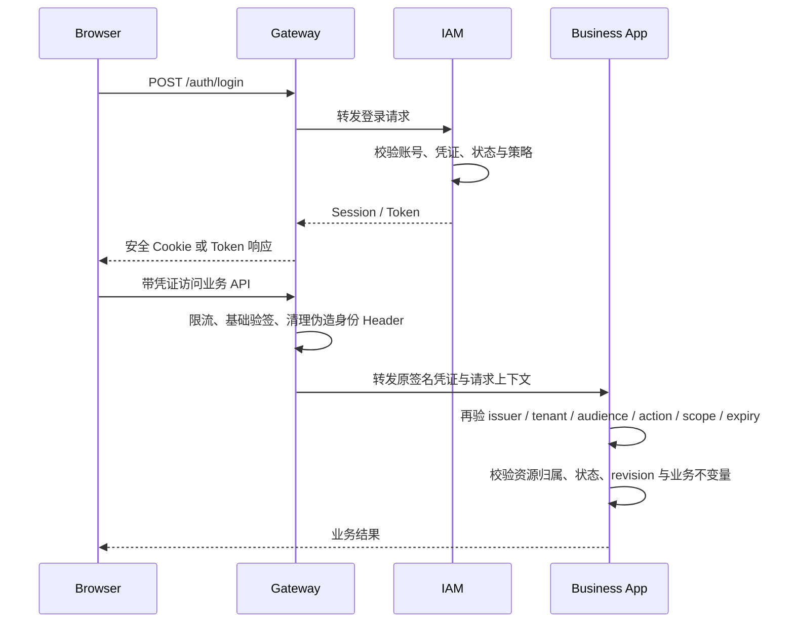

# 第 12 轮：Gateway、IAM 与参考认证工程适配

日期：2026-09-20  
状态：已进入当前讨论基线；职责边界已确认，具体令牌、Cookie、密钥与撤销协议尚未实现

## 本轮要解决的问题

需要明确登录和注册为什么属于 IAM 而不是 Gateway，Gateway 在登录鉴权中到底负责什么，并评估已加入的 NebulaAuth 参考工程是否适合直接作为 OMSBizFoundry 的运行时基础。

## 一句话边界

- **IAM：系统不知道访问者是谁、账号是否有效以及被授予什么能力 → 建立、验证并管理可信数字身份和授权凭证。**
- **Gateway：外部请求不能直接、安全地访问多个内部应用 → 统一接入、验证最低访问条件并把请求转发到正确应用。**

登录和注册 API 可以通过 Gateway 暴露，但账号、凭证、会话和授权决定仍由 IAM 拥有。URL 从 Gateway 经过，不代表业务职责属于 Gateway。

## 职责分工

| 能力 | Gateway | IAM | 目标业务应用 |
| --- | --- | --- | --- |
| HTTPS、域名、路由、请求大小、基础限流 | 负责 | 不负责 | 不负责 |
| 登录／邀请注册页面入口 | 暴露和转发 | 实现账号生命周期 | 不负责 |
| 密码、验证码、MFA、账号状态 | 不保存、不判断 | 拥有并验证 | 不负责 |
| Session／Token 签发、刷新、撤销 | 不签发业务身份 | 拥有 | 只消费可信凭证 |
| Access Token 基础验签 | 可提前执行 | 发布密钥／验证或 introspection | 必须再次验证与自己有关的声明 |
| 角色到能力的授权 | 不决定 | 拥有映射与策略决策 | 发布稳定能力目录 |
| 资源状态、revision、金额和领域约束 | 不判断 | 不判断 | 最终判断 |
| 可信身份 Header | 删除客户端伪造值；必要时从已验证凭证派生 | 提供签名来源 | 不能只信任公网可伪造 Header |

Gateway 可以拒绝明显无效、过期或 audience 不匹配的请求，减少无效流量；但它不能因为 Token 有效就决定“这份合同能不能更正”或“这笔付款能不能登记”。

## 登录与业务请求链路



登录页可以由 Unified Workbench 承载，也可以由 IAM 提供；这属于用户界面装配，不改变 IAM 对身份事实的所有权。

## NebulaAuth 参考工程的实际结构

本轮只做适配评估，不把参考工程的说明或代码当成 BizFoundry 已接受事实。核对到的结构是：

- `services/auth-server` 实现验证码、登录、注册、刷新、登出、JWT／API Key 和会话；
- `services/user-service` 保存和管理用户资料；
- `services/oauth-server` 提供 OAuth 能力；
- `services/api-gateway` 处理路由、`public/user/apikey/admin` 等访问级别、调用 Auth Server 验证令牌并注入 `X-User-*` Header；
- `services/service-registry` 提供服务注册发现；
- PostgreSQL 与 Redis 是其部署依赖。

因此它没有把登录实现错误地放进 Gateway；登录／注册属于 Auth Server，Gateway 负责入口与验证。这一逻辑分层可以参考。

## 可以借鉴的内容

- 登录和注册经过统一外部入口，但实现仍在 Auth Server；
- Auth、User、OAuth 与 Gateway 有逻辑职责区分；
- Gateway 在转发前验证访问凭证；
- 内部服务不应直接暴露到公网；
- Token 刷新、会话撤销、密钥轮换和 API Key 被当成独立安全问题。

## 不能直接照搬的内容

1. **部署过重**：五个服务、Redis、PostgreSQL 和服务注册中心超出当前单 ECS 最小目标；服务发现对静态、少量应用没有必要。
2. **授权粒度过粗**：`public/user/apikey/admin`、`role` 和 `is_admin` 不能表达 BizFoundry 的 tenant、audience、action、resource scope 和业务能力目录。
3. **认证等级进入 URL**：`/{service}/{version}/{auth_level}/{path}` 让访问级别成为调用路径的一部分；BizFoundry 应由服务端路由清单声明访问策略，客户端不能通过改 URL 选择安全等级。
4. **企业注册默认不合适**：参考实现中 `REGISTRATION_ENABLED` 未配置时默认开启，并允许登录时自动注册；BizFoundry 的企业组合必须默认关闭匿名注册，采用首个管理员建立和受控邀请激活。
5. **强同步依赖**：Gateway 对受保护请求同步调用 Auth Server 验证令牌，认证服务故障会令全部受保护访问立即失败；BizFoundry 需要明确短期签名凭证、本地验签、撤销和高风险 introspection 的平衡。
6. **Header 信任必须加固**：Gateway 注入身份 Header 可以作为内部传递优化，但必须删除客户端同名 Header、限制内部端口，并让业务应用验证原始签名凭证或等价的防伪上下文。
7. **安全完成度不能由功能清单推断**：参考仓库自己的 `todos/security/security-audit-report.md` 曾记录 23 个问题，其中部分被标记修复、部分仍是待办；未经独立复验不能当作生产安全基线。

所以结论不是“参考项目不合理”，而是：**它是一套偏完整微服务化的身份系统样例，逻辑分层有参考价值，但部署规模、注册默认值和授权模型都不适合直接成为 BizFoundry 基线。**

## BizFoundry 的第一版选择

第一版保留三个清晰逻辑边界：

```text
Gateway
  └─ 入口、路由、限流、基础验签、可信转发

IAM
  └─ 企业／租户、账号、邀请激活、登录、会话、令牌、角色与能力授权

Business App
  └─ 能力凭证复验、资源范围和业务不变量的最终判断
```

物理部署不必等于三个复杂微服务。单台 ECS 第一版可以使用一个轻量 Gateway 进程和一个 IAM 进程；User 与 Auth 先作为 IAM 内部模块，OAuth、Redis 和 Service Registry 均不是启动前提。以后出现外部统一登录、多个身份源或第三方授权需求，再决定是否拆分 OAuth／User 服务。

## M7 安全门槛

进入 M7 实现前必须先确定并验证：

- 企业建立、首位管理员、邀请、激活、登录、刷新、注销、停用和密码／验证码恢复；
- 匿名注册默认关闭，不能通过缺省配置自动开启；
- Token／Cookie 的签发者、tenant、audience、action、scope、签发和过期时间；
- 签名密钥生成、持久化、轮换、备份和泄露处置；
- Session 撤销、账号停用、IAM 故障和时钟偏差行为；
- Gateway 删除外来身份 Header，内部应用端口不对公网开放；
- Gateway 拦截不能替代业务应用再次授权；
- 登录、注册、验证码和令牌接口的限流、重放防护和安全审计。

## 仍然开放

- 浏览器采用服务端 Session Cookie、短期 JWT，还是 Gateway/BFF 持有 Token；
- Gateway 本地验签与 IAM introspection 分别用于哪些请求；
- 签名采用非对称公钥发布还是其他可轮换方案；
- 单台 ECS 是否需要 Redis，还是先用 PostgreSQL／内存与明确重启语义；
- 是否复用 NebulaAuth 的局部代码，或只借鉴其测试和接口思想；任何复用前都必须做依赖、许可证、威胁模型和安全复验。
