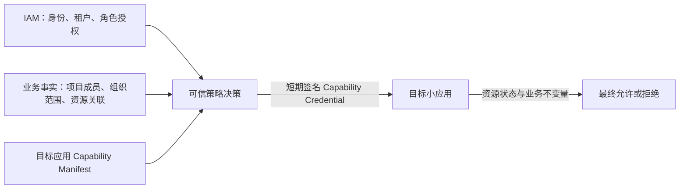
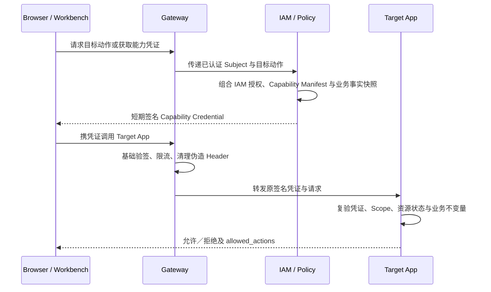

# 第 13 轮：IAM、业务事实与小应用权限链解耦

日期：2026-09-20  
状态：已进入当前讨论基线；逻辑契约已确认，凭证载体、策略求值方式和故障时限尚未实现

## 本轮要解决的问题

在 IAM 统一管理身份与授权之后，如果项目成员、组织范围等业务条件也参与权限判断，容易形成 `IAM → 业务层 → 小应用` 的强制同步调用链。一旦任一中间层停机，所有业务请求都会失败，小应用也会重新耦合客户岗位和外部业务规则。

本轮要明确权限定义、业务事实、策略判断和小应用最终授权如何通信，同时保持各小应用独立。

## 核心结论

权限不是一条层层转发的运行链，而是两类可信输入在策略决策边界汇合：



实际业务请求仍是 `Browser → Gateway → Target App`，不需要依次经过 IAM、Project 和其他业务应用。IAM／策略层只负责形成目标应用能直接理解的短期能力凭证。

一句话分工：

> 小应用定义“可以做什么”，IAM 管理“谁被授予什么”，业务事实说明“当前范围依据是什么”，可信策略层把这些输入收敛成凭证，小应用结合自身状态作最终决定。

## 四份版本化契约

### 1. Capability Manifest：小应用定义权限语言

每个应用随 release 发布稳定、版本化的能力目录，例如：

```json
{
  "app": "contract-ledger",
  "version": "1.0",
  "capabilities": [
    {"key": "contract.read", "name": "查看合同"},
    {"key": "contract.revise", "name": "登记合同变更"},
    {"key": "contract.terminate", "name": "终止合同"}
  ]
}
```

能力 key 表达稳定业务动作，不使用客户岗位、页面、菜单、按钮或通用 CRUD 名称。IAM 可以把能力组合进角色，但不能自行发明目标应用未发布的能力。新增能力默认不自动授予；废弃能力不能把原 key 静默复用为另一种含义。

Capability Manifest 在安装／升级时由部署工具校验并导入 IAM，不要求目标应用为了启动而实时向 IAM 注册。

### 2. Business Fact Snapshot：业务应用只提供事实

Project、People & Groups 等应用可以通过公开 API 或版本化快照提供权限判断所需事实，例如：

```json
{
  "source": "project-workspace",
  "project_id": "project-001",
  "subject": "user-001",
  "membership": "manager",
  "resource_links": ["contract-001"],
  "revision": 7
}
```

业务应用只陈述“谁当前属于什么范围”“哪个资源与什么项目关联”等事实，不签发最终能力凭证、不访问目标应用数据库，也不能因为自己判断用户是项目经理就直接调用合同写接口。

快照必须包含来源、revision／有效时点和稳定引用，策略审计能够解释当时使用了哪一版事实。客户业务规则可以读取这些公开事实，但不能把客户岗位写入目标应用代码。

### 3. Capability Credential：策略层输出目标应用原生结论

可信策略决策把 IAM 授权和业务事实转换成目标应用认识的短期签名凭证：

```json
{
  "iss": "omsbizfoundry-iam",
  "sub": "user-001",
  "tenant": "company-001",
  "aud": "contract-ledger",
  "action": "contract.revise",
  "resource": "contract-001",
  "decision_id": "decision-001",
  "policy_revision": 12,
  "iat": 1790000000,
  "exp": 1790000300
}
```

输出范围必须使用目标应用认识的资源和动作。不能把“可以查看 A 项目”原样交给不认识 Project 的 Contract Ledger；策略层应把它转换为明确的 Contract Resource ID、目标应用支持的有界 Scope，或针对本次命令的凭证。

第一版高风险写操作优先使用绑定单个目标资源、短有效期的凭证，避免把无限资源列表塞进 Token。批量列表和大范围查询的 Scope／introspection 方式仍需在 M7 契约中确定。

只有 IAM 内的受信授权模块或独立的受信 Policy Decision Provider 可以签名。Project、Workbench、Gateway 和浏览器都不能生成或修改能力凭证。

### 4. Allowed Actions：小应用返回当前可用动作

目标应用验证凭证后，还要结合资源状态、revision 和领域规则计算当前 `allowed_actions`，供 Workbench 显示或禁用操作。例如用户拥有 `contract.revise`，但合同处于不允许变更的状态时，响应中不能出现该动作。

`allowed_actions` 只改善界面体验；每次写命令仍在服务端重新验证凭证和业务不变量，隐藏按钮不能替代授权。

## 运行时链路



具体实现也可以由 Gateway/BFF 代表浏览器获取凭证，但不得改变信任边界：策略层签发，目标应用执行，Gateway 只传递和提前拒绝明显无效请求。

## 三层职责边界

| 层次 | 拥有 | 明确不拥有 |
| --- | --- | --- |
| IAM | Subject、Tenant、账号状态、角色到能力授权、凭证签发与撤销 | 合同状态、项目关联和金额规则 |
| 业务事实提供者／策略装配 | 项目成员、组织关系、资源关联等版本化事实；客户策略组合 | 目标应用数据写入和业务不变量 |
| 目标小应用 | Capability Manifest、资源所有权、状态、revision、金额和最终执行 | 客户岗位名、项目内部表和 IAM 角色模型 |

策略层是逻辑责任，不强制增加一个微服务：简单客户可以由 IAM 内部授权模块完成；复杂客户可以接入独立 Policy Provider。两种实现必须输出同形 Capability Credential，目标应用不能感知采用了哪一种。

## 示例：项目经理修改合同

```text
IAM：user-001 拥有客户角色“项目经理”
Project：user-001 是 project-001 的有效成员
Project：project-001 关联 contract-001
客户策略：项目经理可修改本项目合同
Contract Manifest：存在 contract.revise
```

可信策略层输出：

```text
aud=contract-ledger
action=contract.revise
resource=contract-001
```

Contract Ledger 不知道“项目经理”是什么，也不读取 Project 数据库。它只验证凭证，然后判断 contract-001 当前是否允许 revision 变更。客户把角色改名为“商务负责人”时只修改 IAM／策略配置，Contract 代码不变。

## 四类解耦

1. **语义解耦**：客户角色映射为目标应用稳定 Capability；
2. **数据解耦**：策略层只消费公开版本化快照，不跨库查询；
3. **运行解耦**：业务请求直接到目标应用，短期签名凭证避免每次请求层层同步调用；
4. **定制解耦**：客户项目、组织和岗位规则放入 Policy Provider，不进入小应用内核。

## 故障与独立运行

- Project 未安装时，IAM 仍可使用租户级或明确资源级的直接授权；Contract 和 Money Flow 不因此失去独立闭环；
- Project 暂时不可用时，已签发且未过期的凭证按既定 TTL 继续有效；需要新业务事实才能签发的新凭证明确失败，不猜测或扩大范围；
- IAM／Policy 暂时不可用时，既有短期凭证是否继续有效由签名和 TTL 决定，高风险新授权默认失败关闭；
- 单应用交付使用同形本地模板 Provider 产生同一 Credential，不创建 `AUTH_DISABLED` 旁路；
- 精确 TTL、撤销传播、离线验签和高风险 introspection 仍在 M7 威胁模型中确定。

## 禁止项

- 小应用判断“项目经理”“财务主管”等客户角色名；
- 使用页面路径、菜单或按钮 ID 作为权限 key；
- 业务应用、Workbench 或浏览器自行签发能力凭证；
- 策略层直接修改目标应用数据库；
- Gateway 验签通过后跳过目标应用授权；
- 目标应用实时查询 IAM、Project 或 People & Groups 的内部表；
- 用一个万能 `admin` 或 `*.update` 绕过稳定业务能力；
- 在凭证中携带目标应用无法解释的外部 Scope。

## 仍然开放

- Capability Manifest 的 JSON Schema、签名、兼容和弃用协议；
- Policy Provider 获取业务事实采用按需 API、受控缓存还是事件投影；
- 列表查询与大范围数据权限使用有界 Scope、策略引用还是在线 introspection；
- Capability Credential 使用独立 Token、访问 Token 内嵌声明还是 Token Exchange；
- 浏览器直接持有能力凭证还是由 Gateway/BFF 代持；
- 撤销时限、IAM／Policy 故障时长和高风险动作强制在线确认范围。
