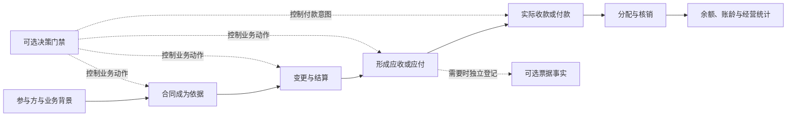
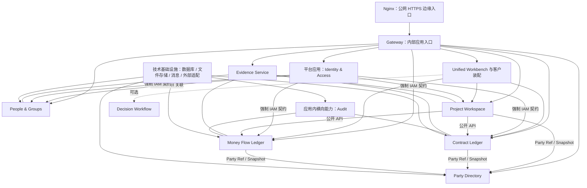

# OMSBizFoundry 当前讨论基线

2026-10-22 Demo 数据基线（BF-170）：`oatest` 当前用于从空业务状态重新走 OMS 一期录入流程。十二个已启用业务 Owner 的用户录入／业务事实与两个本地附件对象卷已经归零；IAM 账号、登录与 Grant、schema／migration、部署配置及不作为外部合作方展示的本方经营主体继续作为系统运行基准保留。页面中的项目、甲方、施工方、合同、票据、收付款、人员／分组、经营承接、生产、审批结果、成本外包与奖金均不得由旧 OA 或旧演示事实回填。该基线不改变各 Owner 的所有权或不可变事实规则，只记录一次有回滚点的 Demo 环境维护操作。[执行证据](./reports/oms-phase1-demo-full-business-reset-20261022.md)

2026-10-22 OMS 一期导航选中态基线（BF-169）：多个业务组同时展开只表示二级入口可见，不表示这些组仍是当前页面。桌面侧栏全局只允许当前页面对应的一个二级入口高亮，历史访问过的二级入口在切页后必须撤销选中和 `aria-current`；当前一级组仍可作为路径父级显示，其他组仅保留展开状态。该基线只约束 Workbench 呈现和无障碍语义，不改变任何业务事实或权限边界；已发布为公网 Workbench v1.22。[发布证据](./reports/oms-phase1-single-current-navigation-publication-20261022.md)

2026-10-22 OMS 一期导航状态基线（BF-168）：桌面侧栏的业务组展开状态不等于当前页面状态。进入另一个业务组只改变当前高亮并展开目标组，不得替用户收起已经展开的其他组；用户可单独收起当前组。分页条数选择必须完整显示标签和内置箭头，不允许图形越出控件边框。该基线只约束 Workbench 呈现，不改变任何业务事实或权限边界；已经由 `main@32d9597` 发布为公网 Workbench v1.21。[发布证据](./reports/oms-phase1-mvp-review-ui-publication-20261022.md)

2026-10-21 OMS 一期列表工作台基线（BF-167）：正式 OMS 可以借用验证原型的清晰导航、直接标题、摘要、表格、排序、分页、就地筛选和导出节奏，但业务数据必须继续来自现有六个 Owner。筛选属于浏览上下文，在表格上方就地展开；新增、编辑、导出确认和简单详情仍使用居中弹窗；项目详情保留完整页面并在桌面保留左侧主菜单。所有导出继承当前列表条件且不受分页限制，金额继续使用精确两位小数文本。该基线只约束 Workbench 呈现，不允许从原型引入新事实、共享状态或演示数据。

2026-10-21 OMS 一期项目列表状态基线（BF-166）：项目列表用于快速判断项目两侧是否结清，不再重复展示应收／未收、应付／未付金额。两列统一命名为“应收状态／应付状态”，正常只显示“已完成／未完成”，既有金额异常仍单独警示；精确金额留在项目详情和专业台账。该变化只收敛列表信息，不改变任何金额事实或 Owner。该基线已由 `main@acce030` 发布到 `oatest`，证据见[发布报告](./reports/oms-phase1-project-settlement-status-publication-20261021.md)。

2026-10-20 OMS 一期详情交互基线（BF-165）：项目详情保留独立完整页面，其他简单详情、新增、编辑、筛选和导出统一使用居中业务弹窗，不再用右侧抽屉把内容挤成窄栏。只读弹窗只保留关闭，手机端弹窗占满视口；文件预览继续作为独立上层，关闭后回到原业务上下文。该基线只约束 Workbench 交互，不改变事实 Owner 或业务命令。该基线已于 2026-10-21 由 `main@99ead97` 发布到 `oatest`，范围与证据见[发布报告](./reports/oms-phase1-usability-baseline-publication-20261021.md)。

2026-10-19 OMS 一期通用主体基线（BF-164）：当前客户的“资质单位”身份只是现实背景，不进入 OMS 稳定产品模型。OMS 统一称当前使用系统的公司为“本方经营主体”，甲方与施工方是具体项目中的外部关系；页面只投影 Party Directory 真实持久化数据，不造演示或默认主体。无人工录入数据时保持空列表，由用户从新增入口建档。

2026-10-19 客户交付仓库基线（BF-163）：OMS 一期前端、平台入口和全部现有小系统进入独立 `OMSBoundry` 仓库，分别位于 `frontend/oms-workbench`、`backend/platform` 和 `backend/services`。这是为了让客户体验、GitHub 协作和后续交付从清晰目录开始，不是把小系统合成一个后端；每个 Go module、数据库、migration、Owner 和部署边界保持独立。`contracts/` 与 `packages/` 暂留根目录是兼容性选择，后续不得仅为目录“更整齐”而破坏稳定契约 URI、replace 路径或发布脚本。

2026-10-19 OMS 一期往来主体基线（BF-162）：项目中的甲方和施工方都是相对于当前资质单位的外部往来主体；资质单位自身不能被选回这两个角色，不能形成自开自收或自收自付。这是当前 OMS 视角下的角色不变量，不是对主体永久定性；Party Directory 继续只管稳定主体档案。错误的既有项目快照不被界面偷改，需在真实甲方档案建立后重新建项目。

2026-10-18 OMS 一期数据范围基线（BF-161）：OMS1 不是六个 Owner 全库数据的别名，而是以 `operations` 类型项目为根的产品投影；票据和资金只有能够归属到该项目范围时才显示。测试环境已按用户要求清空这一范围并保留旧 OA、账号、权限与资质单位，用户可从“新建项目”重新走完整录入。清理采用可恢复检查点而非在 Workbench 增加跨库删除按钮，后续业务删除仍必须服从各 Owner 自己的历史与冲销规则。

2026-10-17 OMS 一期短期访问凭证续期基线（BF-160）：页面内“已授权”只是一次短期换票的缓存提示，不能被当作持续有效的业务访问权。浏览器对人工重定向可能只暴露 `opaqueredirect/status=0`，因此受保护读取必须同时识别这种响应与明确 3xx，按目标 Audience 重新换票并最多重读一次；读取失败不能伪装成 0 条或清空最后成功内容。普通 401／403、校验错误、冲突和写入命令仍按原安全边界失败关闭，不能借续期兼容扩大自动重试。

2026-10-17 OMS 一期主入口基线（BF-159）：当前用户首先进入的是 OMS 一期，不再把旧 OA 工作台当作必须经过的产品外壳。根域名、登录回跳和 `/oms-v1/` 收敛到同一 OMS 工作面；旧项目管理、资料、统计和参考 Demo 保留在独立“旧版工作台”，用于对照与回查但不占当前主导航。入口收口必须同时减少首屏运行时依赖，不能只改菜单名称后仍先加载整套旧页面。

2026-10-17 OMS 一期 CSRF 新鲜度基线（BF-158）：页面首次打开时渲染的安全令牌不是永久事实。业务操作必须以当前浏览器 Cookie 和 Suite Manifest 配置的 IAM 路由取得、核对新鲜 CSRF，成功后才能向 Gateway 换取短期应用凭证；任何刷新或一致性校验失败都应保留用户输入并停止在 Owner 写入之前。CSRF 新鲜度、应用 Capability 和目标 Owner 最终授权是三层不同边界，不能互相替代。

2026-10-14 OMS 一期新增与汇总反馈基线（BF-157）：长时间打开页面后，Workbench 不能把曾经换取过短期应用凭证等同于仍然有效；写入前必须重新授权，只有 Gateway 明确返回入口凭证失效时才允许有界重授权，不能自动重试普通业务拒绝。甲方／施工方管理既要保持“角色由项目关系决定”，也要让刚创建、尚未关联项目的 Party 主体立即可见。项目详情的累计开票、收票、回款和支付必须同时给出笔数与最近业务日期，区分“项目资料更新时间”和“经营事实发生时间”，让用户无需猜测新增是否已经计入汇总。

2026-10-14 OMS 一期详情与选择控件基线（BF-156）：简单详情先呈现状态和金额，再进入主体、日期、来源、备注与附件；只读详情不伪装成可提交表单。选择器保留原生表单语义作为值、校验与事件源，可见交互统一为白色组合框和视口级弹层，必须随触发器锚定并处理边缘碰撞、键盘、禁用与动态选项。该基线只约束 Workbench 表现，不拥有或改写任何业务事实。

2026-10-13 OMS 一期可读性与工作区密度基线（BF-155）：界面优先把横向空间让给业务事实，而不是用大片留白和小字号制造“精致感”。桌面侧栏收窄，普通工作区占满可用宽度，项目详情只保留必要阅读边界；列表、详情、金额链和表单统一提升字号，但页头、筛选和导航继续紧凑，避免笔记本首屏被非业务信息占满。该基线只约束 Workbench 呈现，不改变任何事实 Owner。

2026-10-13 OMS 一期项目详情布局基线（BF-154）：页面操作按业务归属进入板块，不再集中悬挂在右上角。项目资料承载编辑项目和说明，甲方业务承载甲方合同详情与收款链，施工方业务承载施工方关系、应付设置和付款链，变更记录承载历史。页面位置帮助用户理解业务，但不改变 Project、Contract、Billing、Money、Party、Evidence 的事实所有权。

2026-10-13 OMS 一期文件预览基线（BF-153）：合同、票据和收付款凭证的附件都从原详情进入同一预览层，不再出现某处能看、某处只能下载的割裂。PDF 与常见图片使用 Evidence 的短期授权直接查看，图片可缩放；Office 等当前不能安全原生预览的文件明确保留下载。预览不是新文件系统，Workbench 仍只保存业务 Owner 已登记的 File ID／Version 引用，关闭后释放临时地址。

2026-10-13 OMS 一期项目详情基线（BF-152）：项目详情不是合同附件页，也不是财务流水总表，而是一个项目的经营全貌。默认先确认项目、甲方、施工方和更新时间，再分别阅读甲方侧“应收→开票→回款→未回款”和施工方侧“应付→收票→支付→未支付”；多施工方按施工方折叠分账。合同金额变更与项目 revision 历史使用原 Owner 记录，没有事实就显示空状态。具体开票、收票、回款、支付明细和新增动作继续在专业入口完成，避免项目页信息失控。

2026-10-13 OMS 一期合同详情基线（BF-151）：项目详情的合同入口不是单纯文件夹。默认先让操作者确认合同对象、往来主体、精确合同金额、状态和日期，再按需处理附件；附件仍归 Evidence，合同事实与历史仍归 Contract。只有草稿合同可从 OMS 一期追加编辑版本；合同金额低于可唯一归属的已回款／已支付时必须在输入与保存两个时点强提醒。若一个方向存在多份合同且资金未绑定具体合同，Workbench 不按总资金猜测单份合同是否异常。

2026-10-13 OMS 一期接入基线（BF-150）：当前一期不是把全部 Suite 应用都绑进 OMS，而是由六个唯一事实 Owner 组成真实纵向链——Party 管甲方／施工方当前档案，Project 管项目与稳定资源引用，Contract 管上下游合同承诺，Billing 管双向票据，Money 管实际收付款，Evidence 管附件字节；IAM、Gateway、Nginx、Workbench 只负责身份、入口和装配。六 Owner 已在 `oatest.antuinfo.cn` 通过幂等公网写入、复读、筛选分页和附件下载验收。People、Business Engagement、Production、Approval、Cost、Bonus、Design 继续保持独立，可随完整 Suite 部署但不是 OMS 一期前提；一期不得为“全部接上”的表象制造无业务需要的依赖。

2026-10-12 BF-149 增量共识：OMS 一期已经从发布候选推进到 `oatest.antuinfo.cn/oms-v1/` 公网 D1。正式资质单位只能是 Party Directory 的稳定主体并由 Customer Overlay 配置引用；本次使用公网原生命令建立“北京京宏勘察设计有限公司”，没有直接写库、复制主体或按名称猜测。公网登录与五 Owner 读取通过只证明装配和只读工作面可用，不能外推为 Money 实际资金、Evidence 附件、施工方应付或全部业务闭环已经完成。

2026-10-12 BF-148 增量共识：OMS 一期不另造业务后台，而是把现有小系统组合成一条可运行纵向主线。新建项目依次由 Project 保存项目、Contract 保存合同应收总额、Project 保存合同引用；开票由 Billing 保存，项目与双方主体使用稳定 ID／revision。Project 尚为草稿时，Billing 采用自身已支持的人工确认来源快照保留 Project ID 与名称，不放宽 Billing 对正式类型化项目来源的生命周期校验。该主线已经在本地正式 D1、真实 IAM 和真实 Owner 命令下复验；完整发布镜像与交付包已经形成，但 `oatest` 未完成现场升级前仍只能称本地通过／发布候选。

2026-10-12 BF-147 增量共识：新建项目需要甲方但甲方尚未建档时，表单直接提供“创建甲方”入口并进入甲方管理，由用户先显式完成 Party 建档再返回创建项目。页面不得在项目表单中隐式新建主体、按名称猜测身份或保留半套项目；本次只补 Workbench 操作路径和选择器表现，不改变 Party／Project 所有权。

2026-10-12 BF-146 增量共识：OMS 一期的九个二级工作面统一进入对应侧栏一级菜单，内容区不再重复同名 Tab。桌面只展开当前工作区的三个二级入口，移动端用底部四项一级导航加顶栏下紧凑二级导航保持同等可达性。该收口只改变 Workbench 信息架构，不改变任何小系统的数据所有权、接口、IAM 或业务规则。

2026-10-11 BF-145 增量共识：OMS 一期产品访谈已经收口，正式 v1 固定为经营总览、项目经营、应收回款、应付支付四个一级入口，以一个项目关联一个甲方和一个或多个施工方，分别维护应收／应付，登记实际开票、收票、回款和支付。公网固定使用 `Browser → Nginx → Gateway → IAM → Unified Workbench OMS`，新增 `/oms-v1/` 验收路由并保留旧 `/oms/` Demo 对照。OMS／Workbench 只组合既有 Project、Party、Contract、Billing、Money、Evidence 和 IAM；若实现要求共享表、跨库写、双写、事实 Owner 迁移或大规模重解释既有契约，必须作为大边界改动单独决策，不能由 UI 实现顺手完成。

2026-10-11 BF-144 增量共识：当前 OMS 一期 MVP 不使用期限、逾期和催收来驱动产品，只登记实际发生的开票、收票、回款与支付，展示当前余额和超额异常。Money Flow 已实现以必填 `due_on` 为依据的逾期／账龄只读投影，但明确没有催收流程或自动通知；因此它是可复用的既有能力，不是当前 OMS 页面必须启用的功能。未来若需要无固定期限、合同期限依据、客户承诺、跟进或提醒，必须以版本化兼容事实／投影演进，不能给 OMS 数据填假到期日，也不能改变旧 `due_on` 语义。第一版接受必须登录；本地单管理员和正式 Gateway／IAM 都有既有基础，具体采用预置默认管理员还是后台／既有 IAM 注册等待会议确认，不提供免登录自动账号或真实数据鉴权旁路。

2026-10-11 BF-143 增量共识：OMS 一期的核心不是“一张发票对应一次收款”，而是工程完成后资质单位向上游开票，随后围绕同一应收持续登记多笔实际回款、逐笔核销剩余金额并反复跟进，直到结清。这个事实验证了 Money Flow 将义务、实际资金和 Allocation 分开的方向，不构成对既有小系统的否定。后续只在兼容层补期限依据、无固定期限、客户承诺和下一步跟进；既有 `due_on`、预计现金日期、历史事实和导出不能被静默换义。OMS 默认先回答“应收多少、已回多少、分几次回、还差多少、最近一次回款和下一步跟进是什么”，下游应付与付款保持独立推进。

2026-10-11 BF-142 增量共识：最终统一财务报告是长期目标，但当前一期只完善资质单位对外经营 OMS，不把薪酬、耗材、奖金、报销等内部成本提前塞进经营事项、收付台账或待办。未来统一报告从 Contract、Billing、Money、Cost、Bonus 及后续内部成本来源读取版本化财务投影；OMS／Workbench 只装配，不拥有或复制各来源事实。行业调研用于发现当前原型遗漏的履约计量、验收、过程结算、变更签证、质保／担保、分包资质和工资专户等候选结构，但任何规则必须先判断本客户是否适用，再进入验证原型。第一轮已经保持四个一级工作区不变，在经营事项内增加“合同边界 → 履约／计量 → 收付循环”阶段表达，并用“履约与结算”取代“预算与结算”。

2026-10-11 BF-141 增量共识：入口少不等于工作入口不可见。四个一级工作区继续承担角色分流；进入经营事项后，用户应直接看到事项列表、经营全貌、合同与资料、协作方与人员、预算与结算，进入收付台账后，财务应直接看到上游的发票／应收／回款和下游的结算／应付／付款条件／付款授权／支付记录。这样既保留“以事项串起全链”的产品主张，也允许财务横向进入自己长期处理的对象。上述二级名称和示例仍是候选模型，不证明客户岗位、权限或业务规则已经确认。

2026-10-11 BF-140 增量共识：产品不能只按事项或只按功能组织。老板需要整体经营与例外，经办人需要单事项完整闭环，财务需要跨事项统一管理发票、应收、回款、应付、授权和实付，处理人需要从待办直达动作。因此一级工作区调整为经营总览、经营事项、收付台账、待办事项；侧栏不再展开每个业务动作。经营事项仍是主要业务上下文，但不是数据所有者；同一事实可以在事项详情和专业台账中出现，必须保持同一来源、显式关联和可回到事项，不得复制或自动联动。

2026-10-11 BF-139 增量共识：数据量变大时，方向、合同和状态必须成为可分组、可筛选的字段，不能靠每行反复写小标签辨认。单事项页只按业务方向分成“上游收款”和“下游履约与付款”两组，不重复已经由页面上下文确定的合同；跨事项台账和 Excel 保留事项／合同标识、方向和状态筛选。关系视图只帮助理解开票、应收、回款、结算、应付和付款之间的先后与引用，不是流程引擎，也不表示相邻事实会自动产生。

2026-10-11 BF-138 增量共识：台账不是业务说明书。默认概览现在只保留两张收付完成度图，以及紧接其下的七行业务台账；表格五列分别回答“哪个环节、累计多少、最近一笔、还要处理什么、当前状态”，页面不再解释每个名词的定义，也移除中英文重复眉题等装饰性副标题。下载文件为真正的 `.xlsx`，额外带事项编号、事项名称、方向和统计日期，便于进入 Excel 后筛选和汇总，但这些字段不挤占页面。业务链仍保留为次级视图，用于需要理解顺序和独立性的场合。

2026-10-11 BF-137 增量共识：图表层和明细层承担不同任务。图表只支持数秒内判断收付现状；明细可以更长，但必须像经营文档一样顺着读，而不是继续堆卡片和缩写。当前明细在双轨之后增加经营结论、最需处理事项，以及上游三环节和下游四环节表格，每一行都用通俗文本说明事实含义、剩余问题和依据入口。手机不横向滚动宽表，而是把同一列转换为带标签的文档段落。所有解释仍标记为虚构数据和候选模型。

2026-10-11 BF-136 增量共识：清晰不等于把所有正确的信息同时放在首屏。图表默认层是经营观测层，只让用户一眼回答四个数：已回款 220、未回 100、已付款 120、未付 148，并用 69%／45%说明各自在已确认应收／应付口径内的完成度；事项闭环条件作为结果判断保留。合同起点、当前重点、开票／应收／回款和结算／应付／付款六个阶段、完整解释与凭证依据仍存在，但进入明细层按需核对。产品完整性由明细和可回查性承担，不由默认画面的文字数量承担。

2026-10-11 BF-135 增量共识：用户需要的是少量经营图表，不是多个业务图标。默认工作面现以两个明确口径的环形图回答最强问题：已回款 220／已确认应收 320，完成度 69%、未回 100 且 60 逾期；实际付款 120／已确认应付 268，完成度 45%、未付 148 且 96 待判断。开票—应收—回款和结算—应付—付款只作为金额阶段线，不用不同分母的长短条制造错误比较。完整文字链仍在明细模式，业务依据仍从图表直接进入。

2026-10-11 BF-134 增量共识：层级清楚以后仍需控制默认信息量。经营图的默认视图现在只保留“图标＋名称＋核心数字”，让用户先识别合同起点、八个经营节点、两个风险缺口和三个闭环条件；业务属性、最近记录、本次金额和引用依据不删除，而是进入明细模式和节点详情。这种渐进披露比继续缩小字号或压缩间距更能降低认知负担。图标只帮助辨别业务对象，不代表自动流程；上游收入轨与下游履约支出轨仍独立推进。

2026-10-11 BF-133 增量共识：0.2 的“功能全貌”与“第一眼是否读懂”需要分开验证。既有 0.2.10 保留为可操作全貌页；新的对照 Demo 把单事项压缩成五层：事项身份、当前经营重点、合同起点、上下游两条独立经营轨、共同闭环条件。默认层只回答“走到哪里、差多少、下一步是什么”，本次金额、来源引用和凭证依据放到节点详情。桌面并排看收入与履约支出，手机一次只看一轨；双轨不能暗示回款自动触发付款。该结构是对信息表达和多端可读性的产品假设，不改变任何正式业务边界。

2026-10-10 BF-132 增量共识：OMS 0.2.10 的产品表象已经从“能看主线”推进到“能模拟经营事实闭环”。资质单位向上游开票是已确认方向；开票／应收／回款和结算／应付／判断／授权／付款继续各自留痕，只允许人工显式引用。合同当前版本和资料缺口、协作方关联事项和资金摘要、更正反向记录、收付与资料同时归零后的归档均已在同一事项工作面可操作。上述内容仍是候选模型和虚构数据，特别是合同层级、下游类型、确认人与授权规则、资料清单和闭环条件都需要真实样本验证。

2026-10-10 BF-131 增量共识：待办不是另一套业务事实，也不应成为新的一级业务系统；它是从当前经营缺口进入原事项动作的工作面。0.2.4 的待办统一展示类型、处理时点、触发原因和唯一动作，点击后直接打开回款跟进、付款判断等事项内动作，资料待办直接定位缺失资料；提交后依靠现有收付、判断和资料状态重建队列。真实任务责任人、优先级、截止时间、通知和升级规则仍待客户工作方式验证。

2026-10-10 BF-130 增量共识：经营系统需要让用户看见应付为什么可以进入授权、为什么暂时不能付，而不能把“有应付”直接等同于“可以付款”。0.2.3 将付款条件判断作为独立候选事实：可记录金额、判断结果、日期、复核日和依据；通过后才开放授权，暂缓后生成复核事项。判断不修改应付，授权不等于实际付款，实付仍须单独登记。真实判断条件、判断人与授权人的权责边界、复核周期以及上游未回款时能否付款仍待客户样本验证。

2026-10-10 BF-129 增量共识：经营系统不能只在钱到账后记账，还要承接逾期期间的推进。0.2.2 把回款跟进作为独立事实：记录承诺金额、预计到账日和沟通结果，总逾期继续保留，并拆出已安排和未安排金额；待办、预测和历史据此变化。跟进不等于回款，预计日期不修改实际资金，只有单独登记到账后才兑现计划。具体经办人、有效承诺依据、改期／失约规则仍待客户样本验证。

2026-10-10 BF-128 增量共识：收付循环已经用最小可操作原型表达，而不是只展示静态链路。登记回款、付款授权和实际付款分别追加模拟事实；回款不会自动改变付款，授权不会自动形成付款，实际付款必须受当前授权余额约束。每次动作后余额、下一步、待办、时间线、历史和跨事项台账使用同一浏览器内状态重新计算。这证明交互模型可以被评审，不证明客户真实审批链、付款条件、持久化或正式系统成立。

2026-10-10 BF-127 增量共识：已确认的方向事实是资质单位向上游单位开票。收付管理按持续经营循环表达：看缺口、推进开票／催收和结算／付款、分别登记真实发生、核销余额、生成下一轮待办，直至剩余收付和异常得到处理。循环是高价值产品假设，不是已确认的自动流程；特别是上游回款不得自动触发下游付款，应收、回款、应付、授权和付款继续保持独立事实。单事项首先展示收付缺口和下一步，因为这是当前反馈中最强的直接查看诉求。

2026-10-10 BF-126 增量共识：OMS 0.2 的产品取舍由产品侧负责，用户意见是需要分析的证据，不自动变成页面结构。最终侧栏只有待办事项和经营事项：前者回答“现在做什么”，后者是整个经营工作区；其内再分经营总览、全部事项、协作资料。台账、施工单位／班组、名册、预算和模板保持完整可见，但不再与经营事项争夺一级入口。该结构把产品主线重新落回一笔业务及其跨事项经营结果。

2026-10-10 BF-125 增量共识：侧栏入口的“少”来自工作对象收敛，不是删功能或机械追求数字。OMS 0.2 使用待办事项、经营台账、协作单位三个入口：经营台账同时覆盖整体纵览、事项列表和单事项业务链；协作单位覆盖施工单位／班组的负责人、范围、预算、人员名册、应付款和资料模板。合同、票款、结算、资料、历史与模板作为对象内节点、详情或工具弱化呈现，只有形成高频、独立、跨事项工作面时才考虑升级为入口。

2026-10-10 BF-124 增量共识：OMS 0.2 要先让人看到一套像产品的全貌，同时保持入口少。当前候选形态只有“今日工作、经营事项、主体库”三个一级入口；经营事项是核心容器，在同一详情中呈现上游合同到回款、下游协作到实付的两条独立链，以及资料待办和变更历史。两笔案例和模拟回款只服务于快速判断信息架构与交互是否成立，全部留在单个浏览器页面内，不产生真实事实，也不证明产品规则正确。

2026-10-08 BF-122 增量共识：OMS 当前只能确认“资质单位是 OA 业务链中的当前主体”。在正式产品设计、角色、流程和数据契约未知时，先把 OMS 作为 Workbench 内的只读参考 Demo，以静态样例讨论运营总览、合同经营、收付计划、协作资源和经营待办；它不成为新事实所有者，不读取／写入真实业务，也不改变 BF-120 对 OA 当前完成度的判断。公网 `/oms/` 只是 Gateway 到 Workbench 预览的装配别名。

2026-10-07 BF-121：本轮用户优先事项为统计完整版 UI／交互和既定四层权限配置展示，项目详情延后。统计仅使用来源精确金额的版本化临时投影；独立导出必须经来源最终授权。模板草稿和仓库 Overlay 参考不表示 IAM 已生效；[规格](./specs/assembly/oa-statistics-permission-ui-v1.md)记录范围和未完成端口。

2026-10-06 BF-120 当前状态纠偏：用户确认 `AGENTS.md` 是实现完成度的最新摘要。后续未形成干净可追溯基线的代码、报告和运行记录保留为历史候选，不再直接支持“已完成”结论；与当前摘要一致的所有权、契约和边界原则继续有效。当前先做工作树／证据收敛与 C1～C8 缺口矩阵，再补 C1～C6 真缺口、C7、C8、组合／Overlay、真实环境和最终报告。见[当前基线与下一步](./status/current-baseline-and-next-actions-20261006.md)。下方按日期保存的实施记录不删除，但其完成状态受 BF-120 约束。

2026-10-06 BF-119：边界不是永久冻结的分界线，而是随验证逐步收敛的责任、事实、契约和依赖集合。OA 完成度低的当前阶段出现较多 Owner／契约／依赖调整是正常且必要的证伪；每次必须显式登记、版本化并验证兼容、迁移和恢复。后续应看到变化频率、涉及 Owner 数、公开契约／migration 面积、强制依赖、同步调用链和旧场景回归成本总体下降，最终形成较长稳定窗口；稳定窗口仍允许兼容演进。重复公共语义回归 Base，客户差异优先落在 Overlay／配置／策略／连接器／只读投影。若每个新场景仍要求无关 Owner 同改、共享表／双写、核心 fork 或改写旧事实，即说明边界没有收敛。Project、Production、Contract 当前整体仍为候选。[正式决策](./decisions.md)、[演变账](./specs/assembly/small-system-boundary-evolution-ledger.md)。

2026-10-06 BF-118：对外委托页面归在“生产信息”不改变 Owner。Cost 独占委托、发生时联系人、评分和建议，Party／Contract／Evidence／Money 分别独占当前主体、法律合同、文件字节和义务／实付。Project 只在新建边界精确验证，Production 零依赖，Contract 零写；普通列表由 Cost 冻结快照回答。私有 10／10、精确 Scope、缓存、撤权和八库恢复通过，证明一次页面保存可拆成可续办子命令，而不是跨库事务。三重点系统整体仍为候选，Money 实付、全角色／跨 Tenant、Main／公网、第二客户和完整 OA 未证明；下一切片进入资料管理／统计。[规格](./specs/assembly/oa-external-commission-native-v1.md)、[报告](./reports/oa-external-commission-native-validation-20261006.md)、[演变账](./specs/assembly/small-system-boundary-evolution-ledger.md)。

2026-10-06 BF-117：批复／审计是 Approval & Audit Results 的外部结果域，不因原 OA 把页面放在“生产信息”而归 Production。批复冻结 Contract／Settlement 精确 revision，审计冻结 Results 自身 approval revision；Evidence 独占字节，Project 只提供身份／Link，Workbench 只装配原双列 UI、页面缓存和有界待续意图。私有 11／11、撤回重登记、正式 IAM 撤权、六所有者恢复通过；Project／Contract／People 摘要不变、Production 调用为 0。Results 领域和权限边界未扩张，只修正空 Evidence 集合必须稳定输出 `[]`。三重点系统仍为候选，完整 OA 未证明；下一切片进入对外委托并继续记账。[规格](./specs/assembly/oa-approval-audit-native-v1.md)、[报告](./reports/oa-approval-audit-native-validation-20261006.md)、[演变账](./specs/assembly/small-system-boundary-evolution-ledger.md)。

2026-10-06 BF-116：原 OA 四类型生产总览不再由页面拼装或在读取时回查 Project。Production 从一个 Work Item、v6 冻结类型快照、Stage 和有效资料引用发布 `reference-oa-production-progress-v1`；咨询、设计、勘察、测绘只是同一 Stage 集合的只读视图，共享方案／报告不复制可写事实。Workbench 只显示、导航和做最长 30 秒页面内存缓存；Project 当前类型所有权不变、总览读链为 0，Evidence 仍拥有字节且普通进度读取为 0，Contract 零依赖。私有真实入口 10／10、撤权、PG18、五所有者恢复、4 份字节保持和零页面错误通过。该结果把 Production 公开读边界扩大为业务进度投影，但不扩大写所有权；三系统仍为候选，第二客户与完整 OA 未证明。下一切片进入 Results 批复／审计。[规格](./specs/assembly/oa-production-progress-v1.md)、[报告](./reports/oa-production-progress-native-validation-20261006.md)、[演变账](./specs/assembly/small-system-boundary-evolution-ledger.md)。

2026-10-06 BF-115：Project 当前项目类型与 Production 发生时适用性快照是两类事实。Project 继续拥有可变的当前类型和 revision；Production 只在 v6 新建或显式 5→6 过渡时，经已有 `project-workspace.read` 精确验证来源后冻结最小类型键，日常阶段读取／登记不再向 Project 扇出，也不把类型变更静默传播到既有 Work Item。试验仅勘察适用，报告仅咨询／勘察／测绘适用；Contract 不因“报告”或“变更”等同名业务词进入依赖图。真实私有链 9 场景、四份 Evidence 字节与五所有者逻辑空目标恢复通过，说明该依赖时机可行；但第二客户、类型改判的显式业务过渡、正式 D1／keys、Main／公网和全角色均未验证，所以只能记作可预见候选边界。下一步先补四类型生产总览／进度，投影必须来自 Production 自有 Stage／Work Item 事实，Workbench 不得拥有第二份进度真相。[规格](./specs/assembly/oa-production-test-report-v1.md)、[报告](./reports/oa-test-report-native-validation-20261006.md)、[演变账](./specs/assembly/small-system-boundary-evolution-ledger.md)。

2026-10-06 BF-114：Production 的不可变演进链现为 v2 方案、v3 ＋初设、v4 ＋施工图、v5 ＋可选变更／必需竣工，并且只允许同一 Work Item 顺序 2→3→4→5。v5 的双列表只有主文件，无校审／评分；替换是追加新引用再结束旧引用，Evidence 字节不删除。真实验收抓到数据库约束和应用阶段注册表漏同步两项闭包缺陷，修复后从新夹具通过 11 场景与五所有者恢复。无新服务、Audience、Capability、Workload Policy、共享表或跨库事务；Project 零变化，Contract 未依赖。阶段资料子边界取得异类结构复用证据，Production 整体与跨客户稳定仍未证明。下一项按原 OA 区分勘察试验和多类型报告。[规格](./specs/assembly/oa-production-change-completion-v1.md)、[报告](./reports/oa-change-completion-native-validation-20261006.md)。

2026-10-06 BF-113：施工图继续使用 Production 自有阶段资料集合，但不是原位扩充 v3。v4 增加施工图；第一次真实施工图保存才对同一 Work Item 显式 3→4，若旧 v2 进入施工图则顺序 2→3→4，禁止跳级。真实链证明初设资料、Project／People 摘要、Evidence 字节与恢复均保持，没有新增依赖边。“阶段资料集合”子边界现达到同类可重复；Production 整体仍为候选。首次浏览器失败还证明 Tab／组件存在不等于运行时已经装配，只有修复后从新夹具全链重跑才算通过。[规格](./specs/assembly/oa-production-construction-stage-v1.md)、[报告](./reports/oa-construction-stage-native-validation-20261006.md)与[演变账](./specs/assembly/small-system-boundary-evolution-ledger.md)作为变更／竣工的比较基线。

2026-10-06 BF-112：初步设计不是把方案槽复制到另一个 Tab，而是 Production 自有类型定义的兼容演进。v2 历史继续只含方案，v3 增加初设；既有 v2 只在第一次真实初设保存时以同一 Work Item、expected revision 和 command receipt 显式 2→3。原初设 UI、正式 IAM、真实 Evidence 和 PG18／恢复已通过 9 场景；Project／People 零写入、无新增依赖边。只提升“阶段资料集合”子边界的重复性证据，Production 整体与完整 OA 仍未稳定。[规格](./specs/assembly/oa-production-preliminary-stage-v1.md)、[报告](./reports/oa-preliminary-stage-native-validation-20261006.md)和[演变账](./specs/assembly/small-system-boundary-evolution-ledger.md)共同作为后续施工图的比较基线。

2026-10-05 BF-110：生产阶段页面“可进入”与“原生业务端口已接通”现已分离。适用项目的初步设计、施工图设计、变更竣工等原 OA Tab 不再因后端缺口而 disabled；页面复用原阶段布局并明确显示未读取，写入继续关闭，不借方案接口冒充其他阶段，也不在切换时发无关通用读取。公网 10 个生产 Tab 全部点击通过，0 个 403／429／5xx／页面错误／业务写入；17 服务健康，业务事实和 Grant 摘要不变。[报告](./reports/oa-production-stage-navigation-validation-20261005.md)。这关闭的是导航和可见 UI 缺陷，不关闭各阶段原生读写、恢复或完整 OA。

2026-10-05 BF-109：OA 管理员“全部权限”已经按四层分开闭合，而不是万能旁路。原 OA 规则模板为 7 组49／49；当前 Suite 原生 Catalog 为 12 份 Manifest、145／145 显式 tenant Grant；跨应用 Bonus→Project 只增加精确 Workload Policy；Project／Bonus 继续按来源 revision、业务状态和 `allowed_actions` 最终判断。公网外委新增及奖金分配抽屉已真实打开，未初始化生产人员时候选为 `200` 空集而非 422；17 服务健康，Grant 和业务事实未变。批复前置条件及三个未实现阶段适配器继续作为实现缺口，不以管理员扩权掩盖。[报告](./reports/oa-admin-full-access-validation-20261005.md)。

2026-10-04 BF-106实施：直接复用原方案UI、共享集合／精确File引用与原命令续办已有限验证，16真实私有场景、PG18和五所有者逻辑恢复通过，[报告](./reports/oa-production-stage-native-validation-20261004.md)。原组件不等于照抄共享后台，集合completed不等于整体生产完成。后续原阶段差异已逐项读取／登记，不能将试验或报告统一套方案表单；新增定义必须显式版本／过渡，不静默改变已注册version2。Main未更新，真实阶段D1／公网、全部工作面和长期跨客户边界仍待验。

2026-10-04 BF-106：复核原文件 API 后，方案资料按项目＋阶段共享，不能按设计／咨询重复存。Production 以显式 `reference-oa-stage-set-v1@2` 持久化共享集合；只注册方案，不代表完整类型进度。数据库阻止与旧活动任务并列真相，旧 version 1／默认／JSON／hash 不变；新能力独立授权、整批原子、移出留史，Evidence 拥有字节，GET 不写 Project。[施工规格](./specs/assembly/oa-production-stage-materials-v1.md)记录私有未发布候选的纠正；其他原阶段及完整 OA 继续待验，低内存不降低门槛。

2026-10-04 BF-105：新专业分工以 Project 独立类型化引用、原生 personnel.read 和显式 Bonus v3 消费接原奖金表单；旧 Base enum／v2 JSON与 hash 不变。同人多专业按分工区分，参与不适用不结束来源或自动取消奖金资格，旧奖金快照不随源变。正常工作台私有入口 20 场景及 PG18／race 有限通过，未发布 Main；[连续报告](./reports/oa-professional-bonus-continuous-validation-20261004.md)。边界仍稳定、逐项兼容，不以局部联动证明完整 OA／架构或长期跨客户升级。

2026-10-04 BF-104：按“原 UI→逐动作→真实所有者”仿制专业生产人员，六种客户分工和 Tenant 专业字典属于 Project 有界版本化 Overlay；人员与账号仍分开，不改旧 Base Role 或自动扩旧权。候选已完成原生事实／整笔事务、正式 IAM／People 选人保存、未知回复续办及 Project 单库恢复的分层检查，默认不开启、尚未发布。Bonus 消费与完整角色／公网／Suite 恢复仍是独立门禁，[规格](./specs/assembly/oa-production-personnel-v1.md)及[实际报告](./reports/oa-production-personnel-native-validation-20261004.md)，不等于完整 OA 验证成功。

2026-10-04 续轮 BF-103：原手工奖金和已确认来源奖池由同一 Bonus owner 的不同原生能力承接；有限入口 ANY 只解决“有权限却进不去”，不能授予全部能力、扩大侧别／项目或改造 IAM 成业务库。私有真实 Workbench／Gateway／IAM 组件操作已验证，旧核心及来源自有事实保持；候选与 Main 继续分账，完整 OA、B11 和专业分工没有因此关闭。[报告](./reports/oa-bonus-manual-ui-candidate-20261004.md)。

2026-10-04 08:32 UTC BF-102：原 B12 手填基数、池外固定额和同人多分工不能用旧比例来源 Pool 冒充。Bonus 显式类型化扩展拥有登记及撤回历史，保持旧核心、资金／来源确认及授权边界；原 UI 直接复用。私有原生界面／PG18／升级保持和空目标单库恢复通过，不升级为公网或完整 OA；B11 与专业生产另补。[最新报告](./reports/oa-bonus-manual-ui-candidate-20261004.md)登记未完成门槛。

2026-10-04 07:36 UTC 更新（下方“均未发布／Main 未变”为早期状态）：三个经营 Owner 与原成本 UI 已匹配发布，Workbench 当前 `.6`。C 管理员成本有限链及七类／两侧十二组合已有真实点击和原生收尾，共十二记录／24 命令；连续撤回遮挡实际复现、修复、发布和续原记录已验。合同／支付九检查点通过：两链合同、三协议、两定案、单文件预览下载、两 Cash 和一冲销均有可见及原生收尾，其他项目／旧事实保持、17 服务健康。开票单独等授权，整个驱动仍不通过，不能升级为完整 OA。批准的成本两侧 Scope 只给 admin 和逐个验收项目，不扩 Tenant、真实客户项目或其他应用。旧模型、所有权和完整目标不变，角色矩阵与整体运行验收继续保留，见[公网实测](./reports/oa-commercial-public-ui-validation-20261004.md)。

2026-10-04 BF-101 明确成本差异边界：原七类／两侧、无里程用车和可空字段使用 Cost 自有类型化客户记录，不强塞通用费用、不伪造输入、不在 Workbench 存事实。旧模型不变量保持，新 Scope 显式授权，追加历史及附件字节保留。[规格](./specs/assembly/oa-cost-receipt-overlay-v1.md)已实现候选并分层验证，公网与完整运行仍待验。

2026-10-04 最新共识与施工：完整 OA 是目标，招投标只是例子；原组件视觉直接复用，数据／权限接各 owner 端口。Contract／Money／Billing 三个候选工作面均有组件、真库与独立启动分层证据；Contract 真 IAM／Evidence／字节恢复 m、历史夹具 18→22 原子迁移 a，Billing 最新 c 真库及真 IAM／Evidence／字节恢复 e 已通过。均未发布，局部参考夹具不当来源真实进程，不能拼为全站公网通过。成本原七分类／经营生产归属、里程与可空字段差异已在[成本对照](./specs/assembly/oa-cost-original-operation-map.md)登记，尚未实现。Workbench 无业务库、文件属于 Evidence、已确认事实追加留史；[合同](./reports/oa-contract-draft-ui-candidate-20261004.md)、[支付](./reports/oa-cash-ui-candidate-20261004.md)、[开票](./reports/oa-invoice-ui-candidate-20261004.md)及[全站缺口](./specs/assembly/oa-complete-operation-delivery-ledger.md)为当前状态，以下早期描述保留历史。 最新构建、截图与 Main 17 服务只读收尾统一见[本轮检查点](./reports/oa-complete-ui-checkpoint-20261004.md)。

2026-10-04 BF-099：OA 两链支付继续复用原组件。Money 独占实际资金、双方快照及有原因的冲销；Project 只保存显式六种两链／费用关系，Workbench 无业务库。显式选择 Money 本目录主体，不按名称猜身份；金额字符串、目标原生权限、分段幂等及只读零写保留。开票关联／核销／奖金不是随支付完成的事实。Contract 真 IAM＋Evidence 三进程、上传／下载及联合空目标恢复 m 已通过（local Provider），Main 未变；支付仍候选。以下较早批次的待验状态由[合同报告](./reports/oa-contract-draft-ui-candidate-20261004.md)、[支付报告](./reports/oa-cash-ui-candidate-20261004.md)和[全站清单](./specs/assembly/oa-complete-operation-delivery-ledger.md)分别更新，不提升整体结论。

2026-10-04 BF-098：完整 OA 继续为主线。合同客户两链、分项、nullable 费率和协议／结算意图由 Contract 自有版本化 Overlay 保存，Workbench 不拥有事实；未确认预览与 Base 的正式合同／变更／结算分开。候选复用原组件，追加显式确认和三类业务材料引用；Evidence 仍独立拥有文件、字节和技术访问，材料登记／移出不确认合同、不删字节。schema 22 与原组件分层验证已通过，正式组合、最终更正和发布仍是门禁，Main 未变。[边界规格](./specs/contract-ledger/reference-oa-contract-drafts-v1.md)和[实际证据](./reports/oa-contract-draft-ui-candidate-20261004.md)不提升整体结论；以下旧未接表单描述属当时状态。

2026-10-03 范围重申：招投标只是用户举的例子，完整 OA 交付包含合同、资金、人员、生产、资料和权限的实际操作链，不以可点击页签或来源 API 替代。施工缺口集中在[全站交付清单](./specs/assembly/oa-complete-operation-delivery-ledger.md)，逐行保留未完成项。

BF-097 有界商业参与职责已在 Project `.3`／schema 11 发布；原人员组件直接复用，People／IAM／Project 所有权不变，新能力须显式授予，旧策略不自动扩权。同一 C 的 active Person 添加／历史结束／重入及丢回复后原命令恢复已有真实证据，不假称岗位、离职候选、父包传播和完整经营分权等效。当前 Workbench `.6` 修复隐藏来源抢发，终场公网三项零写导航通过、旧事实保持；Contract 原生 JSON 端口真库及自有空库启动通过，仍未部署或接原表单。见[实测及限制](./reports/oa-complete-operation-progress-20261003.md)。

2026-10-03 BF-096 已实施首个组件切片：UI 直接复用原 OA 招投标组件、样式、预览及确认弹窗，只改必要端口和挂载。Auth58 `.20261003.1` 已发布，真实上传／访问／单份移除、同项目刷新及丢回复后原命令继续通过；不重新设计 UI，不复制共享表后台，不转移事实所有权。见[当前报告](./reports/oa-reused-bidding-ui-validation-20261003.md)。

BE 自有多附件集合已兼容前向迁移，文件技术事实仍属于 Evidence；Project 未增加业务写入。Main 文件仍 local、前端仍 ECS；全角色、完整 B03／OA、OSS 和完整恢复运行均未关闭。透镜只辅助说明架构，Evidence step 缺口另记。下方候选“未部署”与此前夜间暂停报告属于历史批次，不覆盖当前切片。

2026-10-02 BF-093～BF-095：小系统在完整仿 OA 的真实操作与验证中持续成熟是允许且必要的，不要求本体零修改。当前优先建立可见、稳定可用的 OA 系统集合，并验证完整架构；稳定或可预见的是职责、所有权、版本化契约、权限和纠错边界。每批登记 Base／Overlay、兼容和实测范围，跨客户长期复用仍需独立证据。B03 方式链 `.11` 已公网通过；下一切片扩展 BE 多附件（旧 put-remove 不变，新 append-remove_one），仍仅保存业务引用、不物理删 Evidence，契约／迁移／真库门禁先于页面接线；未接通附件和其余页面不算通过。

2026-10-02 BF-092 插入修复：用户已完成其项目立项并要求立即修复详情页签。当前先接同项目导航及已有原生只读事实，不改变小系统所有权或授予权限；真实表单、经营参与目的和成本归属仍须逐项实现。完整立项字段及完整 OA 结论不因此提高，见[页签验证](./reports/oa-business-tabs-repair-validation-20261002.md)。

2026-10-02 当前修复（BF-090／BF-091）：完整仿制先拆清原 OA 的入口、字段时机、保存、下一步和失败继续，再逐操作落地。Auth58 `.2` 已关闭“缺经营分工、已有生产分工”的旧待立项恢复阻断：原抽屉明确补齐经营负责人、回填或按权更换生产分工，Project 原子追加历史后完成并进入同一 OA 详情，真实公网点击／刷新复读通过。用户原记录不代选或提交。原源码明确派发选经营负责人、完成抽屉可选生产负责人；未接通的费率、甲方、资质和完整授权矩阵仍待验，不将此次成功外推为 I01～I04 全项或完整 OA。见[分步清单](./specs/assembly/oa-original-usage-workflow-baseline.md)及[修复报告](./reports/oa-initiation-recovery-repair-validation-20261002.md)，入口、数据所有权和 Base／Overlay 方向不变。

BF-089：忠实复制历史名称提示，不复制原全局无范围检索；用户明确采用的名称仍只是项目联系文本，不是主体身份。只投影自己有权读取的 Project 资料，见[规格](../arckit/spec/project-workspace/counterparty-name-suggestions.md)及[候选报告](./reports/oa-client-name-clone-repair-validation-20261002.md)。名称补全已有分层证据，经营参与人映射及正式入口仍待验。

2026-10-02 BF-088：忠实保留原 OA “当前项目内录入甲方”的操作，不把用户录入名称等同于正式主体身份。项目联系上下文由 Project 保留版本，Party 主档及既有身份快照不变；金额、合同和身份授权不因这些文本改变。行内录入候选取得真库、恢复及合成浏览器等分层证据，见[报告](./reports/oa-client-info-clone-repair-validation-20261002.md)；名称补全、经营参与人映射与正式部署仍待验。

2026-10-02 BF-087：忠实仿制同一个编辑入口，不照搬旧非原子写入。基本资料与两类负责人可以同次提交，却仍分别授权；只由 Project 原子保存自有资料与分工历史，不合并 People／IAM。核心编辑、更换／清除的候选取得分层证据；人员候选策略、资质费用等字段和正式部署仍待验，见[报告](./reports/oa-basic-info-clone-repair-validation-20261002.md)。

2026-10-02 BF-086：完整仿制不等于让用户穿梭于小系统页面。Project 自有只读目录保持父子授权边界，参考 OA 界面负责年份、分页和返回上下文；浏览器不保存业务事实，目录不合并各库。P01 目录／导航候选已分层验证，经营／生产进度、全站及 Main 未因此通过，见[本轮报告](./reports/oa-directory-clone-repair-validation-20261002.md)。

2026-10-02：完整仿 OA 继续按原站逐动作修复。BF-085 将已立项基本资料编辑定义为有原因、保留历史的 Project 原生更正；不扩大旧 update 权限或让工作台改写外部事实。核心字段候选已取得真库和合成点击等分层证据，Main 未更新；具体边界见决策索引及[修复报告](./reports/oa-profile-clone-repair-validation-20261002.md)。

日期：2026-09-25
状态：Architecture Baseline 0.1 已确认；作为后续讨论与开发基础，不是客户需求规格，也不表示目标服务已经实现

后续开发的强制约束以[开发决策总表](./decisions.md)为唯一索引。本文件负责解释整体认知；新讨论一旦被接受，必须同时登记到决策总表，不能只散落在轮次讨论中。

当前已经确认的架构基线包括应用组合和数据所有权、固定入口链、IAM 权限协作、独立 Evidence Service、Suite Manifest 与 D1～D4 Deployment Profiles。IAM／入口／当前 D1 所需契约和脚本已经实现；仍然开放的是后续应用接口、D2～D4 自动化、资源规格和现场基础设施选型，而不是重新混合已经分开的系统职责。

## 1. 一句话定位

OMSBizFoundry 不建设一个承载所有业务的通用平台，而是打磨一组**可独立交付的窄域业务成品**：范围小、业务闭环完整、默认即可运行，并能通过明确契约进行组合。

### 1.1 总计划的最小根因

> 每个客户都从头定制一套系统，交付慢且难复用 → 把反复出现且已经稳定的问题做成独立小应用，让新项目主要通过组合和少量定制交付，而不是从头重做。

这句话是 OMSBizFoundry 的顶层 A→B。复杂的数据模型、接口、部署和恢复机制只能用于实现或保护这个结果，不能反过来成为增加业务范围的理由。

### 1.2 最终成功标准

项目成功不等于代码完成、整套服务贯通或第一版功能看起来齐全。最终要验证的是：面对 OA 所处商业圈子的多个真实客户，能否选择一组独立小系统，用稳定内核加少量受控变化完成交付，同时不把客户差异压成万能平台，也不为每个客户反复修改或分叉核心代码。

这个平衡点不能预先宣布成立。当前工程结果只证明若干小系统和 D1 组合能够运行；业务覆盖、变化点放置和客户交付成本仍必须用真实案例持续验证。验证方法、失败信号和第一条证据链见[小系统群产品边界验证](./specs/assembly/product-boundary-validation.md)。

“核心”和“辅助”只描述某个客户组合中的业务角色，不是应用的永久等级。同一个 Party、Contract、Money 或 People 应用可以在一个组合中直接承载客户购买的主要结果，在另一个组合中作为显式依赖，也可以完全不选装。角色随场景变化，数据所有权、版本化契约、历史解释和独立生命周期不能随之漂移。最小搭建是能完成目标业务结果的最小应用集合及其直接依赖，不是追求最少进程；可扩展则表示后续可以通过 Suite Manifest 和稳定契约增加应用，而不重写已有边界。

跨客户交付的候选形态是“版本化稳定 Base + Customer Overlay”。Base 是经过独立与组合验收的应用、契约、migration 和装配制品；Overlay 只增加 Suite Manifest、配置、版本化策略、类型化扩展、连接器、只读投影和隔离专项，不覆盖公共内核或其他应用数据库。该形态在交付体验上类似从稳定架子继续加内容，但不是长期 Git fork。“尽量只做加法”不意味着 Base 永不修改：重复稳定语义、公共缺陷和所有消费者都需要的兼容能力必须回到 Base 演进。当前只把它作为产品线验证方向，第二客户和 OA 完全体增量仍可能否定或修正它。

商业上的优先目标不是让每个客户都定制一套界面，而是形成一套成熟的标准 Web 前端：客户选择所需小应用并完成基本配置后，就能直接开展这些应用已支持的业务。低定制客户优先使用该产品；少量差异通过受控的品牌、术语、菜单和界面扩展配置完成，业务含义与权限不能靠页面配置篡改。确需完全定制的客户可以交付另一套前端，但仍消费同一组版本化业务契约、IAM 授权和各应用自己的事实。标准 Web 的独立发布与 OSS 静态托管属于已接受的远期目标，当前 Go Workbench 仍是服务端生成页面的实现，网页 Bucket 的创建不等于该目标已经实现，也不替代当前 OA 操作链验收。

文件存储切换也遵守稳定边界（BF-081）：Evidence 可以在内部兼容 Local 与 OSS，显式 Primary 只选择新上传的位置；已有 File／Version、摘要与业务引用不变。业务应用无需认识对象地址，回退不修改历史事实；混合元数据／本地字节备份不能冒充 OSS 对象字节备份。

### 1.3 阶段一目标：重组参考 OA

2026-10-02 范围升级（BF-084）：用户要求修复并完整仿制原 OA 的界面与使用流程，原先代表旅程和“不复制全部页面”的范围限制被取代。应逐一对应原站当前可用功能，原站未实现／冲突／缺陷单列，不照搬共享表、身份旁路或其他技术债。当前从已梳理的操作基线开始分批修复，不能用工程测试覆盖率或 C8 关闭宣称完整仿制。

当前团队尚未声称掌握 OA 所处商业圈子的完整核心业务。阶段一不从零猜测行业通用模型，而以现有完成度较高、定制化明显的 OA 作为参考产品，验证能否用当前独立小系统、基础设施和有证据支持的扩展，重组出一套能完成所选核心业务旅程的参考 OA。

阶段一不是逐页面或逐表重写旧 OA，也不把旧 OA 自动提升为行业标准。通过标准是：参考行为可追溯、核心旅程真实可完成、业务事实与状态责任清晰、小系统仍能独立交付、定制差异有明确层次、没有 OA 专用核心分支，并且未知和缺口保持透明。详细边界见[阶段一参考 OA 小系统重组验证](./specs/assembly/oa-reference-stage-1.md)。

2026-10-02 纠偏（BF-083）：不逐页复制技术债，不表示可以自行改变用户操作。必须先按[原 OA 使用流程基线](./specs/assembly/oa-original-usage-workflow-baseline.md)还原入口、必填／后补时机、状态、保存后的去向和失败继续方式；统一项目界面可通过 API 组合独立应用，不要求用户跳到每个小系统。当前立项双负责人门槛与原 OA 不同，能力盘点、接口夹具和恢复通过不能代替操作等效。既有工程成果保留，但完整可用 OA 仍需逐条真人证据；本轮只梳理，不改主站。

阶段一通过表示项目迈出了产品验证的第一步：架构至少成功承载一个复杂参考产品。它仍不足以证明整个商业圈子的通用边界；后续必须用第二个独立真实场景继续证伪和校正。

OA 完全体（全业务范围）的证据审计表明，现有架构能够继续承载项目经营与生产全链路，但当前运行系统还不是“OA 完全体”。已经成立的是身份、人员、独立 Party 及其管理页、单项目、项目包 Base 事实、Project 客户选择及其客户页面、合同、资金、文件和第一设计生产类型的骨架。Billing 已完成独立领域／PostgreSQL 事实层、目标授权、消费侧精确来源引用、完整生命周期 HTTP、Linux AMD64 非 root 交付、Nginx→Gateway→IAM 正式 D1 入口、逐引用最小工作负载授权、故障恢复、联合空目标还原与人类工作区；C3 Project 经营链路又以独立人类金额 Capability 和精确工作负载凭证并行组合 Contract、Money 与 Billing，三角色、撤权／停用、四类故障恢复及 13/220 ms 本地 p50/p95 已通过。C3 的双 Tenant、真实浏览器最终点击与真实 Ubuntu 仍待验证。Contract／Money Party 显式切换现已通过；Business Engagement 下游建议、项目包合同金额分配、咨询／勘察／测绘、奖金和跨域统计仍是明确产品增量。2026-09-27 的 C2 审计已把经营承接固定为独立 Business Engagement 边界：它拥有阶段适用性、承接方式、材料业务引用、revision 和历史，Project 只保存引用／投影，Contract／Money 独立确认建议；后端闭环、PostgreSQL 18 真库、精确 Project／File 工作负载凭证、D1 镜像／release／Suite Manifest、Workbench 页面、服务端 `allowed_actions`、浏览器撤权刷新、联合恢复、409／503 自动化和真实浏览器恢复，以及账号停用、IAM／Policy 故障与恢复审计已经通过，最新 Nginx→Gateway→IAM／Policy→Business Engagement 为 110 条断言。Party→Project 已通过 Nginx→Gateway→IAM 正式 D1 API 链、用户候选发现与服务端 workload 精确复验、Party 目标最终授权、依赖停机／恢复和联合空目标还原；Contract-linked C6 又通过显式 Party `cutover → rollback → recutover`、62 个正式入口断言与联合空目标恢复。目标应用已直接拒绝有效签名错租户凭证；下游建议、Money 完整 D1 Party 消费链和完整双租户 D1 交叉矩阵仍待完成。参考 OA 未证明的未中标、流标、多轮和自动建合同继续保持未知。全业务目标按业务生命周期和纠错验收，不按旧页面、旧表或菜单数量复制；详细门槛见[OA 完全体业务重组验证](../arckit/spec/assembly/full-reference-oa-validation.md)。

2026-09-28 的 C7 边界审计又确认：经营／生产奖金不能继续寄存在参考 OA 的宽 `FinancialRecord`、当前人员表或 Project 页面中。目标采用独立 Bonus Distribution，经营与生产共享一个严格奖池生命周期，但分别读取 Contract 已确认结算和 Money 已确认公司收款，并冻结 Person／Assignment、来源、策略和舍入结果。参考 OA 的具体除数只属于版本化 Customer Overlay；发布分配只能向 Money 提出应付建议，由 Money 独立确认。前五轮实现收缩完成独立领域／PostgreSQL、版本化 HTTP／正式 IAM、真实 People Person／Money Receipt Set 来源、人类工作区和正式 D1；2026-09-29 第六轮又以 Bonus 与 Money 两个独立进程／数据库证明目标停机恢复、接受／拒绝、幂等和源撤回无级联。Person 与 Money Party 不按名称合并，而由人工审核的 exact revision／digest 不可变映射显式衔接。它现在是第十三个进入正式 D1 的目标数据所有者；C7 正式 D1 connector／建议引用恢复、经营／生产单类型最小组合、C8、双 Tenant 和真实 Ubuntu 仍未完成，不能称为完整 OA。

2026-09-29 的 C8 边界审计进一步确认：资料、统计和个人工作不是第十四个业务事实库，而是现有事实所有者之上的只读装配。Project Workspace 只按 Project／Resource Link 有界组合来源；Evidence 拥有文件元数据、不可变版本和下载授权；各领域应用发布带口径、单位、revision／digest 与观测时间的指标和工作项；Workbench 只聚合当前 Subject 的导航、工作项引用和来源状态。第一版不建共享报表库、跨库联表或统一可写待办表，无权值使用 `null／redacted` 而不是 `0`，来源失败必须区分 unavailable／forbidden／not_selected／revision_changed。该共识已由 BF-073 接受；首个后端切片完成 Evidence metadata／download 兼容分权和 Project direct Evidence 资料组合的低资源单元验证，随后以一个 PostgreSQL 容器和 IAM／Evidence／Project 三个独立进程证明真实 workload 换票、精确 File／Project Scope、stale revision、Evidence 停机分段降级与恢复。Project 资料页签、Evidence Link 建立和独立下载授权入口也已实现并通过零容器单元验证。公司 Ubuntu D1 已完成资料多版本重连、Money 指标和 Production 个人工作的正式入口验证，并在 `test.17` 保持 13 个长期容器健康；真实浏览器的人类点击仍需补齐。该部署同时形成 BF-077：发布集合必须闭合 Manifest 解析者和 migration 兼容关系，不能只按改动应用挑镜像。BF-074 明确个人工作必须使用当前人类 Subject 的来源短凭证；正式实验又补充 Person ID 不等于 IAM Subject，必须经 People Policy Fact 解释。Production `WorkItemProjection v1` 已通过 47/47 的相邻 Subject、撤权刷新、来源故障与恢复验证，当前为 `c8-production-personal-work-d1-supported / browser-second-source-and-full-journey-pending`。

专用 C8 资料记录随后揭示 Evidence 的实现与模型不一致：数据库和公开写入路径实际上只允许 Version 1，无法经产品路径产生 Project 要验证的来源 drift。BF-078／ADR-0036 因此把稳定 File ID、服务端分配的单调不可变 Version、最新版稳定引用与历史显式引用固定为 Base 约束；失败版本号不复用，业务应用只冻结连接时 version／digest。Suite Evidence 页面同时复用 Gateway／IAM 的 HttpOnly 能力 Cookie，不要求已登录用户再次粘贴 Token。本地单元、真实 PostgreSQL 18.6 集成和 10 步 Evidence 验收程序已经通过；公司 D1 又以正式入口完成 `available@v1 → revision_changed@v2 → available@v2` 和 Project revision 2→4。最终 `test.10` 兼容闭包把 Evidence `test.7`、IAM `test.8`、Gateway／Workbench `test.10` 一起升级，升级前备份校验、全部 migration、12/12 health 与 `d1 check` 通过。该轮反证进一步表明兼容闭包不只包含 IAM：严格解析 Suite Manifest 的 Gateway／Workbench 和遗留一次性 migration 容器也必须纳入发布与重建规则。真人浏览器下载／分权、独立空目标恢复及其余 C8 来源正式 D1 仍是门禁，未提前计为 C8 完成。

同日 `test.11` 又把 Money `MetricProjection v1` 提升到公司 Ubuntu 正式 D1。非空测试事实只经 Money 自己的页面 API 建立；临时 IAM Subject 依次证明缺 `statistics.read` 为 403、只有统计权时 `value／source_digest` 同时脱敏、增加 `amount.read` 后旧凭证不扩权而新凭证显示精确值、撤权后旧凭证仅保留最长 300 秒残余而新凭证立即重新脱敏。权限读取前后的 Money 业务事实完整摘要一致，临时账号最终停用且零活动 Grant。该结果把首个指标来源提升为 `c8-money-metric-d1-supported`，但 Workbench 真人浏览器、第二指标来源、Production 工作项、Business Engagement 间接资料、双 Tenant 和独立空目标恢复仍未通过。

当前下一阶段以这项 OA 完整体重组作为首轮架构可行性验证主线。业务能力仍按最小纵向闭环逐项增加，不一次铺开所有缺口；每次增量同时验证独立应用、显式依赖、Base／Customer Overlay 归属和既有回归。最终结论必须来自[OA 完整体架构可行性验证计划](./oa-full-scope-validation-plan.md)定义的报告：本地证据负责证明业务与边界，公司私有 Ubuntu 或 ICP 生效后的个人试验田至少一条负责证明完整入口和运维交付。环境等待期间继续本地工作，但不能提前写成整体通过。下一轮参考应用保持待选。

2026-09-27，Business Engagement 又在隔离 D1 中完成联合备份、销毁专属卷后的空目标恢复、原 ID／revision／历史／Project 与 Evidence 引用保持和恢复后继续写入；IAM Grant、审计与签名密钥保持，浏览器 Session 按安全边界归零。随后 409 stale revision 和 Evidence 503 自动化故障注入证明失败不产生部分写入、恢复后新命令只写一次；真实浏览器又复核了 409／503 恢复、Project 上下文返回和撤权退出。这些结果仍不替代真实 Ubuntu、离机副本或公网 HTTPS。

同日的 C2 IAM 边界专项确认：账号停用立即失效 Suite Session、新登录和新签发；已经签发的应用凭证仅在最长 300 秒签名 TTL 内离线残余。IAM 网络故障使显式刷新返回 502，Policy 事实源故障返回 503，两者都清除旧应用 Cookie；失败的 Policy 计算不写成功签发审计，恢复后只重新签发一份。该平衡避免把 IAM 变成逐业务请求同步链，同时保留有界撤权窗口和失败关闭。完整双租户 D1 交叉旅程仍需另行验证。

OMS 已作为第二参考产品形成 `evidence_ready` 场景账和与参考 OA 的六层人工对照。它加强了合同、主体／人员、义务与资金分离、Evidence 和历史纠错等稳定共性，也暴露 Billing、施工履约、经营汇总和审批／费税策略的独立边界；因此 Party 继续先行，Billing／Invoice 成为其后优先证据审计候选。OMS 仍只有业务规格与浏览器内存原型，生产服务、数据、IAM、契约和边界信号未完成，不能替代第二真实客户或整体架构验收。

阶段一核心范围已经确认为 J1 项目立项与责任建立、J2 经营合同与回款、J3 设计生产交付、J4 项目资料追溯。第一生产类型使用设计项目；第二生产类型在首个 Demo 通过后根据暴露的扩展问题选择。合同或结算事实不会直接生成 Money Flow 正式义务，必须由责任人明确确认。

阶段一采用两级本地业务验证：先分别完成 Contract、Money、People、Evidence、Project 和 Design 的独立 Demo，再用全部通过的小系统扩展参考 OA 组合。各应用直接使用同一 IAM 契约的本地模板 Provider，允许暂不启动 Nginx、Gateway 和中心 IAM；Project／Design 为隔离相邻应用可以使用公开 reference-read 契约桩，但不能绕过真实状态机、数据库或授权。六个 Level A 独立 Demo、Level B 高保真 J1～J4，以及从最小组合到高保真组合的首份六层实际变化账目已通过；当前结论证明首个参考 OA 的本地业务架构与无客户核心分支的定制化方法，不代表跨客户适配、真实策略运行、完整入口或真实客户已经验收。详细门禁见 [Demo Validation 2](../arckit/spec/assembly/demo-validation-2.md)。

后续真实场景使用版本化 Customer Scenario Evidence v1 账目，明确区分参考产品、脱敏真实客户与假设探针，并记录事实所有权、生命周期、六层归属、边界信号、验收证据和限制。格式校验通过不等于业务判断正确，也不能由单份场景账目推出跨客户结论。

该模式不是鉴权旁路，也不改变完整组合固定入口链；业务 Demo 通过后使用同一业务发布物在公司私有 Ubuntu 环境验证 Nginx、Gateway、中心 IAM 和统一体验。最终客户品牌和页面精修可以延期，但业务操作入口、结果说明、历史、错误与恢复不能缺失。六个独立产品统一遵循[独立 Demo 体验基线](../arckit/spec/assembly/demo-experience-baseline.md)：根路径是人类可读首页，业务页面按首页、记录列表和记录工作区形成可恢复的任务框架，工程信息退居帮助区。

### 1.4 A→B 最小根因原则

每个小应用、业务板块、功能、数据字段和技术机制在进入设计前，都必须能用一句好懂的话说明：**当前问题 A 是什么，完成后的可验证结果 B 是什么**。

不同层级使用同一原则：

| 层级 | 必须回答的问题 |
| --- | --- |
| 小应用 | 为什么值得独立存在，最终解决什么问题？ |
| 业务板块 | 接收什么事实，形成什么业务结果？ |
| 功能 | 用户当前遇到什么问题，操作后什么发生了可验证变化？ |
| 数据字段 | 这个事实支撑什么判断，缺少它会丢失什么含义？ |
| 技术机制 | 防止什么风险，最终提供什么保证？ |

A 和 B 优先使用业务事实或用户可观察结果；身份、幂等、备份等支撑能力可以使用“风险 → 保证”。A→B 是检验设计的原则，不是证明需求已经成立的证据。真实案例不足时，结论继续保持开放，不能用技术复杂度替代业务依据。

每个新事项至少先写清：

1. 问题 A；
2. 目标 B；
3. 过程中不能破坏的约束；
4. 如何证明已经到达 B；
5. 明确不解决什么。

如果一个设计对象包含多个互不相关的 A→B，它可能需要拆分；如果多个设计对象解决同一个 A→B，它们可能职责重复；如果无法说明它服务哪个上层 A→B，则不进入核心。

在上述最小切片之后，Billing 又完成列表、纠正、登记无效、Evidence 管理、历史与工作负载只读引用的完整生命周期 HTTP，并提供可配置运行进程。真实 PostgreSQL 18 已验证 revision 1→4、相邻 Project 拒绝、金额收敛和登记无效后有效汇总归零；随后 Linux AMD64 非 root 镜像、pull-only release、Suite Manifest、正式 IAM／Gateway 入口、Party 故障零写入与恢复重试、联合备份和销毁数据卷后的空目标还原均已通过。人类工作区现已进入 Workbench，服务端 `allowed_actions`、金额撤权／恢复、历史脱敏、盲写拒绝、409 和依赖 503 均通过 D1 正式入口验收。Project 的 C3 四分段只读组合、完整首组人类权限矩阵和来源／IAM 故障恢复也已通过；双 Tenant、真实浏览器最终点击、Billing-only 和真实环境仍未完成。

## 2. 信息与事实边界

- OMS 当前是第二参考产品：已经形成业务规格、交互原型和单节点部署约束，可用于发现稳定共性、候选业务边界和反例；它尚未形成生产架构或真实客户验收，不能单独决定 BizFoundry 内核。
- OA 是完成度较高但定制化明显的真实项目，可用于识别长期使用中成立的模式和反例。
- 两个参考项目中的页面、岗位、流程、字段和技术实现都不会自动进入 BizFoundry 内核。
- 只有跨真实场景仍然稳定的业务事实，才可能进入小系统核心。

Contract／Money Party 迁移先于 2026-09-27 完成只读预检和首轮 D1 人工确认映射；2026-09-28 又完成来源应用自有的追加转换账。两侧含引用数据的真库用例已经通过精确目标复验、全部引用映射门禁、`cutover／rollback`、本地写权永久冻结和转换防篡改；Contract-linked C6 正式 D1 进一步完成 `cutover 1 → rollback 2 → recutover 3`、切换前／回滚后 422、Directory 模式下 201，以及联合备份和空目标恢复保持。禁止自动合并、名称推断和运行时双写继续成立；完整双 Tenant 与 Money 完整 D1 消费链仍待补证。

## 3. 当前完整组合

当前确认十二个拥有明确数据边界且已有运行实现的应用：Identity & Access、People & Groups、Party Directory、Project Workspace、Business Engagement、Billing / Invoice、Production Operations（兼容原 Design Operations）、Approval & Audit Results、Cost & Outsourcing、Contract Ledger、Money Flow Ledger 和 Evidence Service。可选业务应用均按自身阶段接入 D1 装配开关；Production、Results 与 Cost & Outsourcing 的相应最小组合已经通过正式入口、未选应用缺席、依赖或恢复边界与联合空目标恢复。上述应用接入同一正式 IAM 契约；Contract 遗留文件尚未迁移。两个台账仍保留迁移前本地 Party 表和历史快照，但运行时显式切换／只读回滚机制已经通过，不再把“保留本地表”等同于仍可形成第二套当前主体真相。Nginx、Gateway、统一工作台和部署运维包属于正式装配组件，不算业务小应用；单应用开发仍可绕过完整入口链直接验证自身 API。

### 3.1 Identity & Access

最小根因：**多个应用各自解释登录身份会产生不一致和审计缺口 → 每次受保护访问都获得统一、可信且可追溯的身份上下文与能力凭证。**

IAM 是独立平台应用。它拥有租户、账号、登录、注销、邀请、激活、密码／验证码恢复、会话、令牌签发刷新撤销、角色到能力的授权和身份审计。企业注册默认采用“首个租户管理员建立 → 管理员邀请 → 受邀人激活”，公共匿名注册默认关闭且不能因缺省配置自动开启。标准组合部署正式 IAM；客户明确不接中心 IAM 时使用同形本地模板提供者；自动化使用测试提供者。提供者可以替换，版本化 IAM 契约和可信 Actor 不能绕过。

### 3.2 People & Groups

最小根因：**一群人被反复组织在一起，但成员、分工和能力信息容易散落 → 随时知道有哪些组、组里是谁、各自在组内承担什么，以及这个组具备什么能力。**

People & Groups 以 Group 而不是个体 HR 档案为主要聚合，拥有最小 Person、Group、带有效期的 Membership、可配置 Group Type、组内 Membership Role、Capability Definition 和版本化 Roster Snapshot。客户界面可以把 Group 显示为“施工队”“项目组”“服务小组”或“班组”，内核不认识这些客户词。

Group 的 Purpose 是给人阅读的用途说明；Capability 是租户可配置且可检索的能力标签；组在某项目或合同中当前具体承担的任务属于 Project／Contract Assignment，不进入 People & Groups。它不保存密码、会话或 IAM 角色授权，也不拥有项目任务、合同范围、预算、工资、奖金、考勤、绩效、招聘、应付款或实际付款。一个 Person 可以关联或不关联 IAM Subject，组内“负责人”也不会自动获得系统权限。

### 3.3 Project Workspace

最小根因：**同一项目的合同、收支和资料散落在多个小应用 → 让用户从一个项目入口组织、查看并操作这些记录。**

Project 是可选业务小应用。它拥有项目身份、项目资料、`project/package` 两级父子关系、既有项目转换记录和外部资源关联，不拥有合同正文、合同 revision、义务、资金或核销事实。attach／wrap 转换保留原 Project ID、Assignment、Resource Link 与外部事实；安全条件不满足时拒绝自动撤销，不做级联猜测。项目页面可以调用其他应用的正式 API 完成创建和修改，但命令由目标应用授权、校验和写入。Project 未安装或停机时，Contract Ledger 和 Money Flow Ledger 仍可独立工作。项目包合同金额分配仍是待证业务规则，不进入当前 Base。

### 3.4 Design Operations

最小根因：**设计项目已经立项，但生产阶段、负责人和成果没有独立事实所有者 → 用固定、可验证的设计生产类型完成阶段推进、成果交付和显式纠错。**

Design Operations 是 Project Workspace 的类型化扩展，不是 Project 内部模块或万能工作流。第一版固定 `design-v1` 的方案、初步设计、施工图、施工配合／竣工验收四个阶段；负责人只引用 Project 当前 active `production_owner` Assignment，成果只引用 Evidence File ID／Version。它拥有工作项、阶段状态、适用性、成果业务槽位和历史，但不复制 Project、人员名册或文件技术事实，也不处理合同、资金、成本、外委、奖金、审批和客户自定义流程。独立运行时、引用契约与 J3-A01～J3-A20 已完成本地业务切片验证；J2／J4 组合和完整入口另行验收。

C4 边界审计进一步确认：Design Operations 是未来 Production Operations 的 `design-v1` 兼容基线，而不是需要与咨询、勘察、测绘各复制一套的模板。目标只保留一个可写生产事实所有者，以代码拥有、不可变版本、逐类型验收的 Type Definition 表达差异；第一增量是 `consultation-v1` 的“方案（可不适用）→报告（必需）”。Project 只拥有所选类型键，完成立项只要求至少一个规范化类型，不复制或预判 Production 类型注册表；Production 在创建时最终校验定义、Project 选型和 revision。类型间 Work Item、frontier、revision、成果和历史相互独立；旧 Design API／Capability 只代理 `design-v1`。C4-A01～A14 当前本地轮次已通过：除 migration、双类型生命周期和聚合回归外，People＋Project＋Evidence＋Production 的隔离 D1 已完成 Suite Manifest／Workbench、未选应用缺席、正式 Nginx→Gateway→IAM 主链、依赖故障恢复和联合空目标恢复。随后的 86 条入口断言与真实浏览器又补齐 Grant 撤销／恢复、账号停用／启用、Assignment 结束与页面权限恢复。双 Tenant 与真实 Ubuntu 仍须补证。

C5 责任边界审计确认：批复／审计不是 Production Stage、Project 字段、合同变更、票据或资金事实，而是可独立交付的外部结果登记域。Approval & Audit Results 独占精确金额、Contract／Settlement 或批复来源 revision 快照、Evidence 业务引用、覆盖原因、纠正／撤回和不可变历史；批复默认冻结合同／结算来源，审计默认冻结批复 revision。Results 人类工作区按 Project 提供登记、纠正、撤回和历史。Project 用 `reference-oa-c5-v1` 纯读取来源并解释 `satisfied／pending／unavailable`，GET 不写业务状态；显式检查点确认冻结 Project expected revision 与精确 result ID／kind／revision／digest，只追加 Project confirmation／history／command／revision，Project 保持 active，来源变化显示 drift。领域核心、PostgreSQL 18、受保护 HTTP、目标 IAM、精确 adapter、页面、当前检查点，以及正式 D1 的独立数据库／工作负载身份、Suite Manifest、Workbench、入口、未选缺席和联合空目标恢复已验证；74 个真实入口断言进一步验证独立 Contract／Evidence／Results／Project 的批复→审计→检查点确认、依赖故障零写入、纠正权限撤销／恢复、确认后 drift 和 Results 停机语义。2026-10-06 的私有原 OA 浏览器切片再以 11／11 验证双列 UI、真实 Evidence、未知回执重放、纠正／撤回重登记、正式 IAM 撤权和六所有者空目标恢复；该切片没有执行 Project Completion Checkpoint。Main／公网、正式 D1／keys、完整双 Tenant、全角色、账号停用与第二客户仍待实现。参考 OA 的 `not_applicable` 实际规则、多来源金额聚合、两级审批、多轮复审、签章和自动下游建议继续保持未知。

C6 责任边界与正式 D1 验证确认：成本与外协不是 Money Flow 的支付记录、Billing 的票据记录、Contract 的法律文本、Party 当前档案或 Project 字段。独立 Cost & Outsourcing 已在一个部署边界内用 Cost Entry 与 Outsourcing Engagement 两个严格聚合实现发生原因、精确整数金额、Provider 发生时快照、评分、Evidence 业务引用、revision 和追加纠错，并以 PostgreSQL 18 验证幂等并发、失败零写入和历史防篡改。版本化 HTTP、正式 Ed25519 IAM、Project／精确资源 Scope、金额与 Evidence 分权、动态 `allowed_actions` 以及 Project／Party／Contract／Evidence 四类请求绑定 adapter 已通过故障恢复矩阵；人类工作区、正式 D1、选装缺席、Party `cutover → rollback → recutover` 和联合空目标恢复均有直接证据。

C6→Money 的应付建议进一步验证“来源原因”和“目标义务”可以在不共享表的前提下协作：C6 冻结精确来源 revision／digest、Project、Party、金额与用途并先追加 `target_unavailable`；Money 幂等受理后独立接受或拒绝。接受恰好创建一个 Money 自有 payable／open Obligation，拒绝创建零个；C6 只同步决定、目标 revision 和可选义务引用。两个真实进程／数据库已通过目标停机／恢复、接受／拒绝、重放、历史防篡改和部分失败恢复。Billing 仍独立登记票据；禁止宽 `FinancialRecord`、跨库写入、按名称关联、物理删除和删除外协时级联删除财务事实。完整正式 D1 connector、跨进程撤回、Money／Billing 只读投影、Project 完成适用性、完整双 Tenant 和真实 Ubuntu 仍待验证；出现第二个稳定用途、生命周期或部署差异时再以证据评估拆分应用。

### 3.5 Contract Ledger

最小根因：**合同会不断补充和修改 → 让人随时知道现在到底按哪份约定办事，以及为什么。**

最小职责：

- 签约主体及签约时快照；
- 合同法律文书、编号、金额、币种和关键日期；
- 不可变 revision；
- 补充协议、调整、重述、终止和结算；
- 合同之间的有向关系；
- 文件证据引用和历史追溯。

不负责应收应付余额、开票、实际资金、核销、会计总账和客户审批步骤。

### 3.6 Money Flow Ledger

最小根因：**应收应付和实际收付款容易混在一起 → 让人随时知道该收付多少、已经收付多少、还剩多少。**

最小职责：

- 账簿所有者、往来双方及形成事实时的主体快照；
- 应收与应付义务；
- 义务调整与受控纠错；
- 实际收款与付款；
- 资金与义务之间的多对多分配、核销和反向核销；
- 未分配资金；
- 从上述事实派生当前余额。

内部账户转账、账龄、预计现金日期、汇总、导出和备份可以是已经实现或交付所需的支撑能力，但不因此成为 Money Flow Ledger 独立存在的根因。发票、审批、坏账、税费、管理费、质保金和行业结算规则必须分别取得真实 A→B 与责任边界，不能因为常见就自动进入公共内核。

其来源可以是合同、订单、结算单、人工依据或外部系统，因此不能强依赖 Contract Ledger。

合同外收支可以直接以人工或外部来源快照建立义务，也可以先登记为未分配实际资金。报销、奖金等业务如果只需要记录已确认金额，Money Flow 已能承接；如果还需要申请、审批、计算、分摊、票据校验或特定撤销生命周期，这些过程属于独立的 Reimbursement、Bonus／Compensation 等可选来源应用。来源应用只能提出带版本化依据的义务建议，由 Money Flow 自己确认和保存，不能直接写入台账数据库。

Money Flow 不是会计总账，不自动形成收入确认、成本费用、利润、税务分录或法定财务报表。

应收／应付方向必须相对于明确的账簿所有者解释：应收时账簿所有者是债权方，应付时账簿所有者是债务方。义务形成时保存债权方与债务方当时的 Party 快照，不能用之后变化的主体当前资料重写历史。

### 3.7 Evidence Service

最小根因：**多个应用分别处理文件会产生重复、安全和追溯差异 → 提供统一、版本化、可校验的文件保存与受控读取能力。**

Evidence Service 是独立运行的小服务，只拥有文件字节、版本、摘要、存储状态、上传会话和技术访问凭据，不理解“合同扫描件”“付款凭证”等业务含义。业务应用保存 File ID、Evidence version、引用对象和业务类型，不再嵌入 OSS SDK、长期密钥、分片上传、签名 URL 或物理清理代码。

Evidence Service 自己提供可替换存储 Provider：单机最低配置使用独占本地目录，阿里云部署优先支持 OSS。OSS 第一目标链为“服务端建立上传会话与短期有界 STS → 浏览器 multipart 直传 OSS → Evidence Service 完成对象大小、类型和摘要校验 → 短期签名 URL 下载／预览”。OSS 字节不经过 Nginx、Gateway 或业务 API；D1 本地 Provider 的字节使用 Evidence 签发的对象级短期 URL，经 Nginx 直达 Evidence、绕过 Gateway。两种模式的控制面仍经过统一入口和 IAM。单应用如需要文件能力，可以在同一交付包内附带 Evidence Service，但不能把存储实现复制回业务代码。

`M10-001` 已先交付业务无关 File Transfer Core 与 Evidence v1 控制面契约，覆盖浏览器 multipart、进度、取消、幂等 complete 重试、下载／预览和按身份范围隔离缓存。它只是调用组件，不拥有文件事实；`M10-002` 已建立独立 Evidence 服务进程、IAM、数据库、本地／OSS Storage Provider、服务端完成校验、清理与备份恢复；`M10-003` 已完成 Suite Manifest、IAM、Gateway、Nginx 本地数据面、应用开关和 D1 联合恢复。2026-09-22 已在真实私有阿里云 Bucket 上通过精确 CORS、1 MiB 上传下载、150 MiB multipart、取消清理、服务端摘要复核和匿名拒绝；Contract 迁移及云端剩余负例仍未完成。

### 3.8 Gateway、Workbench 与应用开关

入口链的最小根因是：**多个应用各自暴露入口和通用访问规则 → 对外形成一个稳定、安全、可观测的入口。** Complete Suite 固定为 `Browser → Nginx → Gateway → IAM／目标应用`。Nginx 是唯一公网入口，负责 HTTPS 终止、域名与静态资源、基础反向代理、连接和请求体约束；第一版 Gateway 是独立、小型 Go 服务，位于内网，负责版本化静态路由、Suite Manifest 路由、基础限流、访问日志和 Access Token 的基础验签。登录／注册接口从两层入口到达 IAM，由 IAM 实现；Nginx 与 Gateway 都不保存账号、密码或验证码，也不签发业务身份。

Gateway 必须删除客户端传入的身份 Header，再从已验证签名凭证派生必要上下文，并把原始签名凭证或等价防伪上下文传给目标应用。目标应用必须复验 issuer、tenant、audience、action、scope 和有效期，再结合自己的资源状态、revision 和业务不变量作最终授权。Gateway 验证通过不等于业务操作获准。

BF-082 补充：应用可以在 Suite Manifest 用有限的备选原生入口能力（ANY）替代单个遗留 view 门禁；它不授予全部能力、不改变最终授权，用于解除 Evidence metadata／download 的错误耦合。旧 Manifest 保持兼容，新字段必须随 Gateway／Workbench 消费者闭包交付；实现／真实运行状态单独记录，不能据此直接关闭连续 C8。

NebulaAuth 参考工程正确地区分了 Auth Server、User Service、OAuth Server、API Gateway 和 Service Registry，可以参考其登录经 Gateway、Auth 签发凭证和 Gateway 验证凭证的方向；但不直接采用其五服务＋Redis＋Registry 最低部署、URL 认证等级、默认开放自动注册和 `user/admin` 粗粒度授权模型。第一版 User 与 Auth 保持 IAM 内部模块，OAuth、Redis 和服务注册中心不是启动前提。

Unified Workbench 提供统一菜单和连续操作体验，不拥有业务事实。一个版本化 Suite Manifest 声明已安装和启用的应用，第一版不建设独立配置中心。关闭应用只停止路由、菜单、进程和相关连接器，不删除数据库或文件；重新启用前必须校验版本、migration、健康状态和权限目录。IAM 逻辑契约不能关闭。

统一工作台的独立小应用读取必须保持可感知的连续体验，但不能因此吞并事实：首次进入显示稳定页面结构和轻量 Skeleton，短时返回已读栏目直接使用有界页面内存投影，过期内容保持可见并后台刷新，显式刷新仍到来源应用。投影只属于浏览器页面读取状态，不保存 Credential、不持久化业务事实、不跨账户或 Project 复用；实际读取仍经 Gateway／IAM 并由目标应用最终授权。该规则已按 BF-108 在公网验证，后续参考 OA 页面直接复用，不以每次切换清空页面证明“小应用独立”。

### 3.8 Deployment Profiles

单台 ECS 只是最低成本部署档，不是架构上限。Suite Manifest 决定启用哪些应用；独立版本化的 Deployment Profile 决定应用放在哪些节点、运行几个副本、连接什么数据库和文件存储。两者不得混成客户专用代码分支。

当前确认四档：D1 在一台 ECS 运行完整组合；D2 把应用与 PostgreSQL 分到两台 ECS；D3 把 Nginx／Gateway 边缘、内部应用和 PostgreSQL 分到三台 ECS；D4 使用冗余流量入口、至少两个应用节点和高可用数据层。D1～D3 主要解决成本或隔离，并不自动形成高可用。所有档必须使用同一镜像、API、migration、IAM 与 Evidence 契约，端点通过配置注入，不能硬编码 `localhost`。详细矩阵见[部署档规格](./specs/assembly/deployment-profiles.md)。

## 4. 一条完整业务主线



必须长期保持以下区分：

- 合同金额不等于应收或应付；
- [OA 参考证据审计](./specs/connectors/contract-money-oa-reference-audit.md)确认“合同有效／结算金额影响应收统计”是一个现实业务信号，但该参考把金额直接等同应收是客户规则，不足以确定通用连接器的触发、主体映射、确认和变更处置；
- [OMS 雏形参考证据审计](./specs/connectors/contract-money-oms-prototype-reference-audit.md)确认另一类现实意图：合同、发票和结算材料只作依据，独立审批通过才形成已确认应收／应付；它与 OA 的直接统计规则相反，证明通用内核只能稳定保留来源证据与独立确认，不能预设自动形成义务；
- 合同原始金额、当前有效金额和结算金额是三种独立事实；阶段结算按截至当次确认的累计金额记录，不覆盖合同金额，也不在 Contract Ledger 内自动形成义务；
- 合同终止、最终结算和操作性关闭是三种独立事实；关闭不自动证明法律终止、履约完成或财务清偿；
- 应收应付不等于票据；
- 票据不等于实际资金；
- 当前材料只能确认票据需要独立于义务和现金、并存在开具／接收方向；票号唯一范围、作废／红冲／更正以及票据—义务匹配金额和撤销规则尚未明确，在真实案例出现前不实现通用发票表；
- 付款申请或审批通过不等于实际付款；
- 实际资金只有经过 Allocation 才能明确核销了哪些义务；
- 错误资金登记的 Cash Reversal 不等于真实退款；退款必须保留原资金和第二次反向资金，但在它如何影响既有 Allocation、Obligation 余额与 Closure 明确前不实现现金半闭环；
- 减免表示义务已经被免除，坏账表示应收可收回性处置且未必消灭原权利；在预计可收回额、转回和追回款规则明确前，坏账不能从现有 outstanding 中直接扣除；
- 义务余额归零与受控关闭是两个独立事实；关闭只冻结 Money Flow 的零余额操作终态，不自动证明合同终止、履约完成或会计结账；
- 内部账户转账不是经营收款或付款，只能以单一非经营事实表达，不能拆成两笔后重复统计；
- 统计是从事实重建的投影，不是第二套可手工修改的业务真相。
- 当前经营汇总只按本方账簿主体 Party ID 与币种分别展示应收、应付、有效实际收付和未分配资金，并逐项下钻到原事实；它不是会计收入、利润、银行余额、跨币种总额或退款后的净现金。
- 义务到期日是条款事实，预计收付款日是可调整的经营判断，两者长期分离；当前预计金额只从查询时未结余额派生，没有预计日期的 open 正余额必须显示为未排期，不能用到期日静默补值。该排期不是银行余额预测、付款承诺或会计现金流量表。
- Money Flow 数据移交以单一本方账簿主体 Party ID 为最小闭合边界，导出原始业务事实、预计现金日期历史与关联，不导出可重建汇总、身份凭证、其他账簿或 Contract 数据；CSV 摘要用于发现非预期变化，不等同备份、恢复、签名或法律真实性证明。
- Money Flow 灾难恢复使用本系统 PostgreSQL 的版本化全量备份，保留全部账簿、身份密码摘要、幂等命令和审计，但排除会话；恢复只进入同 major 的全新空数据库。它与单一 owner 的业务 CSV 是两个不同交付边界，也不与 Contract Ledger 形成联合备份。
- Money Flow 以包含 server、ops、backup、示例配置和运行手册的版本化 release bundle 独立交付；正式启动使用只读 `verify` schema 门禁，升级由显式预检、升级前备份、停服、单事务 migration 和启动后验收组成，不依赖 Contract Ledger 或通用部署平台。
- 当前逾期与账龄只把查询时的 open 正余额按今天或未来分类日派生分段；单条义务的过去时点余额已经能按单调 recorded-time 重放当时有效的 revision、核销、反向、减免和关闭，但跨义务历史账龄汇总、业务生效日和会计期间仍未定义，不能用 current 余额倒推。
- 未分配实际收付款可以早于义务存在并在以后核销，足以安全保存尚未归类的预收／预付或超额；系统不自动赋予预收账款、预付账款、保证金等会计分类。通用导入在批次、业务键、部分失败、冲突和纠错规则明确前不进入 v1。

## 5. “小”不是功能残缺，而是范围收敛

每个小系统应当是一个小而完整的纵向成品。单独部署时至少需要具备：

- 清晰且封闭的业务范围；
- 可直接使用的基础界面和 API；
- 自己的数据模型、数据库迁移和数据所有权；
- 强制接收可信 IAM 上下文并具备与自身业务动作相符的授权和审计能力；
- 必要的文件和证据处理能力；
- 默认可用的本地适配器；
- 与风险相称的自动化测试；
- 明确的安装、部署、升级、备份、导入和导出入口。

不能为了追求形式上的拆分，让一个小系统依赖未声明、无独立价值或无法验收的公共平台；但“独立交付”也不等于单进程或零依赖。一个 Contract 或 Money 产品包可以携带 IAM、Party、Evidence 等已声明依赖，只要各自数据所有权、版本化契约、升级、备份恢复和故障行为能够独立验证。IAM 契约是所有受保护访问的强制边界，但客户明确不接外部 IAM 时可以使用同形的本地模板提供者，不能通过关闭鉴权形成第二条路径。只有应用确实包含文件功能时才需要 Evidence Service；独立交付包可以附带其本地文件模式，但业务应用不得另写一套嵌入式文件实现。

第一阶段交付目标不是继续增加孤立服务，而是形成 **Complete Suite 0.1**：最低可以在一台 ECS 上具备 Nginx、Gateway、Unified Workbench、IAM、People & Groups、Party Directory、Project、Contract、Money Flow 和 Evidence，并可按 Deployment Profile 拆到两台、三台或高可用多节点；各档都能从登录走到真实业务操作、应用开关、审计、备份与恢复。Party Directory 已完成第一版生命周期、模型、API、IAM、故障和迁移边界定义，并实现独立核心、release／恢复、可操作管理页、Project 客户选择与 D1 API 正式链。参考 OA 的项目客户关系由 Project 拥有：浏览器以当前用户 Party Capability 发现 active 候选，创建时 Project 服务仍通过 IAM 交换精确 Party Scope 工作负载凭证，验证 Party revision 并冻结 ID、revision、kind、legal name；Party 停机后新引用失败关闭、无 Party Base 立项仍可用、既有快照可读，恢复后新命令只写一次，联合空目标还原保持业务引用。Contract／Money 已实现只读迁移预检、来源应用自有不可变映射和追加运行时转换账；含引用数据的显式切换／只读回滚、本地写权冻结、Contract-linked C6 和联合空目标恢复已经通过。台账仍保留历史 Party 快照而不回写 Directory 当前档案；完整双 Tenant 与 Money 完整 D1 消费链仍未验证。这里的“全”指产品闭环完整，不代表覆盖所有 OA、财务、人事和行业流程。

## 6. 系统、业务模块和公共能力的区别

- **完整系统**：客户最终能够独立安装、运行和使用的产品。
- **核心业务模块**：系统内部拥有某类业务事实和规则的边界，如合同或经营收支。
- **平台应用**：可独立管理并向多个业务应用提供统一契约的能力；当前 IAM 属于这一层。
- **横向公共能力**：业务主体、文件证据、审计事件等多个业务模块需要的支撑能力。
- **技术基础设施**：数据库、对象存储、消息机制和外部系统适配。

Identity & Access 不属于合同或收支的下层业务模块，也不归入文件、通知等“基础能力”杂项；它是可独立建设的平台应用。业务应用必须依赖版本化 IAM 契约，但不依赖某个 IAM 产品的内部模型或独立进程：正式 IAM、本地模板和测试提供者必须产生同形上下文。People & Groups 是人员编组、Membership 和能力画像的独立所有者，不拥有登录凭证或具体业务任务；Project 是可选业务应用；Evidence 是独立文件事实服务并可切换本地文件系统／OSS Provider。Party Directory 是可独立使用的领域应用，拥有主体当前档案、稳定 ID 和 revision；Contract、Money、Project 等消费应用拥有上下文角色与业务发生时快照。参考 OA 已给出首个具体反例：`projects.client_id` 属于 Project 的客户选择关系，不属于 Party 或 Business Engagement；Project 只在选择时冻结 Party 最小快照，Party 当前修改不会反写项目历史。这里的“平台”“文件事实”“领域应用”描述技术职责，不决定某个客户场景中的业务主次。Audit 继续保持应用内横向边界。



## 7. 独立运行原则

### Project Workspace 的独立边界

Project Workspace 可以独立维护项目身份和外部资源关联，但不是 Contract Ledger 或 Money Flow Ledger 的数据父级。它通过公开 API 和类型化引用组合其他应用；对方不可用时显示明确降级状态，不直接访问数据库补偿。

### Contract Ledger 的独立闭环

```text
登记往来主体
  → 建立合同
  → 签署生效
  → 变更／补充协议
  → 结算／终止
  → 查询、追溯和导出
```

它不要求存在项目系统、收支系统、审批系统或客户 OA。目标交付可以把 Party Directory 作为显式直接依赖随包安装；在迁移完成前，当前 Contract release 仍使用自身轻量目录。

### Money Flow Ledger 的独立闭环

```text
登记往来主体
  → 建立应收／应付
  → 登记实际收款／付款
  → 分配与核销
  → 查看剩余金额
```

它允许通过人工、导入或外部来源建立义务，不要求存在 Contract Ledger。目标交付可以把 Party Directory 作为显式直接依赖随包安装；在迁移完成前，当前 Money release 仍使用自身轻量目录。票据、账龄和预测均不是该闭环成立的前提；已经实现的查询投影或将来的票据能力必须继续服从各自的 A→B。

## 8. 系统可以有业务联系，但不能互相控制

目标不是消灭联系，而是让联系满足：

1. 显式：能够看出来源、动作和责任边界；
2. 可控：未选装应用断开后，本系统仍能完成自身闭环；已声明直接依赖断开时，已有历史保持可读，新增依赖动作按契约明确失败或降级；
3. 可追溯：保存当时引用的来源 ID、revision、事件和金额依据；
4. 不越界：一个系统不能直接修改另一个系统的数据；
5. 可恢复：外部调用失败或重复时不会产生重复、半成品或双重事实。

推荐关系：


例如，合同结算为 100 万时，连接器可以建议创建 100 万应收义务；Money Flow Ledger 确认后形成自己的独立事实。合同后来变更为 90 万时，不能覆盖原义务，而应建议追加 -10 万义务调整。

连接器的最小根因是：**同一份业务依据需要在两个独立系统之间重复录入 → 在不替目标系统作决定的前提下安全传递这份依据。**没有真实重复录入问题时不需要连接器；关闭连接器后，两个应用仍必须分别完成自己的核心闭环。

## 9. 五类耦合约束

| 耦合类型 | 当前约束 |
| --- | --- |
| 数据耦合 | 每个系统拥有并写入自己的数据；禁止跨系统直接改表 |
| 运行耦合 | 未选装应用停机或不存在时自身闭环仍可运行；已声明直接依赖必须有明确故障预算、降级和恢复验收 |
| 业务耦合 | 只交换公开快照、命令结果和已经发生的业务事实 |
| 时间耦合 | 不要求多个系统在同一分布式事务中同时成功 |
| 客户耦合 | 客户岗位、页面、术语和行业算法不得进入稳定内核 |

初期可以采用模块化单体验证边界，也可以把两个系统做成独立工程；是否拆成服务不是解耦成立的标准。真正的标准是数据所有权、公开契约和独立闭环。

## 10. 最小共享内容

可以共享的内容必须非常少，并且跨域语义完全一致：

- 类型化 ID；
- 精确 Money 与 Currency；
- LocalDate 与 Instant；
- ActorRef；
- Revision；
- IdempotencyKey；
- SourceSnapshotRef；
- 统一事件 envelope。

不能放入共享内核：

- Contract、Project、Client、FinancialRecord 等业务实体；
- 客户岗位和权限角色；
- 审批状态；
- 行业费用字段；
- 管理费、奖金和工资规则；
- 包含业务字段的万能基类。

## 11. 默认实现与可替换端口

为了保证开箱可用，小系统优先自带默认实现，同时允许客户替换：

| 能力 | 默认实现 | 可选替换 |
| --- | --- | --- |
| 业务主体 | 独立 Party Directory 当前档案＋消费应用历史快照 | 客户主数据或 CRM 适配器；现有台账本地目录在迁移完成前保留 |
| 身份授权 | 显式配置的本地模板 IAM 提供者 | 正式 IAM；自动化使用同形测试提供者 |
| 文件证据 | 独立 Evidence Service＋本地文件 Provider | 阿里云 OSS 优先；以后可增加 MinIO、S3 或客户文档系统 Provider |
| 决策门禁 | 默认直接允许并保留授权审计 | 审批系统适配器 |
| 事件交付 | 本地事务与 outbox 方案 | 外部消息基础设施 |

替换适配器不能改变合同 revision、义务、资金和核销等核心事实语义。

IAM 的角色名称允许按客户配置，但业务应用不得判断“经营经理”或“法务负责人”等客户角色名。Contract Ledger、Money Flow Ledger 和 Project Workspace 分别发布稳定业务能力目录；版本化 Customer Overlay 把客户站点角色映射为目标应用动作，IAM 保存 Subject 授予并结合策略签发，业务应用再结合租户、资源归属、当前状态和并发版本形成最终 `allowed_actions`。页面按 `allowed_actions` 显示或禁用入口，服务端在命令执行时再次校验。权限变化由页面经 Gateway 使用当前 IAM Session 显式重新授权；失败时 Gateway 清除旧应用 Capability Cookie，页面退回只读恢复态。按钮位置和页面名称不是权限键，隐藏按钮也不能替代服务端授权。

当前参考 OA 明确选择 `reference-oa-administrator-v1`：唯一指定的 OA 管理员对已安装 Suite 的全部版本化 Capability 持有 tenant-scope 显式 Grant。该画像通过 Catalog 枚举和 IAM 审计实现，不把普通身份管理员自动升级为业务全权，也不允许未知通配符。新增应用或 Action 后必须重新对齐；所谓“全部权限”只覆盖已发布能力，目标应用仍可因跨 Tenant、资源不存在、状态不允许或 revision 冲突拒绝命令。

权限协作不能变成 `IAM → Project／People & Groups → 目标应用` 的逐请求强制同步链。它使用四份版本化契约：目标应用发布 Capability Manifest；Project、People & Groups 等事实所有者提供带来源、revision 和有效时点的 Business Fact Snapshot；受信 IAM 授权模块或 Policy Provider 把 IAM 授权与业务事实收敛为目标应用原生、短期签名的 Capability Credential；目标应用在复验凭证后根据本地资源状态和领域不变量返回并执行 `allowed_actions`。实际业务请求经 Nginx 与 Gateway 直接到目标应用，业务事实提供者、Gateway、Workbench 和浏览器均不得签发权限结论。

策略层是逻辑责任，不强制新增微服务：简单装配可以放在 IAM 内部，复杂客户可以替换独立 Policy Provider，但二者必须输出同形凭证。Project 未安装时可以使用租户级或明确资源级直接授权；临时不可用时只能在已签发凭证的有效期内继续，高风险新授权默认失败关闭。M7-001 已确定 v1 Schema、Ed25519 单 Audience JWT、5 分钟最大 TTL、30 秒时钟偏差、离线复验和撤销残余窗口。应用间访问不复用用户 Session 或长期 Bearer Token：调用应用以独立、可轮换的 Ed25519 工作负载身份向 IAM 交换最长一分钟、单 action、精确资源的同形 Capability Credential；Assertion 绑定具体请求并防重放，私钥只在调用方，IAM 只持公钥和能力上限策略。Project→People 的 D1 运行证据已经证明自动获取／续期、无进程重启轮换以及 IAM／People 故障下“新命令失败、既有事实可读”；C1 项目责任矩阵又证明身份管理员无隐式业务权、客户站点角色与 Project Assignment 可以分别映射到稳定动作／精确 Scope，Project 仍作状态和 revision 的最终授权。详见 [IAM 与 Capability 契约 v1](./specs/identity/access-contract-v1.md)和[OA 第一阶段权限实验](./reports/oa-stage-1-authorization-experiment-20260926.md)。

“基础”当前只确认 Evidence／File 能力，不作为字典、编号、审批、通知、业务规则和客户字段的收容项目。Party 不归入万能“基础”，而是已经由两个台账稳定使用点和参考 OA 装配证据支持的独立领域应用。其他共享能力仍只有出现至少两个稳定使用点，并能写清独立 A→B、数据所有权、显式依赖和失败行为时才增加。

## 12. 客户定制的放置顺序

1. **配置**：术语、字典、显示、编号和简单阈值；
2. **策略**：可替换计算或决策，如合同生成义务规则；
3. **类型化扩展**：拥有自己对象和生命周期的奖金、工资、报销、施工计量等；
4. **客户装配**：菜单、页面旅程、角色映射、系统组合和外部接口。

不为了尚未出现的客户差异预建无限动态字段和无限动态流程。只有真实重复出现、语义稳定的变化点才上升为公共能力。

## 13. 明确避免的平台化倾向

- 不建设所有业务共用的万能记录表；
- 不把 Project 作为所有业务对象的强制父级；
- 不要求所有业务都进入统一审批流；
- 不先做低代码表单、流程设计器或通用报表平台；
- 不为了复用而建立大量强制部署的公共服务；
- 不允许客户装配层跨系统直接访问内部表；
- 不用微服务数量证明解耦；
- 不用复制核心代码的方式完成客户定制。

## 14. 小系统设计验收标准

一个候选小系统只有同时满足以下条件，才符合 BizFoundry 目标：

- 从空环境可以独立安装并进入可用状态；
- 不部署其他 BizFoundry 系统也能完成自己的业务闭环；
- 不配置审批、项目或行业扩展仍能运行；
- 不接外部 IAM 时能够通过显式本地模板提供者运行，但所有受保护访问仍经过同一 IAM 契约；
- 内核不存在具体客户名称、岗位和行业专用字段；
- 与其他系统只通过公开且可版本化的契约交互；
- 外部系统故障不会破坏已经形成的业务事实；
- 客户定制不要求复制、修改或长期 fork 核心代码；
- 核心升级不依赖人工合并客户分支；
- 数据可追溯、可导出、可备份和可恢复；
- 汇总可以下钻，并能从明细事实重建。

这些标准证明单个小系统的产品边界，不证明整个商业圈子的适配已经成立。商业适配还必须把真实客户差异放入稳定内核、配置、策略、类型化扩展、客户装配或客户专项中的唯一一层，并检查是否出现万能抽象、跨系统侵入或客户核心分支。完整判据见[小系统群产品边界验证](./specs/assembly/product-boundary-validation.md)。

## 15. 参考装配场景的使用规则

设计单位 OA、资质单位与施工综合体、小型咨询或服务公司只用于检查现有边界是否会被客户差异击穿，不是已经确认的三套客户需求：

- “已有台账能力可复用”不等于客户已经接受页面、流程、权限或人工建账方式；
- “当前不需要修改核心表”只表示现有材料没有提出新的稳定事实，不承诺未来客户永远不需要类型化扩展；
- Project 已进入目标组合但具体字段和流程仍需规格与验收；People & Groups v1 已按最小 Person／Group／Membership／Capability／Roster Snapshot 边界完成，生产、奖金、管理费、审批、Excel 导入和 OA 身份适配仍必须先取得真实样例与责任边界；
- 小型咨询场景最接近当前实现，但票据、通用导入、Money Flow 多用户和 Contract → Money Flow 自动流动仍未完成；
- 不能为了让参考场景看起来完整而增加行业枚举、万能字段、共享主数据或空连接器。

当前逐场景结论见 [M6-005 三类参考装配场景边界审计](./specs/assembly/three-reference-scenarios-boundary-audit.md)。

C8 的第一条统计来源与第一消费者已经固定：Money Flow 只发布自身 current Operating Summary 的类型化 `MetricProjection v1`；Suite Manifest 用可选 `metric_projection` 声明来源，Workbench 严格校验来源、Tenant、Scope 和脱敏不变量，只按来源、Ledger Owner Party 与 Currency 分区展示。组合层不复制公式、不持久化指标、不跨来源合计；指标结构读取与金额读取分权，无金额能力时 `value` 和 `source_digest` 同时为空，不能以 0 或可枚举摘要替代。公司 Ubuntu D1 已经正式证明 Gateway／IAM／Money 链、结构权 403、金额脱敏、Grant 扩张不影响旧凭证、重新签发后精确可见、撤权残余窗口与刷新收敛，而且读取前后 Money 事实摘要一致。当前仍待 Workbench 真人浏览器、第二来源运行时分区、双 Tenant 和跨来源公式边界验证。

C8 的个人工作身份边界也已固定：Project Assignment 引用 People Person 及其 source revision，不能把 Person ID 当成 IAM Subject；People 通过版本化 Policy Fact 解释当前 Person→IAM Subject 关联，Production 使用分别受限的 Project／People workload credential 组合后，才按当前人类 Credential Subject 发布 current-only `WorkItemProjection v1`。Workbench 只聚合该投影，不保存统一待办事实。公司 D1 已以 47/47 正式证明相邻 Subject 隔离、action/read 撤权刷新、来源停机降级和事实只读；这允许 Production 的最小交付组合显式依赖 IAM、Project、People，但不允许共享表、复制关联或由 Workbench 接受 Subject 输入。

参考 OA 现在进入“正式产品化”而不是继续扩充静态仿制页面。可用性的最低定义是：入口可达、布局不截断、动作能够完成真实写入、成功结果可重新读取、无权和依赖故障不伪造成功。第一条切片是新建待立项 Project；后续依次装配 Party／People、Contract／Evidence、Billing／Money／Cost 和真实统计。管理员架构透镜只解释一次操作穿过 Nginx、Workbench、Gateway、IAM 与事实所有者的路径，帮助操作者学习系统；它不成为新的业务应用或共享日志真相。每条切片同时记录 Base、连接器、Overlay 和 Workbench 的实际改动，用证据回答“定制主要落在连接器／Overlay，稳定核心是否保持”的平衡问题。

## 16. 当前开放问题

参考 OA 仿制期间的小系统成长现在使用持续的[边界演变账](./specs/assembly/small-system-boundary-evolution-ledger.md)记录。静态隔离只是最低守卫；Project、Production、Contract 的事实范围、依赖边、兼容方式、失败恢复和下一证伪条件必须随每个纵向切片更新。当前三者均是候选边界，尚无跨客户稳定结论。

- Suite Manifest v1 格式、D1 文件配置来源和跨版本升级操作已经验证；是否需要独立签名／摘要发布仍待真实制品分发模型确定；
- Money Flow 在首位管理员和可信会话之后，何时需要多用户、角色变更、停用与密码管理；
- IAM 的邀请、激活、登录、密码重置、会话、能力授予和签名凭证已实现；Workbench 当前只提供最小统一入口，面向最终客户的管理交互仍待真实使用反馈完善；
- People & Groups v1 已实现；后续是否需要组织层级、证书、排班或 HR 档案，必须由新的真实 A→B 和边界证据触发，不能扩张当前内核；
- Project Workspace 的最小字段、关联类型、降级展示和跨应用命令失败恢复契约；
- Evidence Service 的 Contract 遗留文件迁移，以及真实 OSS 的网络中断重试、凭证过期、生产监控与恢复策略；
- 第一版 Gateway 已作为独立小型 Go 服务与版本化静态路由实现；当前 D1 采用 Docker Compose、静态限流和容器健康检查，具体 ECS 资源限额仍待容量测试；
- Suite Session、Capability Token、密钥轮换、撤销残余窗口和 IAM 故障策略已经固定，IAM 私钥权限、原子轮换、公钥发布、Gateway／目标应用离线复验均已验证；生产监控告警仍待部署现场设计；
- Evidence Service 是否需要默认事件交付，以及真实云端的监控、清理和恢复策略；
- D1～D4 的 vCPU、内存、磁盘和带宽建议，D4 的 SLB／数据库方案及各档自动迁移回退方式；
- Workbench 使用服务端渲染组合还是独立 SPA；
- 合同到义务连接器的第一版规则与人工确认方式；
- 何时以真实报销或奖金案例建立第一个非合同来源应用；
- 哪些能力必须进入工程模板，哪些应在出现真实客户后再抽取。

详细推进顺序和阶段验收标准见 [`development-plan.md`](./development-plan.md)。
