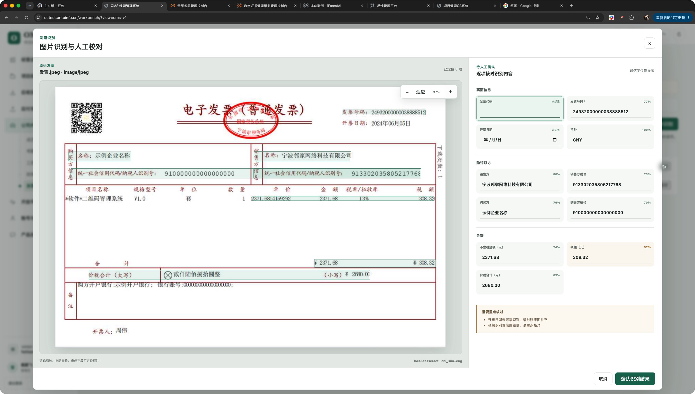

# 发票人工校对窗口尺寸修复发布验证（2026-11-06）

## 结论

BF-311 已发布。BF-310 的查看器能力本身已经存在，但运行时把 `is-recognition` 加在 `.oms-v1__dialog-mask`，CSS 却匹配 `.oms-v1__dialog.is-recognition`，因此宽屏规则从未命中，页面持续使用基础 720px 对话框。现已把规则改为从遮罩层定位内部内容框；桌面校对窗口接近全屏，左侧原图、右侧字段和固定操作区可同时使用。

公网 Unified Workbench 为 `v0.1.0-test.oms-v1.81`，Invoice Recognition 保持 `v0.1.0-test.oms-v1.79`。本次只修改 Workbench CSS 选择器、缓存版本和回归测试，没有修改 Owner、API、schema、Grant、候选 revision 或业务数据。

## 实现与边界

- `.oms-v1__dialog-mask.is-recognition .oms-v1__dialog` 使用 `width:min(1800px,100%)`、`height:min(1120px,calc(100vh - 24px))`。
- 对话框 body 继续承载原图／字段双列工作面，footer 固定在可见底部；980px 以下回落单列，720px 以下去除遮罩外边距。
- 自动化回归明确断言状态类位于遮罩层，并拒绝重新引入 `.oms-v1__dialog.is-recognition` 错误选择器。
- 关闭或取消不确认候选；本次线上验证没有点击“确认识别结果”。

## 本地验证

- Workbench 专项 Node 测试 3/3、全量 Node 测试 294/294 通过。
- `GOWORK=off go test ./...` 与 `GOWORK=off go vet ./...` 通过。
- D1 v1.81 release bundle 检查通过；候选清单与 v1.80 相比只替换 Workbench 镜像。

## 公网验证

- 正式升级前恢复点：`/var/backups/omsbizfoundry/20261106T133027Z`。
- `checksums.sha256` 中 21 项备份制品全部通过。
- 发布后独立 `d1 check` 通过；21 个正式长运行服务全部 healthy。
- 运行 Workbench 摘要为 `sha256:7267a8c6ebc4cc4d461f286944f0d9f2c89bfb3ed9acd50fea335d4324bf601c`。
- 公网 `/workbench/assets/oms-phase1.css?v=20261106.4` 包含遮罩层状态选择器与 1800 × 1120 尺寸规则。
- 使用 computer use 在 Chrome 原有 125% 缩放下刷新、进入“公司内部管理 → 发票识别”、打开既有待确认记录。窗口接近全屏，原图适应倍率为 97%，右侧字段区和底部按钮均可见；未执行候选确认。

## 发布制品

- Unified Workbench：`v0.1.0-test.oms-v1.81@sha256:7267a8c6ebc4cc4d461f286944f0d9f2c89bfb3ed9acd50fea335d4324bf601c`
- Invoice Recognition（未变更）：`v0.1.0-test.oms-v1.79@sha256:8b62f6c6952578d5fdbe7463973f0af300a7f29b06ccc80ba4f0ea02dc61ecc3`
- 发布包：`dist/omsbizfoundry-d1_v0.1.0-test.oms-v1.81_linux_amd64.tar.gz`

## 明确未完成

- OFD 仍需可替换 Provider；PDF 仍只处理首页面。
- 多版式脱敏样本的字段准确率门禁尚未建立。
- Billing／Internal Finance Requests 尚未消费确认摘要，识别不会自动入账、报销或付款。
